<div align="center">

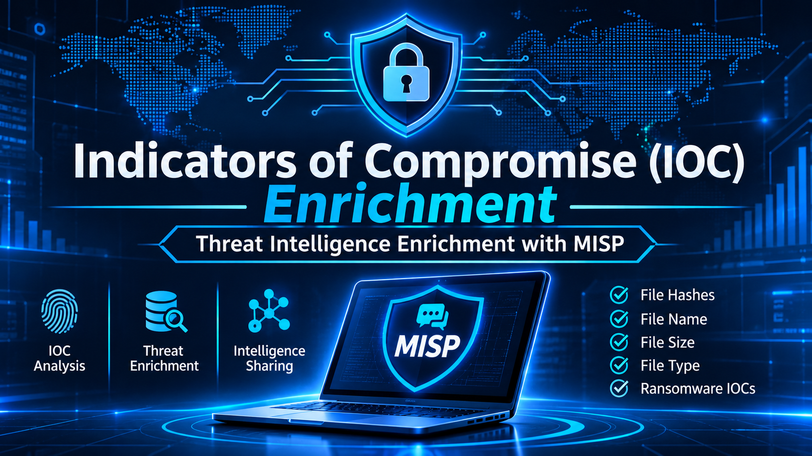

# 🛡️ Indicators of Compromise (IOC)

### Cyber Threat Intelligence — Lab Task Documentation


**Author:** Sanawar Imran

</div>

---

## 📑 Table of Contents

| Section | Description |
|---------|-------------|
| [Introduction to IOC](#introduction-to-indicators-of-compromise-ioc) | Overview of Indicators of Compromise and the MISP platform |
| [MISP Platform Overview](#misp-platform-overview) | Navigating the MISP dashboard, event list and IOC type panel |
| [Creating a New IOC Event](#creating-a-new-ioc-event) | Setting up an IOC event for the WikiWorm malware sample |
| [Adding File Hash IOC Attributes](#adding-file-hash-ioc-attributes) | Entering MD5, SHA1, SHA256 hashes and file size as attributes |
| [Saving and Verifying the IOC Event](#saving-and-verifying-the-ioc-event) | Saving the event to MISP and confirming it in the directory |
| [IOC Bucket Configuration](#ioc-bucket-configuration) | Adding file name, PE file type and completing all details |
| [Ransomware IOC Documentation](#ransomware-ioc-documentation) | Creating and documenting ransomware indicators |
| [Conclusion](#conclusion) | Summary of the lab and key takeaways |

## 📁 Repository Structure

```text
.
├── README.md
└── images/
    ├── ai.png
    ├── image_01.png
    ├── ...
    └── image_24.png
```

---

## Introduction to Indicators of Compromise (IOC)

Indicators of Compromise (IOCs) are forensic artifacts or observable evidence that indicate a system has been compromised or is under attack. They are critical components of Cyber Threat Intelligence (CTI), enabling security analysts to detect, analyze, and share threat information across organizations.

In this lab task, the **MISP** (Malware Information Sharing Platform & Threat Sharing) platform is used to create, document, and store IOCs related to malware samples and ransomware threats. MISP is an open-source platform widely used by cybersecurity teams for structured threat intelligence sharing.

### Types of IOCs Documented in This Lab

| IOC Type | Description |
|----------|-------------|
| **File Hashes** | MD5, SHA1, SHA256 cryptographic fingerprints of malware samples |
| **File Name** | Specific filenames associated with known malware (e.g., WikiWorm) |
| **File Size** | PE (Portable Executable) file size as a behavioral indicator |
| **File Type** | PE file type classification for malware categorization |
| **Ransomware IOCs** | Indicators specific to ransomware attack campaigns |

---

## MISP Platform Overview

The MISP platform dashboard provides a centralized interface for managing threat events, attributes, and sharing groups. The screenshots below show the MISP environment used for this lab task.

### MISP Dashboard — Initial View

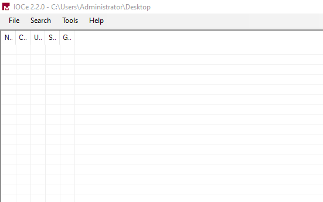

**Description:** This is the first screen of the MISP platform, which acts as the main threat intelligence workspace for the lab. From here the analyst can reach events, attributes and sharing options. It is the starting point for creating and managing all the IOCs in this task.

### MISP Event List Interface

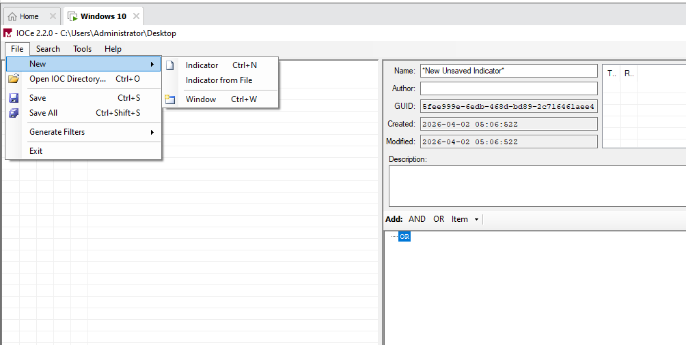

**Description:** This screen lists the threat intelligence events that already exist in MISP. Each row shows basic event details so the analyst can browse and search them. It helps in understanding how events are organized before a new one is created.

### IOC Type Selection Panel

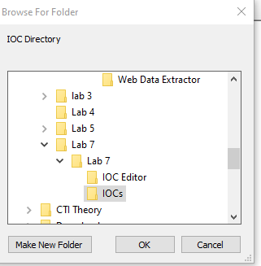

**Description:** This panel is used to choose the category of indicator that will be recorded. Selecting the correct type ensures the IOC is stored and searched properly later. In this lab it leads to the file based indicators of the WikiWorm sample.

---

## Creating a New IOC Event

A new IOC event is created in MISP to document the indicators associated with the WikiWorm malware sample. The event serves as a container for all related IOC attributes and metadata.

### Initiating IOC Event Creation

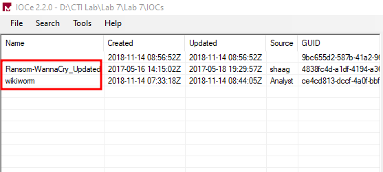

**Description:** Here the IOC type is selected and the process of creating a new threat event begins. The event works as a container that will hold all the related indicators. This step sets up the base for adding the WikiWorm attributes.

### Configuring the OR Relationship

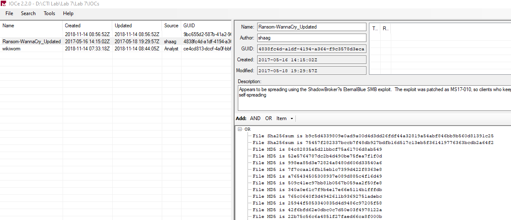

**Description:** This step sets the OR logical relationship between the IOC attributes. It means that matching any one of the listed indicators is enough to identify the threat. This makes the IOC more flexible when it is used for detection.

### Specifying Malware Name — WikiWorm

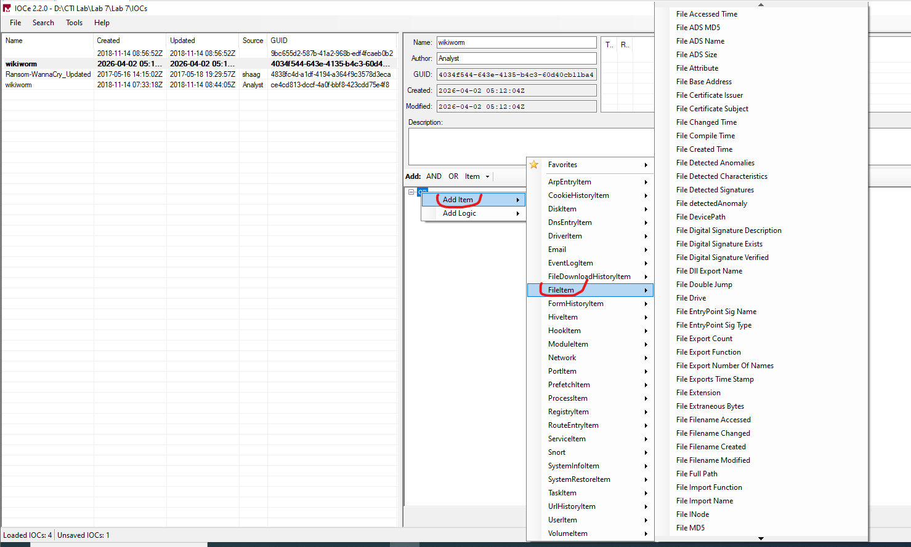

**Description:** The malware name WikiWorm is entered as the main identifier of the threat event. Giving the event a clear name makes it easy to find and share later. All the hashes and file details added next are linked to this name.

---

## Adding File Hash IOC Attributes

File hashes are the most reliable indicators for identifying specific malware samples. Three hash types are added: **MD5** (128-bit), **SHA1** (160-bit), and **SHA256** (256-bit). Together, these provide comprehensive identification and cross-platform verification.

### PE File Appears in Attribute View

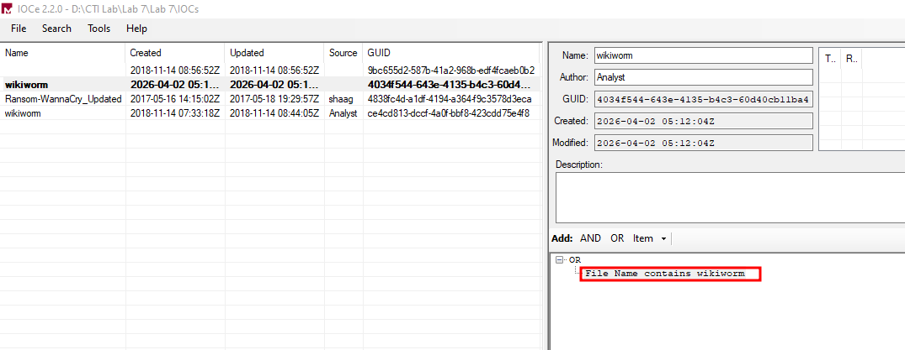

**Description:** The attribute view now shows a PE (Portable Executable) file type entry for the event. This confirms that the file classification has been recorded correctly. It also shows that the event is ready for hash values to be added.

### Adding MD5 Hash

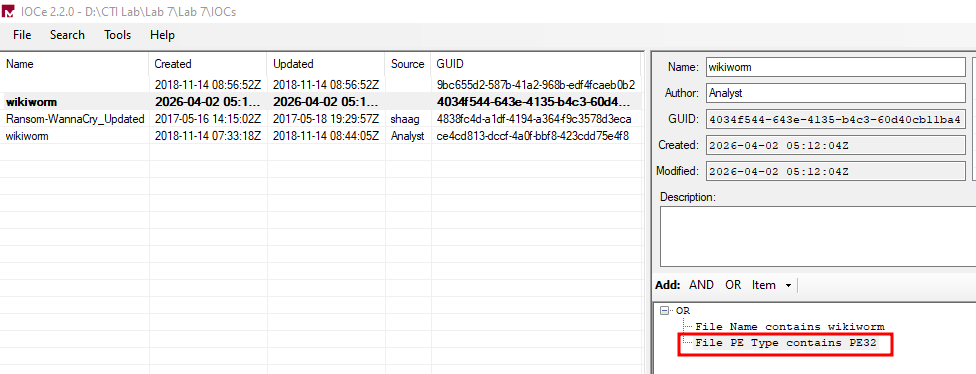

**Description:** The MD5 hash of the WikiWorm sample is entered as a file hash attribute. A hash works like a fingerprint that identifies the exact file. It is one of the quickest ways to match this malware on other systems.

### Adding File Size

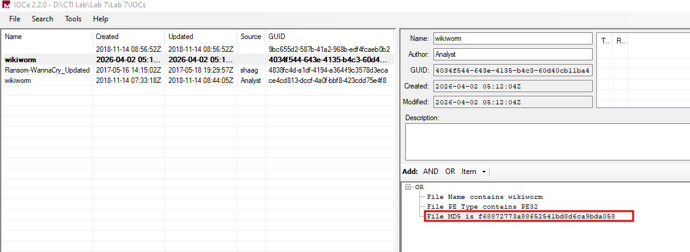

**Description:** The size of the PE file is added as another IOC attribute. File size is a useful supporting detail when checking whether a file matches the known sample. It adds extra confidence to the identification along with the hashes.

### Adding SHA1 Hash

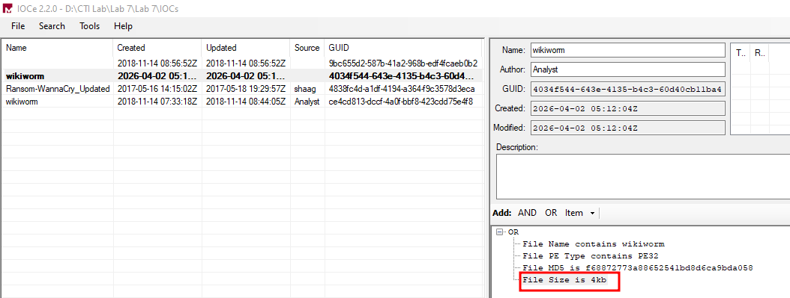

**Description:** The SHA1 hash of the malware sample is entered as an additional attribute. Using a second hash type gives another way to verify the file. It helps when different tools or platforms support different hash formats.

### Adding SHA256 Hash

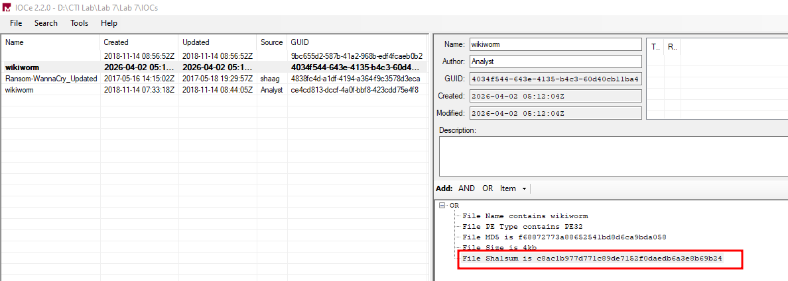

**Description:** The SHA256 hash is entered as the strongest cryptographic identifier of the sample. It is much harder to fake than the older hash types. With MD5, SHA1 and SHA256 together the file can be verified very reliably.

---

## Saving and Verifying the IOC Event

After all hash attributes are entered, the IOC event is saved to the MISP database. The save process persists all attributes and makes the event available for sharing and querying within the platform.

### Saving the IOC Event

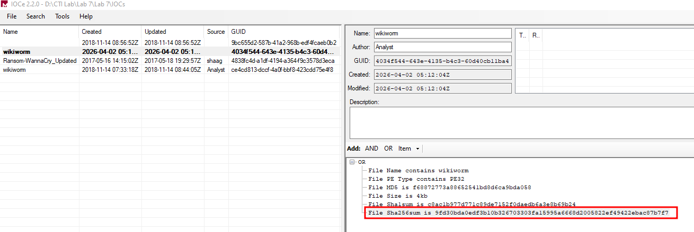

**Description:** After all the hash attributes are entered, the save operation is started for the event. Saving writes the attributes into the MISP database. Once saved, the event can be queried and shared with other analysts.

### Confirming Save in Directory

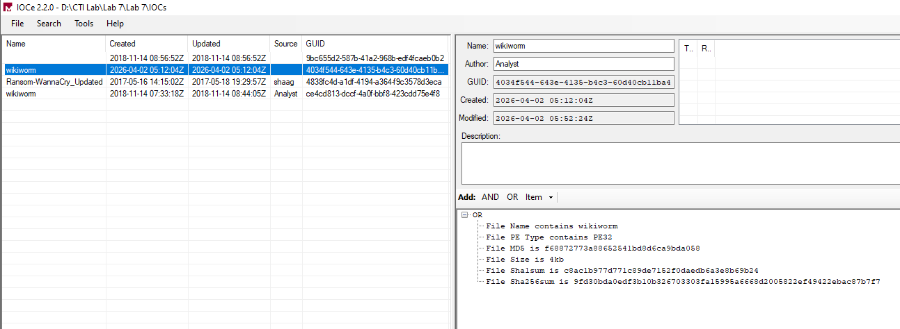

**Description:** The saved IOC event is checked in the MISP directory listing. Its presence in the list proves that the save was completed correctly. This verification step avoids losing work that was not stored.

### Final Saved State Confirmation

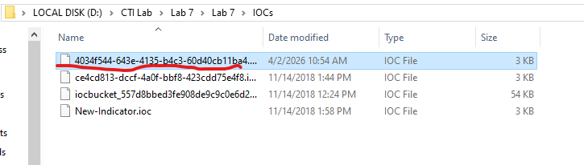

**Description:** This screen gives the final confirmation that the IOC event has been stored successfully. All the entered attributes are shown as part of the saved event. It marks the end of the first part of the lab.

---

## IOC Bucket Configuration

The IOC Bucket is a structured container within MISP that groups related indicators. This section documents the configuration of the IOC Bucket for the WikiWorm malware campaign, including filename, PE type, and complete attribute entry.

### Opening the IOC Bucket

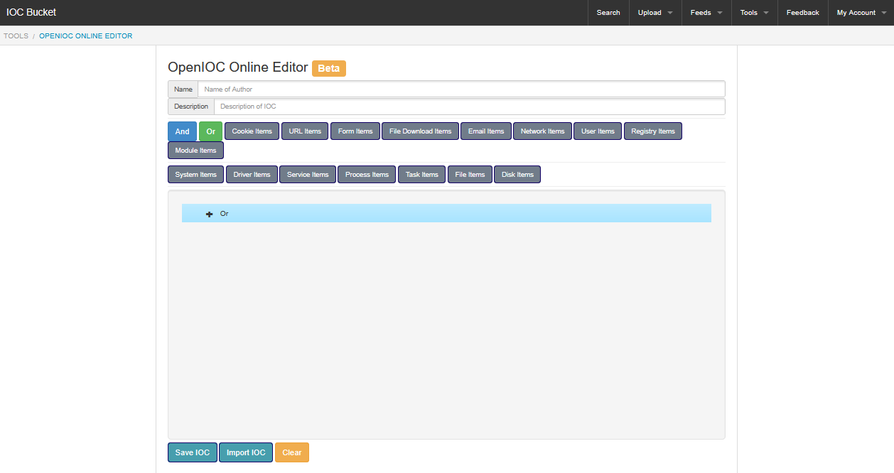

**Description:** The IOC bucket is opened and is now ready to receive attributes. A bucket is a structured container that groups related indicators together. It is used here to organize everything linked to the WikiWorm campaign.

### Adding WikiWorm File Name

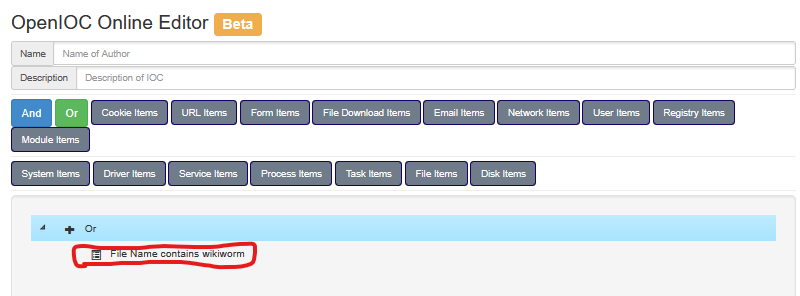

**Description:** The file name wikiworm is entered as an IOC attribute inside the bucket. Malware file names can help analysts spot the sample in logs and file systems. It works together with the hashes to give a fuller picture.

### Specifying PE File Type

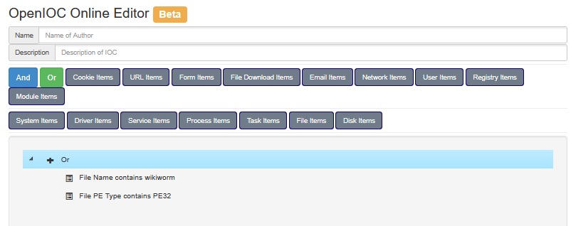

**Description:** The PE (Portable Executable) file type is added as a classification attribute. This tells analysts that the sample is a Windows executable. It helps in grouping and categorizing malware of the same kind.

### All Details Entered

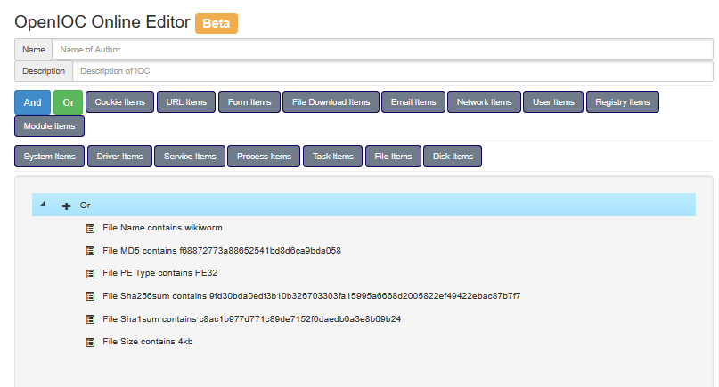

**Description:** All the required IOC details are now filled in and ready for submission. The entries include the file name, file type and the other attributes added earlier. This is a final check before the bucket is saved.

### Final Save of IOC Bucket

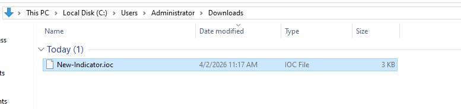

**Description:** The completed IOC bucket is saved with all the WikiWorm attributes in place. A confirmation shows that the data was stored without errors. The indicators are now available for later searching and sharing.

---

## Ransomware IOC Documentation

In addition to the WikiWorm malware IOCs, this lab also documents ransomware-specific Indicators of Compromise. Ransomware IOCs include file encryption signatures, registry modifications, network communication patterns, and ransom note filenames.

### Ransomware IOC Header

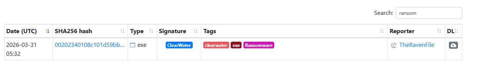

**Description:** This is the header of the ransomware section of the lab. It marks the start of documenting indicators for a different type of threat. Ransomware IOCs are recorded separately from the WikiWorm malware IOCs.

### Ransomware Event Interface

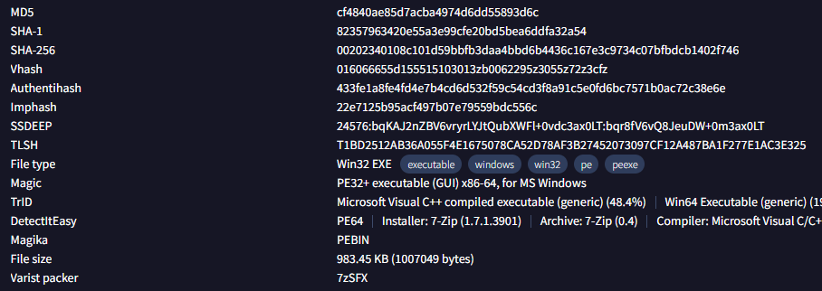

**Description:** The MISP form for creating a ransomware IOC event and entering its attributes is shown here. The layout is the same as for the earlier event, so the same workflow can be reused. It is where the ransomware related details are typed in.

### Ransomware Attribute Configuration

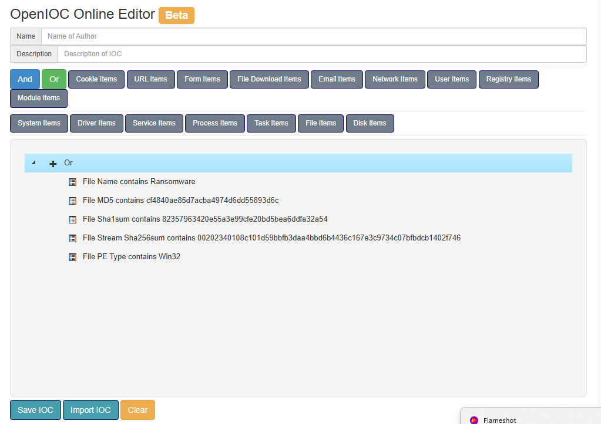

**Description:** This view shows the detailed attributes that are configured for the ransomware IOC. Each attribute describes one observable sign of the attack. Together they help analysts recognize the ransomware when it appears again.

### Ransomware IOC Final View

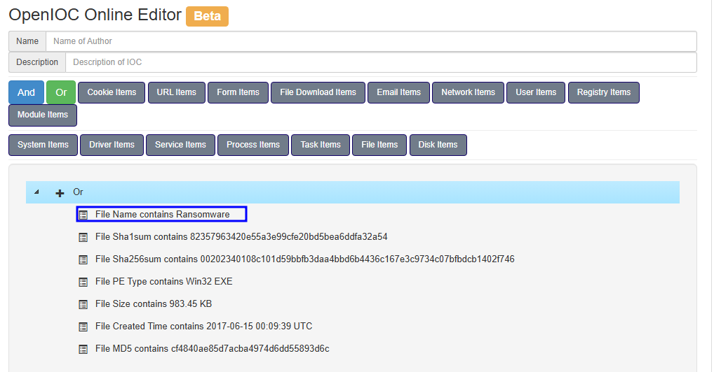

**Description:** The complete ransomware IOC event is displayed with all the configured indicators. This final view lets the analyst review everything in one place. It confirms that the event is complete and correctly structured.

### Save Confirmation


**Description:** A confirmation bar appears to show that the ransomware IOC event was saved successfully. It proves that the data has been written to the platform. This completes the documentation of all the IOCs in the lab.

---

## Conclusion

This lab task successfully demonstrated the end-to-end process of creating, documenting, and saving Indicators of Compromise (IOCs) using the MISP Threat Intelligence Platform. The platform was configured and its event management interface was explored. A new IOC event was created for the WikiWorm malware sample, and MD5, SHA1 and SHA256 file hash attributes were added for cryptographic identification. The IOC Bucket was configured with the filename, PE type and file size attributes, and ransomware-specific IOCs were documented as a separate threat category. Finally, all IOC events were saved and verified in the MISP database.

The practical application of MISP for IOC management reinforces key CTI principles including structured threat data sharing (using MISP's STIX-compatible format), collaborative intelligence, and efficient indicator lifecycle management. These skills are essential for SOC analysts, threat hunters, and incident responders in modern cybersecurity operations.
