<p align="center">
  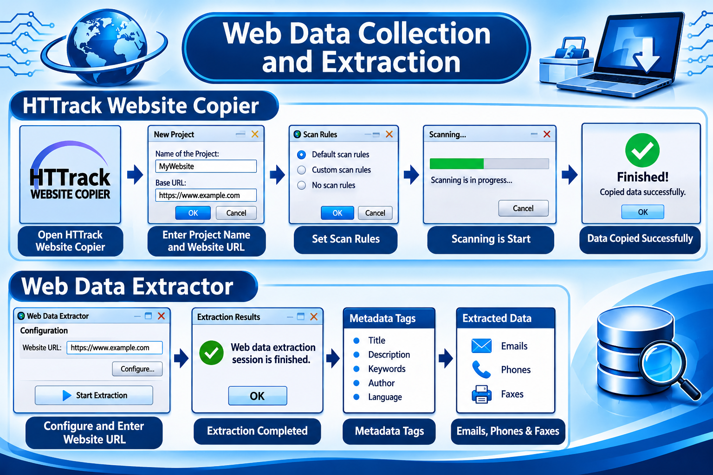
</p>

<h1 align="center">🌐 HTTrack &amp; Web Data Extractor</h1>
<h3 align="center">Lab 1 &amp; 2 — Website Copying and Data Extraction</h3>

<p align="center">
  
  
  
  
</p>

<p align="center">
  <b>Sanawar Imran</b> · Roll No. <b>243633</b> · BS Cybersecurity, Air University
</p>

---

## 📑 Table of Contents

- [Overview](#-overview)
- [Task 1 — HTTrack Website Copier](#-task-1--httrack-website-copier)
- [Task 2 — Web Data Extractor](#-task-2--web-data-extractor)
- [Repository Structure](#-repository-structure)
- [Disclaimer](#-disclaimer)

---

## 📖 Overview

This lab demonstrates two web reconnaissance tools used in information gathering.

| Task | Tool | Purpose |
|------|------|---------|
| 1 | **WinHTTrack Website Copier** | Mirror a website to local disk for offline analysis |
| 2 | **Web Data Extractor 8.3** | Crawl pages and extract meta tags, e-mails, phones and faxes |

---

## 🕸️ Task 1 — HTTrack Website Copier

> Mirroring `https://linesofattraction.com/` to a local project folder.

### 1. Launching WinHTTrack

<p align="center">
  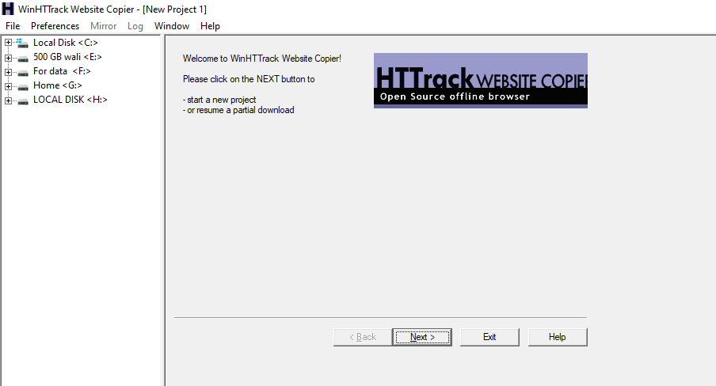
</p>

- Welcome screen of WinHTTrack Website Copier after installation.
- The left pane lists the local drives, the right pane shows the project wizard.
- Click **Next** to start a new project or resume a partial download.

---

### 2. Naming the Project

<p align="center">
  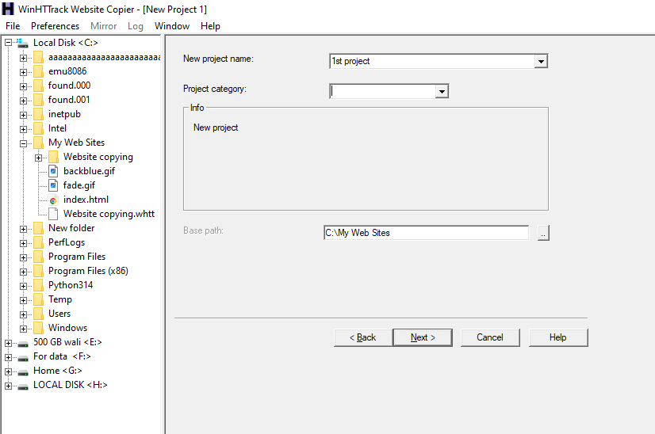
</p>

- The project name (`1st project`) and category are entered here.
- The base path `C:\My Web Sites` decides where the mirrored site will be saved.
- Existing folders such as *Website copying* are visible in the left tree.

---

### 3. Entering the Target URL

<p align="center">
  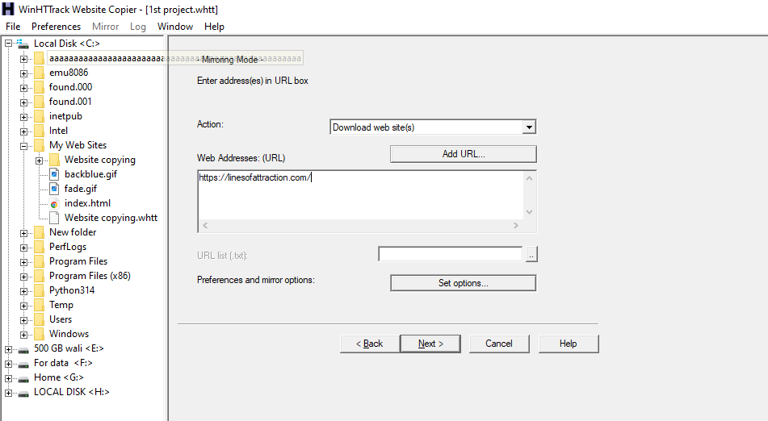
</p>

- The action is set to **Download web site(s)**.
- The target address `https://linesofattraction.com/` is typed in the Web Addresses box.
- **Set options** opens the preferences and mirror options dialog.

---

### 4. Configuring Scan Rules

<p align="center">
  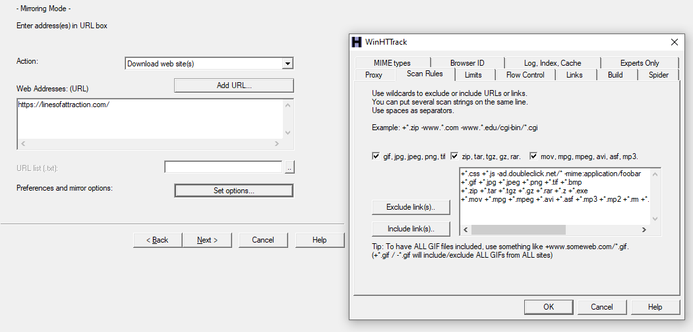
</p>

- The **Scan Rules** tab controls which file types are included or excluded.
- Images (gif, jpg, png), archives (zip, tar, rar) and media (mov, mpg, mp3) are ticked.
- Wildcard filters like `+*.css +*.js` are used to include or exclude links.

---

### 5. Connection Settings & Finish

<p align="center">
  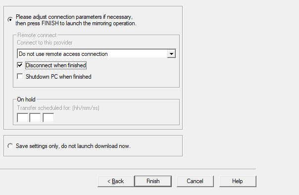
</p>

- Final wizard page for remote-connect and scheduling options.
- *Disconnect when finished* is ticked and *Shutdown PC* is left unticked.
- Pressing **Finish** launches the mirroring operation.

---

### 6. Scanning Started

<p align="center">
  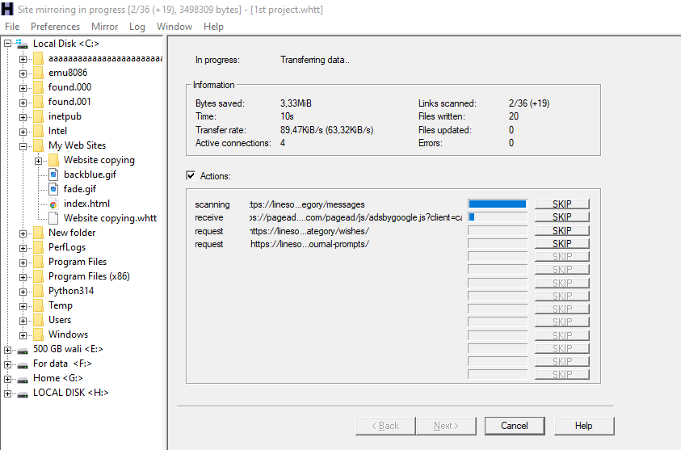
</p>

- The mirroring session is running and data is being transferred.
- The status shows bytes saved, links scanned, transfer rate and active connections.
- Live actions list each URL being scanned, received or requested.

---

### 7. Copied Data

<p align="center">
  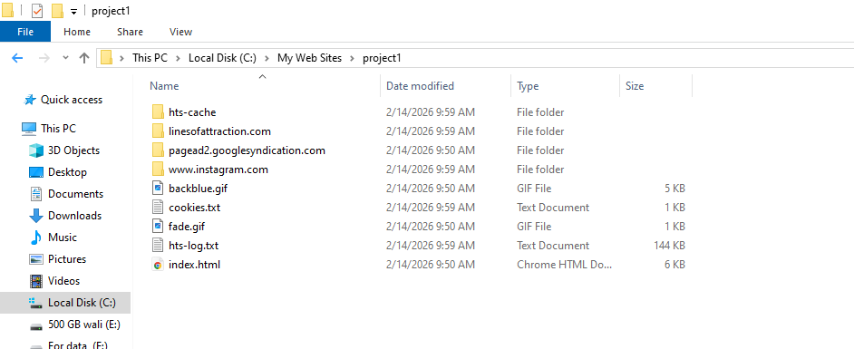
</p>

- Windows Explorer shows the mirrored project folder `project1`.
- It contains site folders (`linesofattraction.com`, `www.instagram.com`) and `index.html`.
- Helper files `hts-cache`, `cookies.txt` and `hts-log.txt` are also created.

---

### 8. Cookies File

<p align="center">
  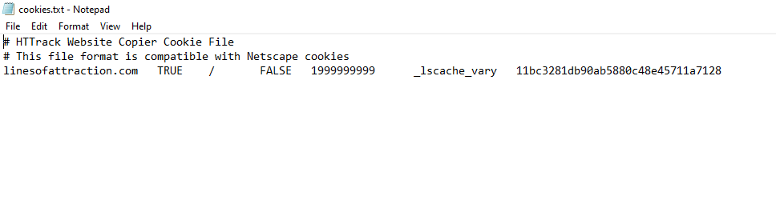
</p>

- `cookies.txt` opened in Notepad.
- It stores the cookies HTTrack received, in a Netscape-compatible format.
- The captured entry is `_lscache_vary` for `linesofattraction.com`.

---

### 9. Logs

<p align="center">
  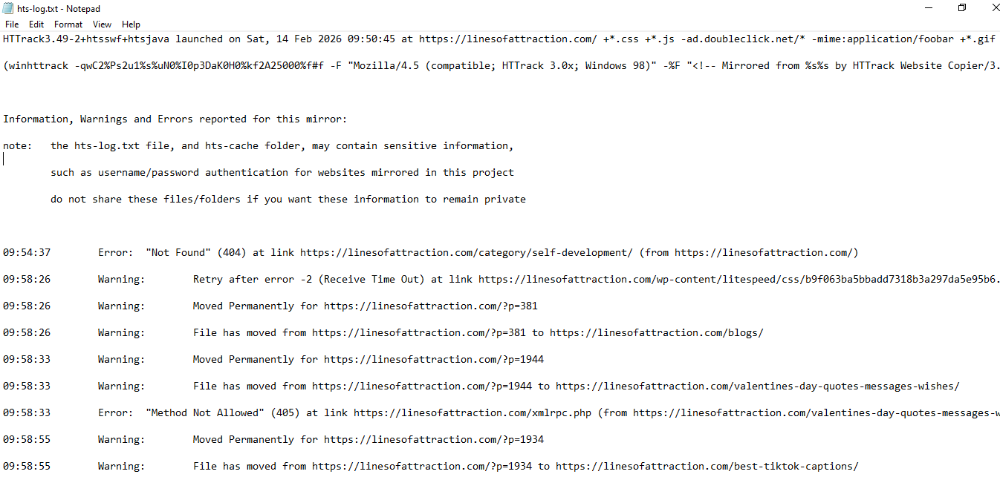
</p>

- `hts-log.txt` opened in Notepad.
- It records the launch command, user-agent and the full mirroring timeline.
- Errors and warnings (404, 405, redirects, time-outs) are listed with timestamps.

---

## 🔍 Task 2 — Web Data Extractor

> Crawling a website and extracting meta tags, e-mails, phones and faxes.

### 10. Web Data Extractor Home

<p align="center">
  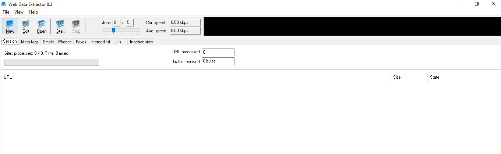
</p>

- Main window of **Web Data Extractor 8.3** before any session is started.
- Tabs for Session, Meta tags, Emails, Phones, Faxes, Merged list and Urls are ready.
- The toolbar offers New, Edit, Open, Start and Stop controls.

---

### 11. Session Settings

<p align="center">
  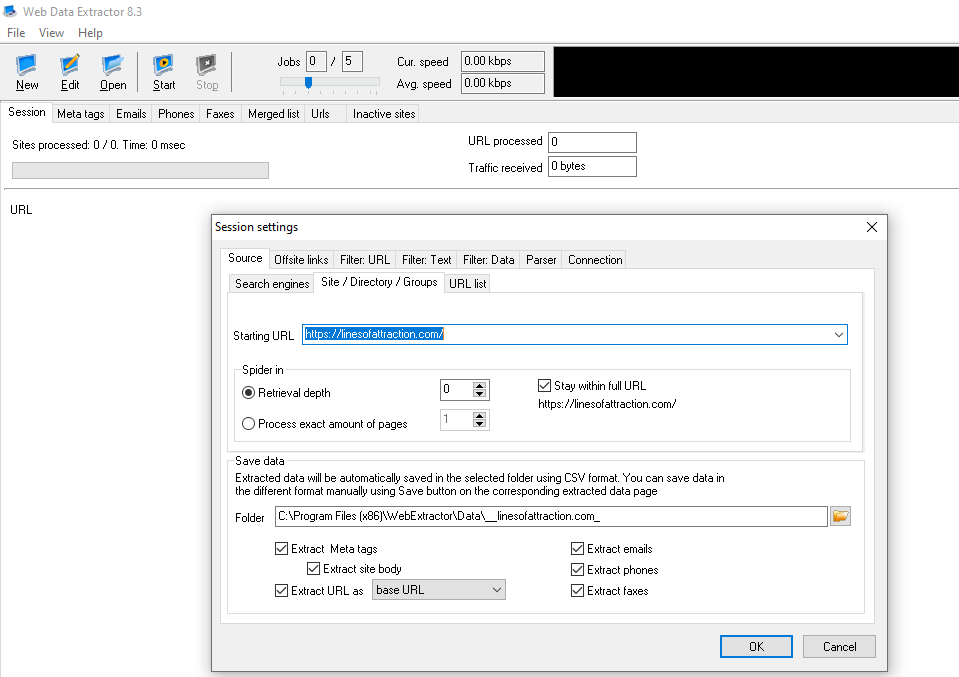
</p>

- The **Session settings** dialog is configured with the starting URL.
- Retrieval depth and *Stay within full URL* control how far the spider crawls.
- Options to extract meta tags, emails, phones, faxes and site body are enabled.

---

### 12. Extraction in Progress

<p align="center">
  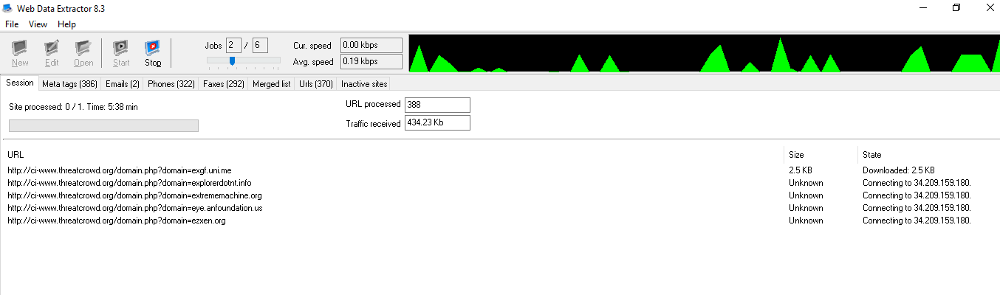
</p>

- The extractor is crawling and the activity graph shows live traffic.
- Counters show 388 URLs processed, 434.23 Kb received and results piling up in each tab.
- The URL list shows pages downloading with their size and connection state.

---

### 13. Session Finished

<p align="center">
  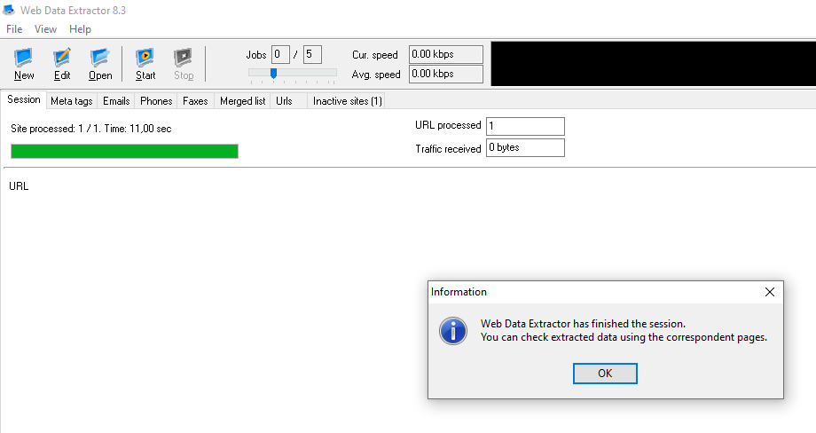
</p>

- An information box confirms the extraction session has finished.
- One site was processed in 11 seconds and the progress bar is full.
- Extracted data can now be reviewed in the corresponding tabs.

---

### 14. Meta Tags

<p align="center">
  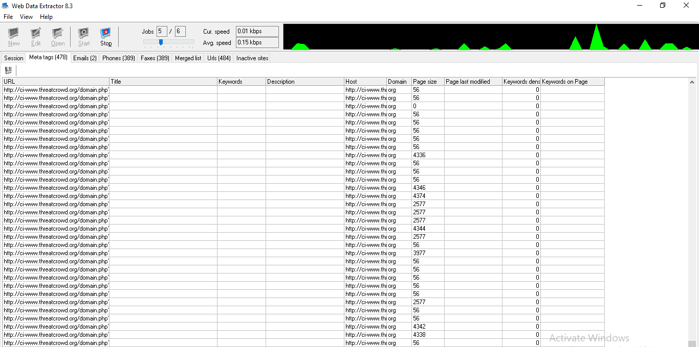
</p>

- The **Meta tags** tab lists metadata collected from every crawled page.
- Columns include URL, Title, Keywords, Description, Host, Domain and Page size.
- Hundreds of entries were captured from the crawled domains.

---

### 15. Emails

<p align="center">
  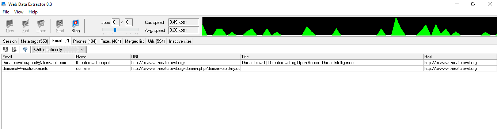
</p>

- The **Emails** tab shows e-mail addresses found while crawling.
- Two addresses were extracted, each with its name, source URL, title and host.
- This is the kind of contact data a crawler can harvest from public pages.

---

### 16. Phones

<p align="center">
  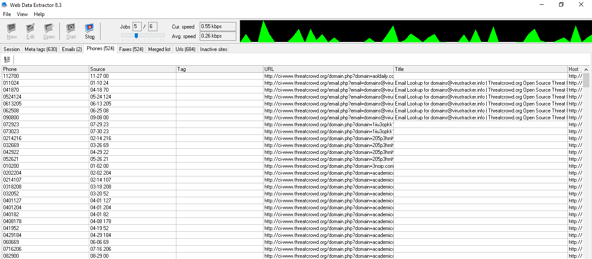
</p>

- The **Phones** tab lists phone-number patterns found on the pages.
- Each row shows the number, its source text, the URL and the page title.
- Many entries are date-like strings, so results need manual verification.

---

### 17. Faxes

<p align="center">
  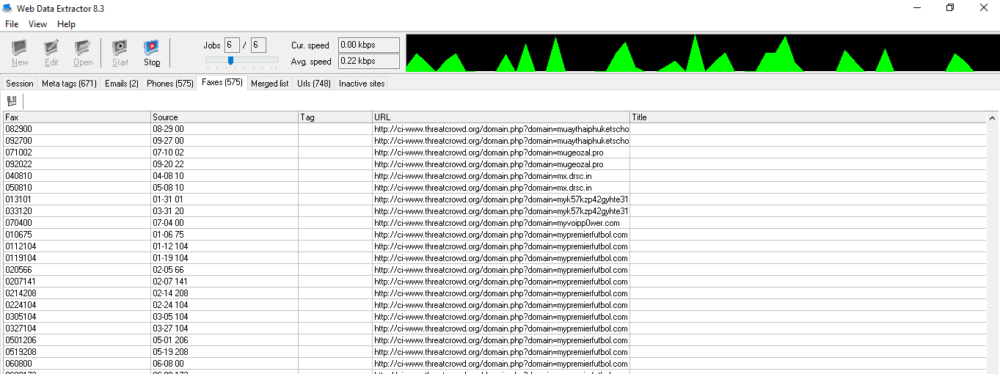
</p>

- The **Faxes** tab lists fax-number patterns detected by the extractor.
- Each entry includes the value, source, URL and page title.
- Like phones, many matches are false positives and should be validated.

---

## 📁 Repository Structure

```text
.
├── README.md
└── images/
    ├── ai.png
    ├── screenshot1.png
    ├── screenshot2.png
    ├── ...
    └── screenshot17.png
```

---

## ⚠️ Disclaimer

This work was performed for **educational purposes** in a lab environment. Only crawl or copy websites you own or have permission to test.

<p align="center">Made with ❤️ by <b>Sanawar Imran</b></p>
