<div align="center">

# Cyber Threat Intelligence: Footprinting Reports

### Email Footprinting with EmailTrackerPro · DNS Interrogation with WHOIS & NSLookup


</div>

---

## Table of Contents

1. [Overview](#overview)
2. [Objectives](#objectives)
3. [Email Footprinting](#email-footprinting)
   - [Email Footprinting Findings](#email-footprinting-findings)
   - [Email Footprinting Conclusion](#email-footprinting-conclusion)
4. [DNS Interrogation](#dns-interrogation)
   - [DNS Interrogation Findings](#dns-interrogation-findings)
   - [DNS Interrogation Conclusion](#dns-interrogation-conclusion)
5. [Overall Findings](#overall-findings)
6. [Key Learnings](#key-learnings)
7. [Tools Used](#tools-used)
8. [Repository Structure](#repository-structure)
9. [Disclaimer](#disclaimer)

---

## Overview

Footprinting is the first phase of any threat-intelligence or security assessment: collecting as much information as possible about a target before interacting with it directly. This repository documents two hands-on exercises from the Cyber Threat Intelligence course that cover two common footprinting sources:

- **Email Footprinting:** a received email is traced back to its origin by analysing its raw headers with eMailTrackerPro.
- **DNS Interrogation:** WHOIS, NSLookup and passive DNS / threat-intel sources are used to collect registration, name-server and IP information about `www.certifiedhacker.com`.

Together, the two exercises show how a few freely available tools can reveal the sender, route, ownership and infrastructure behind an email or a domain. Every step is backed by a screenshot with a short description.

| Topic | Description | Tools |
|---|---|---|
| [Email Footprinting](#email-footprinting) | Data collection through email headers | eMailTrackerPro, Gmail |
| [DNS Interrogation](#dns-interrogation) | Data collection through DNS records | Whois, NSLookup, passive DNS / threat-intel sources |

---

## Objectives

**Overall objective:** to practise passive and semi-passive reconnaissance techniques and learn how to turn raw data (email headers, WHOIS records, DNS answers) into usable threat intelligence.

**Email Footprinting objectives**
- Retrieve the raw headers of a received email from Gmail ("Show original").
- Trace the email with eMailTrackerPro and follow the `Received:` chain hop by hop.
- Identify the sender IP, route, approximate location and signs of forgery.

**DNS Interrogation objectives**
- Collect registration data (registrar, dates, status, contacts) using WHOIS.
- Resolve the target's A record and name servers using NSLookup.
- Use passive DNS / threat-intel sources to see historical resolutions and the web-server banner.

---

## Email Footprinting

| | |
|---|---|
| **Objective** | Trace a received email back to its origin by analysing its raw headers, and collect the sender IP, route and location. |
| **Tool** | eMailTrackerPro (Visualware) + Gmail "Show original" |
| **Figures** | 10 screenshots, each with a short description |

#### Figure 1: Main window (My Inbox)

<p align="center">
  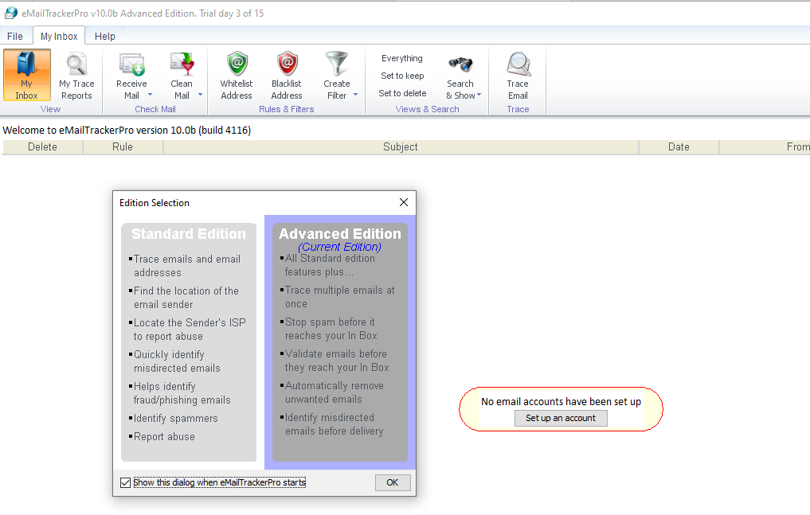
</p>

> **Description:** The main window opens on the My Inbox tab, with a toolbar for Receive Mail, Whitelist, Blacklist, Filters, Search and Trace Email. The message "No email accounts have been set up" appears because no mailbox is connected. This is fine, since the raw headers are pasted into the tool manually.

#### Figure 2: My Trace Reports tab

<p align="center">
  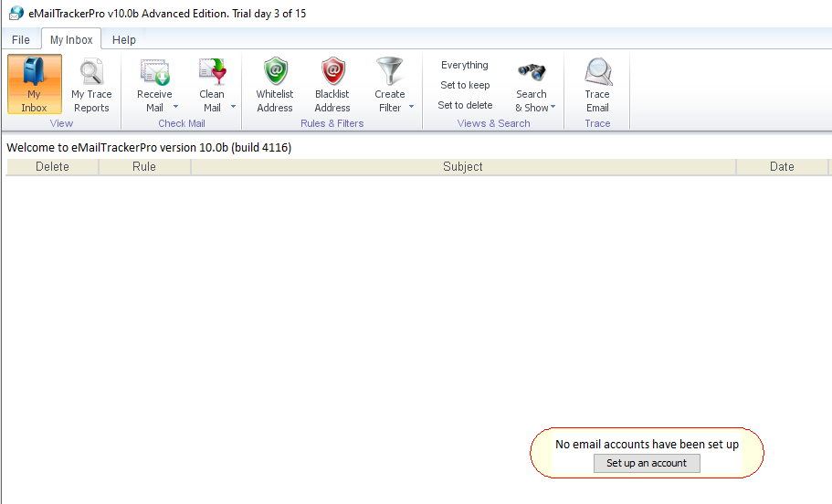
</p>

> **Description:** The My Trace Reports tab lists earlier traces and plots them on a world map. The map and the Trace Information panel are empty because no email has been traced yet. Selecting a trace later shows its summary at the bottom of the window.

#### Figure 3: Trace Headers dialog

<p align="center">
  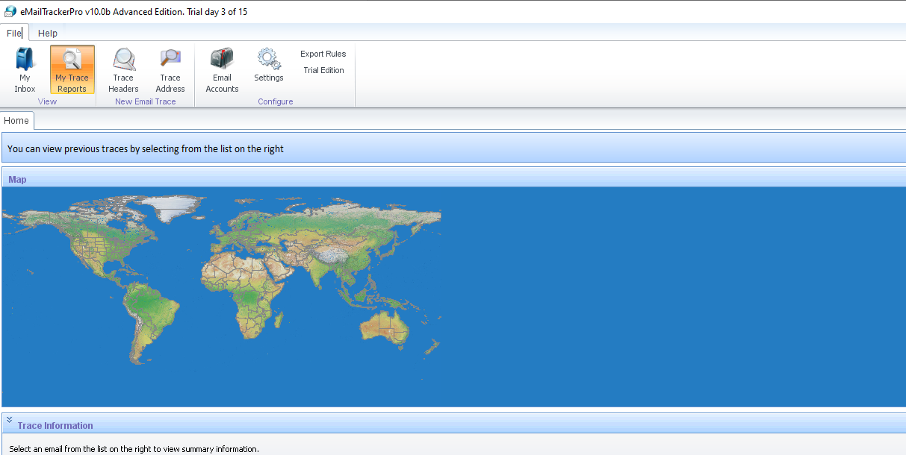
</p>

> **Description:** Clicking Trace Headers opens the "eMailTrackerPro by Visualware" dialog. The option "Trace an email I have received" is selected, since the goal is to locate the sender of a received email. The large box is where the copied raw headers are pasted before pressing Trace.

#### Figure 4: Selecting an email in Gmail

<p align="center">
  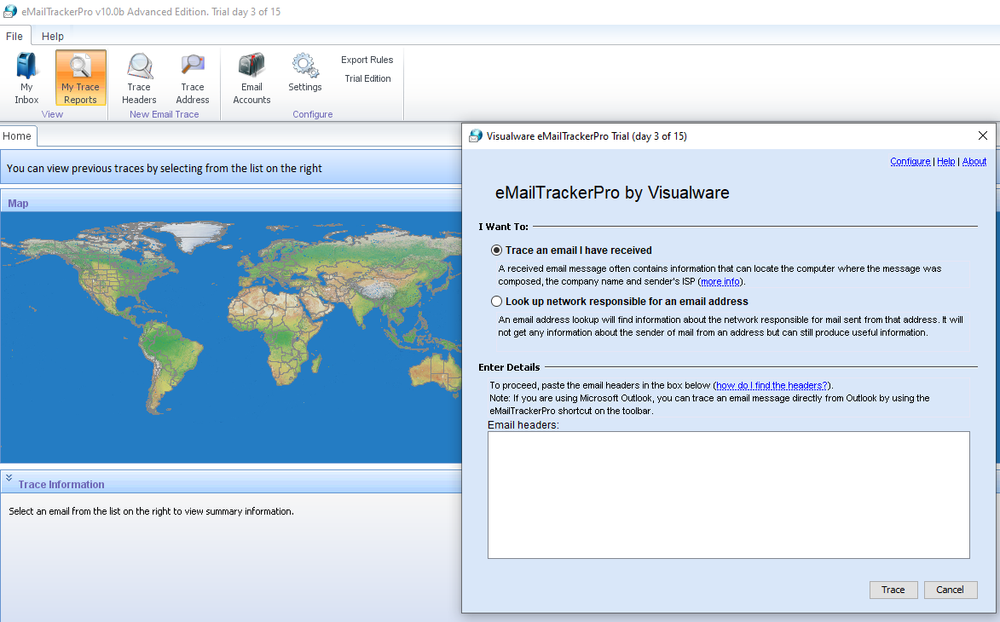
</p>

> **Description:** A suspicious promotional email titled "This Is Where the Money Is Flowing…" is found in the Gmail Spam folder. Gmail flags it as similar to messages previously reported as spam, and the sender name is "Dan Mirkin, CEO". The message menu is used to open the original message, which contains the full headers.

#### Figure 5: Original message and raw headers

<p align="center">
  
</p>

> **Description:** Gmail's Original Message page lists the message ID, creation time, sender, recipient and subject. The authentication checks are shown as SPF: PASS, DKIM: PASS and DMARC: PASS. The raw header text below (the Received: chain) is copied and pasted into eMailTrackerPro.

#### Figure 6: Tracing started

<p align="center">
  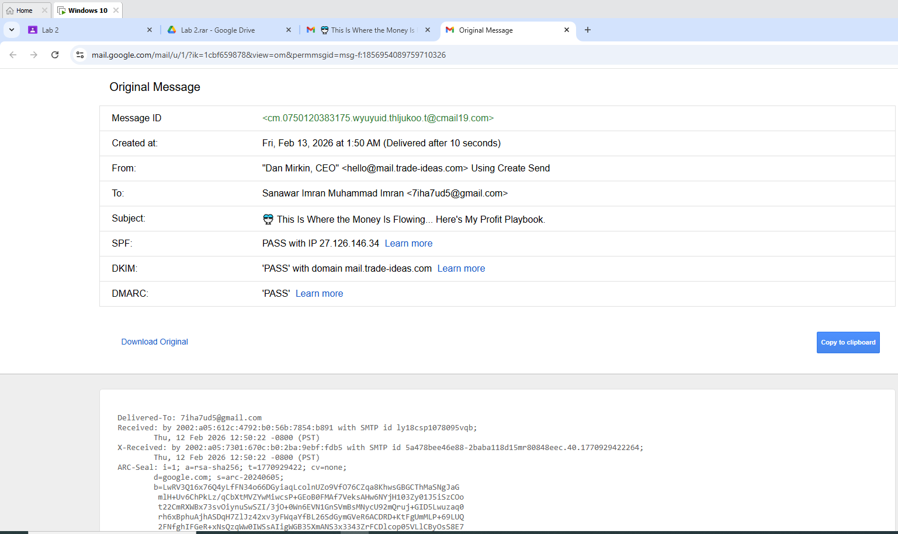
</p>

> **Description:** After the headers are pasted, the trace begins and the status bar shows that the location is being looked up. The world map and the Email Summary panel on the right start to fill with data. The tool walks through the Received: chain hop by hop to find the originating IP.

#### Figure 7: Tracing complete, route and IP details

<p align="center">
  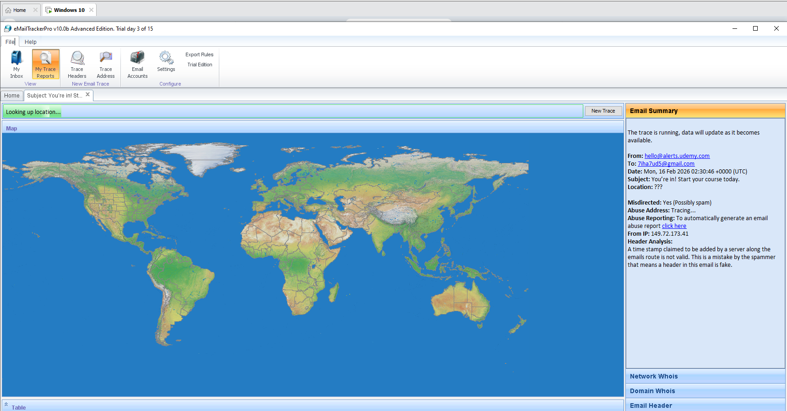
</p>

> **Description:** The trace finishes and the route is drawn on the world map. The IP Address Details panel shows the IP, hostname, city, country, ISP and organisation for the traced address. The table at the bottom lists each hop with its type (origin or private) and location.

#### Figure 8: Hop table

<p align="center">
  
</p>

> **Description:** The hop table lists every hop in the email's path, numbered in order. Hop 1 is a private address (192.168.40.2), and the final hop is 149.72.173.41 on a udemy.com mail server host. The location column resolves the end hop to "America", matching the summary report.

#### Figure 9: Email summary

<p align="center">
  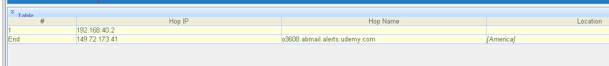
</p>

> **Description:** The summary shows the email is from hello@alerts.udemy.com, sent to the author's mailbox, dated 16 Feb 2026, with the subject "You're in! Start your course today." It reports the location as America, "Misdirected: Yes (possibly spam)" and a sender IP of 149.72.173.41. The header analysis notes an invalid timestamp, and a system scan shows no SMTP, HTTP, HTTPS or FTP server running.

#### Figure 10: Identification report

<p align="center">
  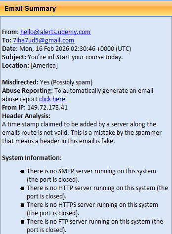
</p>

> **Description:** The final report says IP 149.72.173.41 was found, but little location detail was available, so the closest result is America. It warns that an invalid timestamp suggests a forged header and that the sender address is easily faked, so the result is not conclusive. A route map of North America shows the traced location, with solid lines for known hops and dotted lines for guessed ones.

### Email Footprinting Findings

| Item | Result |
|---|---|
| Sender IP | `149.72.173.41` |
| Claimed sender | `hello@alerts.udemy.com` |
| Approximate location | America (closest location the tool could resolve) |
| Misdirected / possible spam | Yes |
| Header analysis | A timestamp claimed by a server on the route was not valid, so a header is suspicious |
| Open services | No SMTP, HTTP, HTTPS or FTP server running (ports closed) |
| Email authentication | SPF: PASS · DKIM: PASS · DMARC: PASS |
| First hop | Private address `192.168.40.2` |

> **Note:** The sender address is easy to forge, so it should not be treated as conclusive on its own. Header analysis and the IP trace give stronger evidence.

### Email Footprinting Conclusion

EmailTrackerPro is a good tool for email footprinting. It automates header analysis, shows the route on a map and saves a lot of time compared with reading headers by hand.

---

## DNS Interrogation

| | |
|---|---|
| **Objective** | Gather IP and domain information about `www.certifiedhacker.com` using WHOIS, NSLookup and public threat-intel sources. |
| **Tools** | Online Whois lookup, online NSLookup, passive DNS / threat-intel pages |
| **Figures** | 8 screenshots, each with a short description |

#### Figure 1: Whois domain lookup home page

<p align="center">
  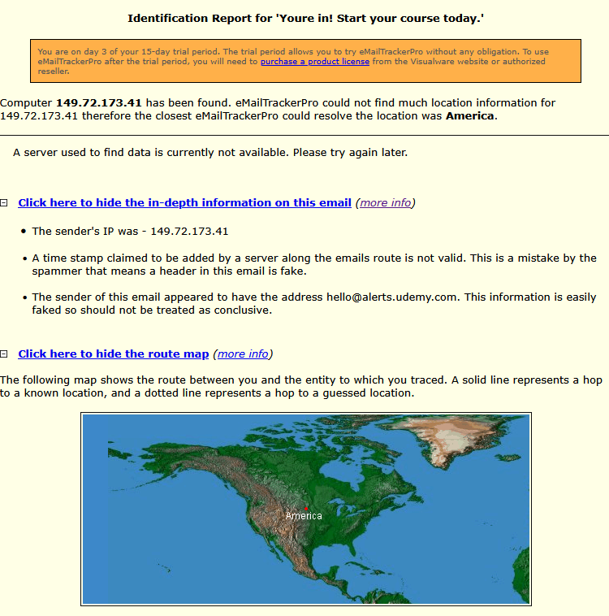
</p>

> **Description:** An online Whois service is opened to gather registration data for the target domain. The search box accepts either a domain name or an IP address. This is the starting point for the domain and IP information gathering.

#### Figure 2: Domain and registrar information

<p align="center">
  
</p>

> **Description:** The Whois record for certifiedhacker.com shows it was registered on 2002-07-30, expires 2026-07-30 and was last updated 2025-05-30. The status is "client transfer prohibited" and the name servers are ns1.bluehost.com and ns2.bluehost.com. The registrar is Network Solutions, LLC (IANA ID 2), with an abuse e-mail and phone number listed.

#### Figure 3: Registrant and technical contacts

<p align="center">
  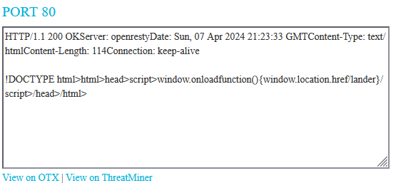
</p>

> **Description:** The registrant and technical contact sections of the same record are shown here. Both are listed as Perfect Privacy, LLC in Jacksonville, FL, USA, which is a privacy-protection service. Personal details are masked, and the contact e-mail is a forwarding address at networksolutionsprivateregistration.com.

#### Figure 4: NSLookup online tool

<p align="center">
  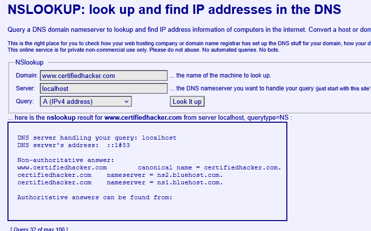
</p>

> **Description:** An online NSLookup page is used to query the DNS records of the target. The domain field is filled with www.certifiedhacker.com and the DNS server is set to localhost. The query type is set to A (IPv4 address) to get the IP the domain resolves to.

#### Figure 5: NSLookup A-record query and answer

<p align="center">
  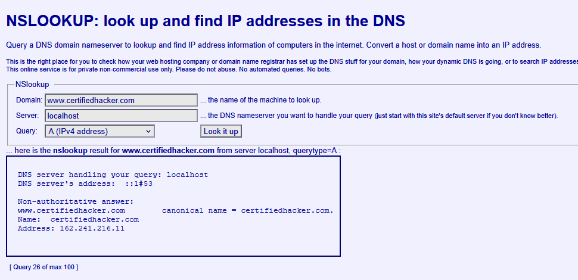
</p>

> **Description:** The same query is shown with the form and the result together. The non-authoritative answer shows that www.certifiedhacker.com is an alias (canonical name) of certifiedhacker.com. The domain resolves to the IPv4 address 162.241.216.11.

#### Figure 6: NSLookup name-server (NS) query

<p align="center">
  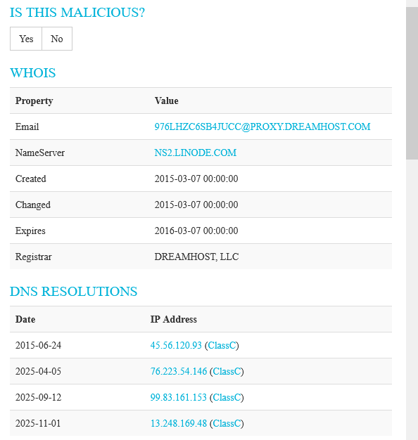
</p>

> **Description:** The query type is changed to find the authoritative name servers of the domain. The answer lists ns1.bluehost.com and ns2.bluehost.com as the name servers of certifiedhacker.com. This matches the name servers already seen in the Whois record.

#### Figure 7: Whois record and passive DNS resolutions

<p align="center">
  
</p>

> **Description:** A threat-intelligence style source shows a Whois record with the registrar, name server and the created, changed and expiry dates. Below it, DNS Resolutions lists dated IP addresses (for example 45.56.120.93 in 2015 and 13.248.169.48 in 2025). Historical resolutions like these show how the infrastructure behind a domain has changed over time.

#### Figure 8: Port 80 HTTP banner

<p align="center">
  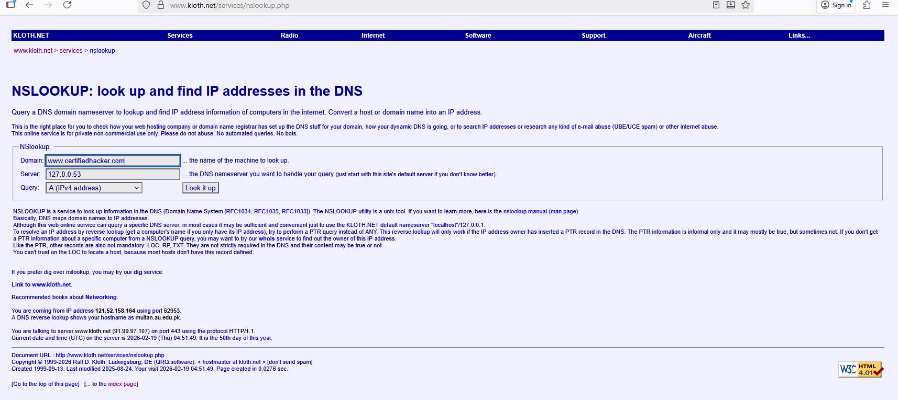
</p>

> **Description:** The port 80 section displays the raw HTTP response returned by the web server. It shows HTTP/1.1 200 OK, the server software (openresty), the date, content type and a Content-Length of 114. The short HTML body runs a script that redirects the browser to a /lander/ page, and links to View on OTX and ThreatMiner are given.

### DNS Interrogation Findings

| Field | Value |
|---|---|
| Domain | `certifiedhacker.com` |
| Registered / Expires / Updated | 2002-07-30 / 2026-07-30 / 2025-05-30 |
| Status | client transfer prohibited |
| Name servers | `ns1.bluehost.com`, `ns2.bluehost.com` |
| Registrar | Network Solutions, LLC (IANA ID 2) |
| Registrant / Tech contact | Perfect Privacy, LLC (privacy-protected) |
| A record | `162.241.216.11` (`www` is a CNAME of the root domain) |
| Historical resolutions | e.g. `45.56.120.93` (2015), `13.248.169.48` (2025) |
| Web server banner | `HTTP/1.1 200 OK`, openresty, redirects to a `/lander/` page |

### DNS Interrogation Conclusion

WHOIS, NSLookup and passive DNS sources together give a quick picture of a target's ownership, registrar, name servers and IP addresses. This is the foundation of the reconnaissance phase.

---

## Overall Findings

| # | Finding | Topic |
|---|---|---|
| 1 | The email's final traced hop was `149.72.173.41`, resolved only to "America" (country-level accuracy). | Email |
| 2 | The email claimed to come from `hello@alerts.udemy.com`, yet the tool flagged it as misdirected / possible spam and reported an invalid timestamp. | Email |
| 3 | SPF, DKIM and DMARC all passed, yet the message still landed in Spam, so passing authentication alone does not prove an email is trustworthy. | Email |
| 4 | The first hop was a private address (`192.168.40.2`), which is internal and cannot be geolocated. | Email |
| 5 | `certifiedhacker.com` was registered in 2002, is managed by Network Solutions and uses Bluehost name servers. | DNS |
| 6 | The registrant's identity is hidden behind a privacy service (Perfect Privacy, LLC). | DNS |
| 7 | `www` is a CNAME of the root domain, which resolves to `162.241.216.11`. | DNS |
| 8 | The name servers from NSLookup matched the WHOIS record, which confirms the data is consistent. | DNS |
| 9 | Passive DNS shows the domain pointed at different IPs over time (2015 vs 2025). | DNS |

---

## Key Learnings

**Email footprinting**
- Email headers hold the real routing evidence. The `Received:` chain is read from the bottom (origin) to the top (destination).
- The `From:` field is trivial to spoof, so conclusions must come from the headers and the IP trace, not the display name or address.
- IP geolocation is approximate. A result like "America" shows the limits of the technique and why it needs corroboration.
- SPF, DKIM and DMARC "PASS" confirms the mail was authorised by the sending domain's infrastructure. It does not mean the content is safe or wanted.
- Private IPs in a header (such as `192.168.x.x`) are internal hops and cannot be traced.

**DNS interrogation**
- WHOIS reveals registrar, creation / expiry dates, status and name servers, which are useful for judging how old and how established a domain is.
- Privacy-protection services mask the registrant, so ownership often has to be inferred from other data.
- NSLookup record types matter: **A** gives the IPv4 address, **NS** gives the authoritative name servers, and a **CNAME** shows aliases.
- Cross-checking tools (WHOIS vs NSLookup) is a simple way to validate data.
- Passive DNS gives history that a live lookup cannot, which helps an analyst track infrastructure changes and pivot to related indicators.
- HTTP banners expose server software and behaviour (for example redirects), which helps profile a target.

**General**
- Footprinting can be done passively and legally with public sources, and it is the basis for later phases of an assessment.
- Good CTI work means collecting from several sources, validating them against each other and clearly stating what is not conclusive.
- Documenting each step with screenshots and short descriptions makes the work reproducible and reportable.

---

## Tools Used

- **eMailTrackerPro** (Visualware): email header tracing
- **Gmail**: retrieving original message headers
- **Whois** lookup service: domain registration data
- **NSLookup** (online): DNS record queries
- Public threat-intel / passive DNS sources: historical resolutions and banners

## Repository Structure

```
CTI-Lab-Reports/
├── README.md
└── images/
    ├── screenshot2.png … screenshot11.png    # Email footprinting
    └── screenshot12.png … screenshot19.png   # DNS interrogation
```

## Disclaimer

These exercises were completed for **educational purposes** as part of the Cyber Threat Intelligence course. Only an intentionally public test target (`certifiedhacker.com`) and the author's own mailbox were used. Do not run these techniques against systems you do not own or have permission to test.
