

  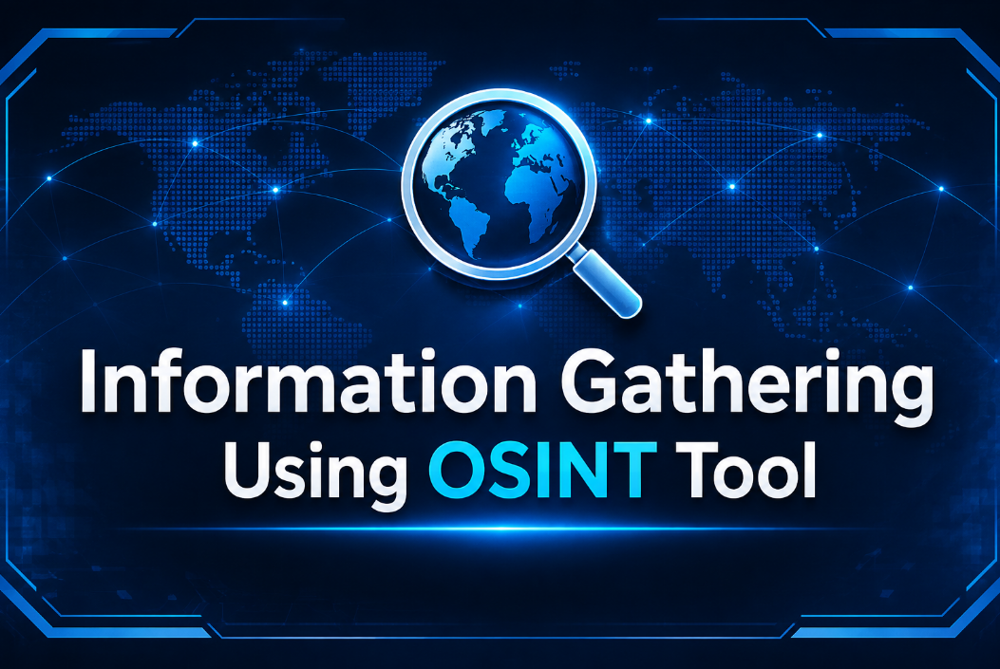

# **Information Gathering Using OSINT Tools**

### **OSTRICa and OSRFramework on Kali Linux | Cyber Threat Intelligence Task**

---

## **Table of Contents**

- [Overview](#overview)
- [Tools Used](#tools-used)
- [Cloning the OSTRICa Repository](#cloning-the-ostrica-repository)
- [Running OSTRICa](#running-ostrica)
- [Collecting Intelligence on a Target Website](#collecting-intelligence-on-a-target-website)
- [Generating the Graph](#generating-the-graph)
- [Viewing the Graph in the Browser](#viewing-the-graph-in-the-browser)
- [Analysing Indicators in the Output File](#analysing-indicators-in-the-output-file)
- [Installing OSRFramework](#installing-osrframework)
- [Profiling the Username analyst](#profiling-the-username-analyst)
- [Profiling the Username kalilinux](#profiling-the-username-kalilinux)
- [Learnings](#learnings)
- [Conclusion](#conclusion)
- [Connect With Me](#connect-with-me)

---

## **Overview**

**OSINT (Open Source Intelligence)** is the practice of collecting information from publicly available sources. In **Cyber Threat Intelligence**, it helps analysts understand a target, map its attack surface and identify possible threats.

This project documents a hands-on lab performed on **Kali Linux** using two OSINT tools:

- **OSTRICa** (Open Source Threat Intelligence Collector) gathers domain, IP, hash and email intelligence from many plugins and visualises the relationships as a graph.
- **OSRFramework** searches for a **username** across **173 platforms** and saves the findings in a CSV file.

Every stage below is shown with its screenshot and a short explanation.

---

## **Tools Used**

- **Operating System:** Kali Linux
- **Tool 1:** OSTRICa (Python 2 based)
- **Tool 2:** OSRFramework (usufy)
- **Target domain:** www.certifiedhacker.com
- **Target usernames:** analyst and kalilinux

---

## **Cloning the OSTRICa Repository**

- **Goal:** download the OSTRICa source code from GitHub.

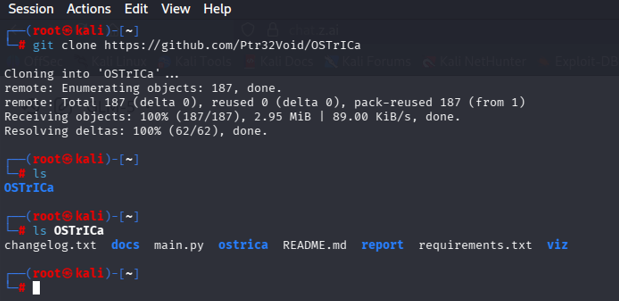

The **git clone** command pulls the OSTRICa repository into the home directory. The **ls** output confirms the folder was created and shows files like **main.py**, **requirements.txt** and **README.md**.

---

## **Running OSTRICa**

- **Goal:** start the framework and see its plugins and commands.

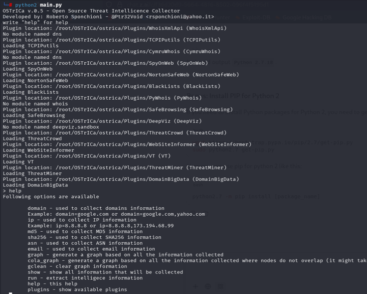

The tool was launched with **python2 main.py**. It loads plugins such as **VirusTotal**, **PyWhois**, **ThreatCrowd**, **SpyOnWeb** and **DomainBigData**. Typing **help** lists commands like **domain**, **ip**, **email**, **graph** and **run**.

---

## **Collecting Intelligence on a Target Website**

- **Goal:** gather information about **www.certifiedhacker.com**.

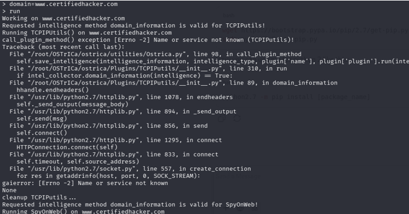

The target was set with **domain=www.certifiedhacker.com** and executed with **run**. OSTRICa queried each plugin in turn. One plugin (**TCPIPutils**) raised a name resolution error, but the others continued and returned data.

---

## **Generating the Graph**

- **Goal:** turn the collected data into a visual graph.

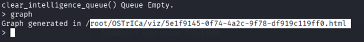

The **graph** command generated an **HTML file** inside the **viz** folder of OSTRICa. The path is shown in the terminal so the file can be opened in a browser.

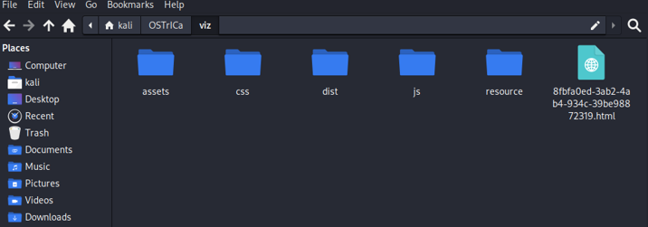

The file manager shows the **viz** directory with the generated HTML report beside the folders **assets**, **css**, **dist**, **js** and **resource**.

---

## **Viewing the Graph in the Browser**

- **Goal:** explore relationships between the target and its indicators.

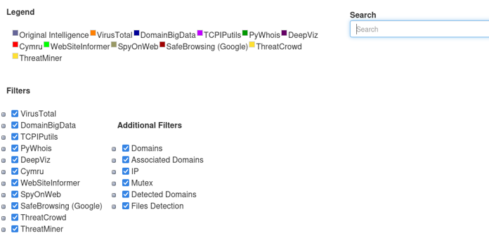

The graph page offers a **legend**, **filters** for each plugin and a **search box**. Each plugin has its own colour so the source of every node is easy to identify.

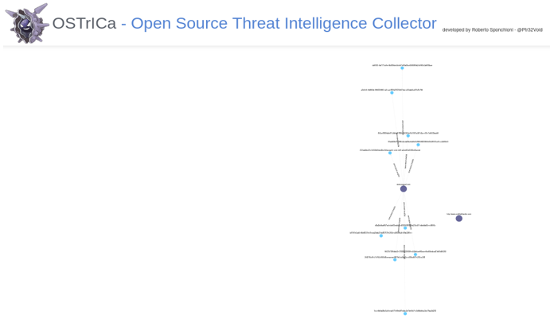

The complete graph is shown here with the **OSTRICa** header. The target domain sits in the middle and its related indicators are spread around it.

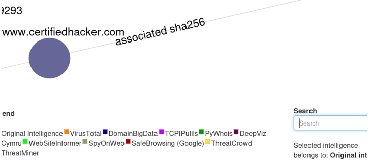

Zooming in shows the target node **www.certifiedhacker.com** linked to values labelled **associated sha256**. This means file hashes were found related to the domain.

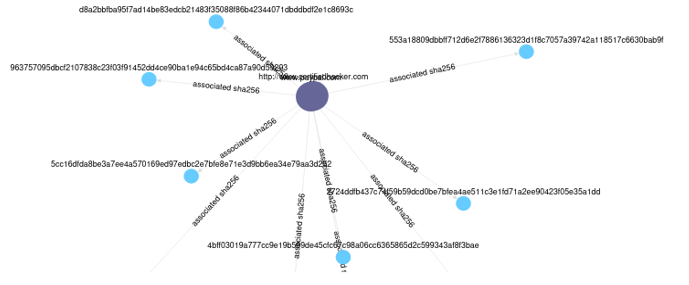

This view shows many hash nodes connected to the main domain. It makes the **relationships between entities** clear at a glance.

---

## **Analysing Indicators in the Output File**

- **Goal:** read the raw indicators behind the graph.

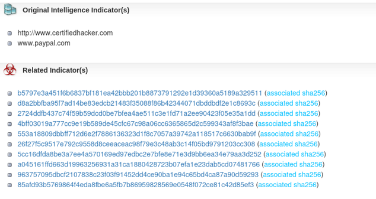

The report lists the **original intelligence indicators** (certifiedhacker.com and paypal.com) followed by **related indicators**. These are **SHA256 hashes** associated with the target.

---

## **Installing OSRFramework**

- **Goal:** install the second tool for username profiling.

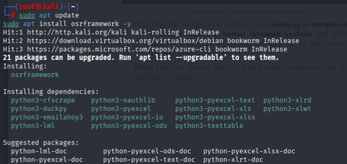

The system was updated with **sudo apt update** and the tool was installed with **sudo apt install osrframework -y**. The dependencies, such as **python3-pyexcel** and **python3-oauthlib**, were installed automatically.

---

## **Profiling the Username analyst**

- **Goal:** find where the username **analyst** exists online.

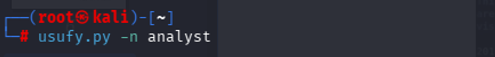

The command **usufy.py -n analyst** was used. **usufy** checks a username across many social, forum and content platforms.

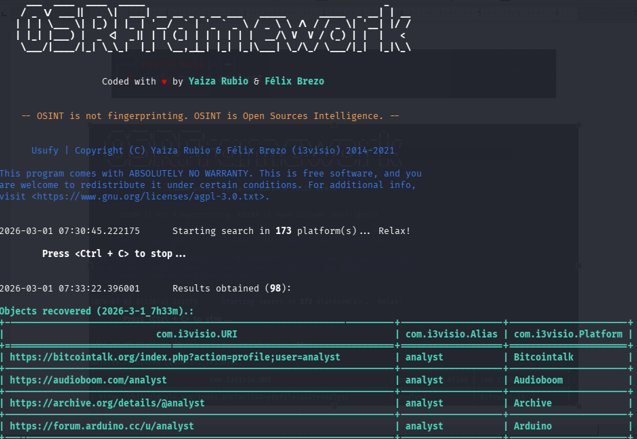

The search started on **173 platforms** and returned **98 results**. Each row shows the profile **URI**, the **alias** and the **platform** name.

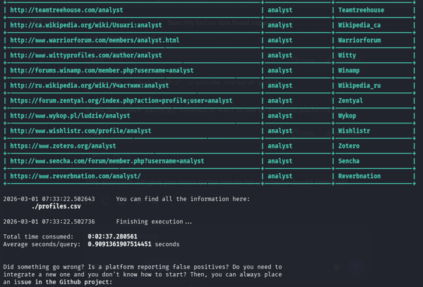

More matching profiles were found on platforms like **Teamtreehouse**, **Wikipedia**, **Zotero** and **Wishlistr**. The results were saved to **profiles.csv** and the total time taken is shown.

---

## **Profiling the Username kalilinux**

- **Goal:** repeat the search with a second username.

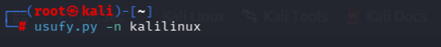

The command **usufy.py -n kalilinux** was executed in the same way to compare the footprint of a different alias.

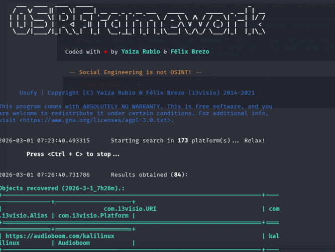

This time the search returned **84 results** across the same **173 platforms**. The recovered profiles are displayed in a table with URI, alias and platform.

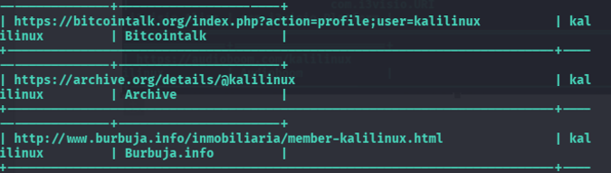

Profiles were found on sites such as **Bitcointalk**, **Archive** and **Burbuja.info**. This shows how one username can reveal accounts on many different sites.

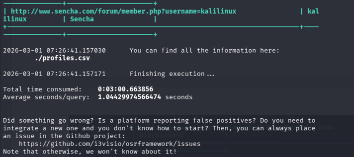

The final screen confirms the results were written to **profiles.csv**, along with the **total time consumed** and the average seconds per query.

---

## **Learnings**

- **OSINT** tools can collect a lot of useful data using only **public sources**.
- **OSTRICa** shows how a domain connects to **hashes**, **IPs** and other indicators through a **graph**.
- **OSRFramework** shows how easily a **username** can be traced across **173 platforms**.
- Some plugins can **fail** because of network or DNS problems, but the tool continues with the others.
- A reused **username** increases a person's **digital footprint** and privacy risk.
- Results should be **verified**, as some platforms can report false positives.

---

## **Conclusion**

This lab successfully demonstrated information gathering with **OSTRICa** and **OSRFramework**. Through cloning the repository, running the plugins, generating graphs and profiling usernames, valuable intelligence was collected from public data. These tools are essential in **Cyber Threat Intelligence**, helping security professionals identify threats, map attack surfaces and make informed decisions.

> **Note:** This work was done for **educational purposes** in a lab environment. Always get **permission** before gathering information about any target.

---

## **Connect With Me**

  
  &nbsp;&nbsp;
  

---

<b>Thank you for reading!</b>

