

  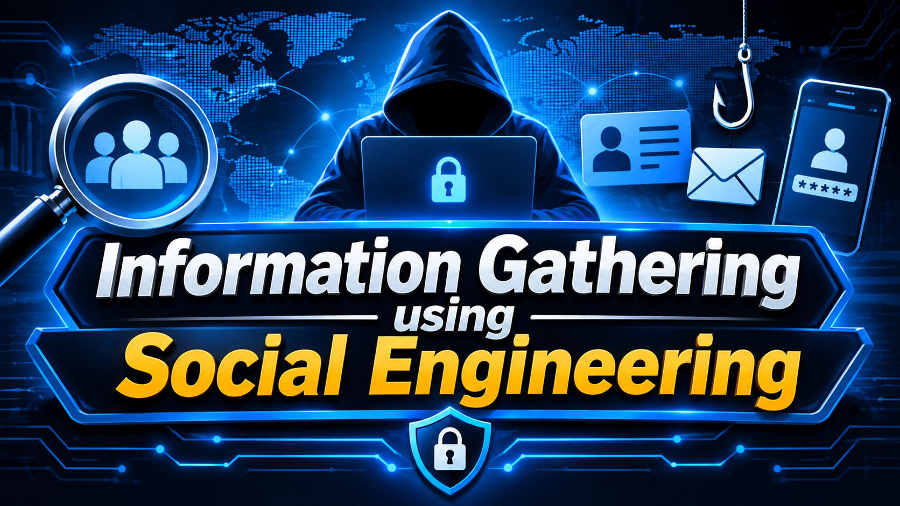

<h1 align="center">Information Gathering using Social Engineering</h1>
<h3 align="center">Social Engineering • GoPhish Phishing Framework • Cyber Threat Intelligence</h3>

  
  
  
  

---

## **Table of Contents**

- [Overview](#overview)
- [Social Engineering Techniques & Security Awareness Assessment](#task-41--social-engineering-techniques--security-awareness-assessment)
- [GoPhish Installation, Configuration & Phishing Campaign](#task-42--gophish-installation-configuration--phishing-campaign)
- [Cyber Threat Intelligence (Netcraft Site Analysis)](#task-43--cyber-threat-intelligence-netcraft-site-analysis)
- [Overall Learnings](#overall-learnings)
- [Conclusion](#conclusion)
- [Connect With Me](#connect-with-me)

---

## **Overview**

This repository documents **three practical lab tasks** completed for the Cyber Security program. Each task focuses on a different stage of a real-world **social engineering and threat intelligence workflow**:

- **Task** demonstrates a **phishing simulation** on Kali Linux using the **Social Engineering Toolkit (SET)**.
- **Task** demonstrates installing and configuring **GoPhish**, an open-source phishing framework, to run a **complete phishing campaign**.
- **Task** demonstrates **Cyber Threat Intelligence gathering** using **Netcraft** to analyze a target domain's hosting, network and SSL/TLS details.

All screenshots used in this README are stored inside the **images** folder, named **Screenshot1.png** to **Screenshot42.png**, in the exact order they appear below.

> ⚠️ **Disclaimer:** All activities shown here were carried out in a **controlled academic lab environment** strictly for **educational purposes**. These techniques must never be used against real individuals or organizations without **explicit written authorization**.

---

## **Social Engineering Techniques & Security Awareness Assessment**

**Objective:** act as a Security Analyst and run a simulated phishing attack to measure how aware employees are of social engineering and phishing threats.

**Tools used:** Kali Linux and the **Social Engineering Toolkit (SET)**.

### Step 1 — Data Collection via Social Engineering

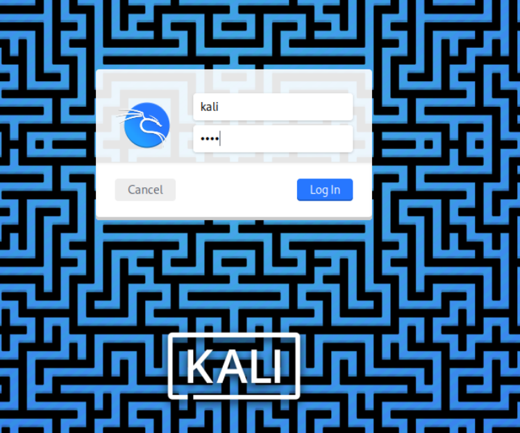

The initial interface used to collect target information is shown here. This sets up the **groundwork** before the actual attack simulation begins.

### Step 2 — Kali Linux Environment Setup

The **Kali Linux** desktop is launched and ready, confirming the attack machine is prepared for the exercise.

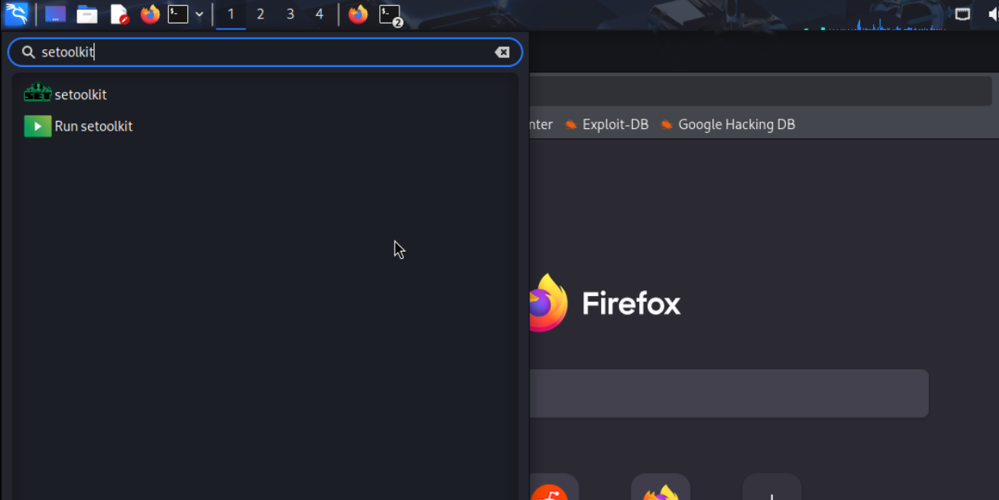

The **terminal environment** is opened and configured, which will be used to run the Social Engineering Toolkit commands.

### Step 3 — Social Engineering Toolkit (SET) Initialization

SET was launched from the terminal. It provides a complete set of modules built specifically for simulating **social engineering attacks** and testing human vulnerabilities.

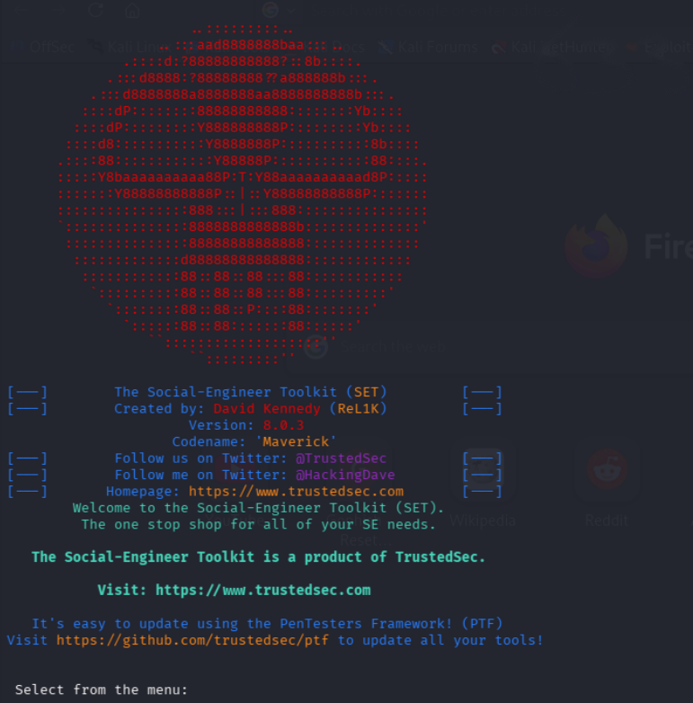

The **SET main menu** appears after a successful launch, confirming the toolkit is ready to use.

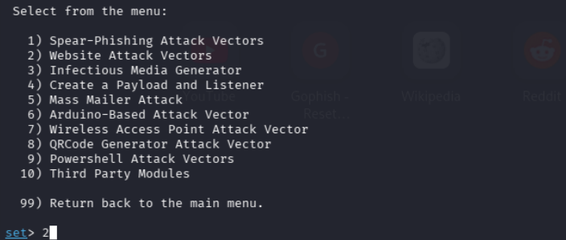

An **attack vector** is selected from the SET menu, choosing the method used for this simulation.

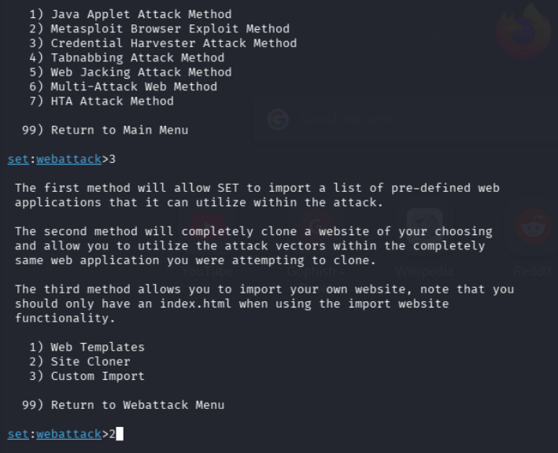

The **payload and configuration** options are set up inside SET to prepare the cloning and delivery mechanism.

### Step 4 — IP Address & Target URL Configuration

The attacker machine's **IP address** and the spoofed **target URL** are entered into SET. This allows the tool to host a cloned site and capture any credentials entered by a victim.

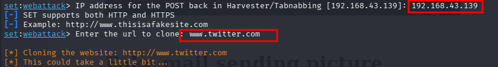

The **IP address and target URL** are configured inside SET, linking the cloned page back to the attacker machine.

### Step 5 — Phishing Email Delivery

A crafted **phishing email** was sent to the target, designed to look legitimate and convince the recipient to click the embedded link.

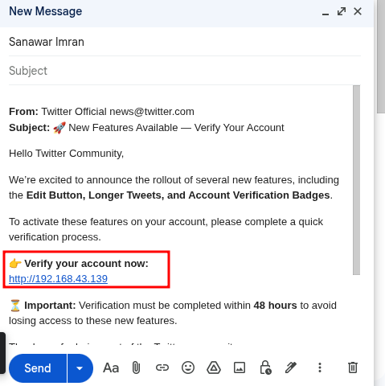

The **phishing email** is shown as successfully delivered to the target's inbox.

### Step 6 — Cloned Website & Credential Capture

After clicking the link, the victim is redirected to a **cloned version** of the real website. Any credentials entered are captured and sent to the SET listener.

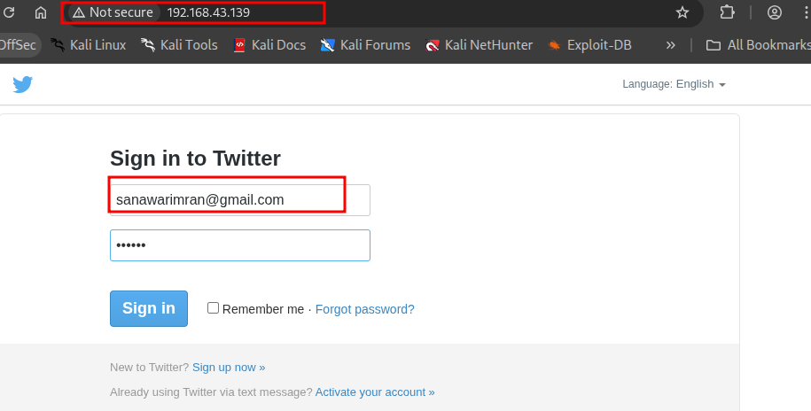

The **cloned website** is rendered and accessible to the target, appearing almost identical to the original.

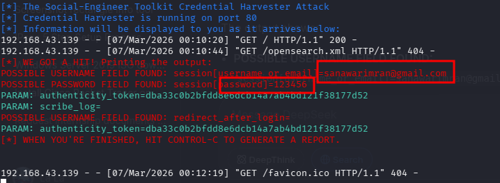

The **captured session and credential data** is received on the attacker machine, confirming the simulation worked.

**Conclusion (Task 4.1):** this exercise successfully showed how effective social engineering can be at exposing weak security awareness in an organization's human layer. It highlights why regular **phishing simulations**, **security awareness training** and stronger **email filtering** are necessary.

---

## ** GoPhish Installation, Configuration & Phishing Campaign**

**Objective:** install and configure **GoPhish**, an open-source phishing framework, and run a full phishing campaign from start to finish on Kali Linux.

### 1. GoPhish Installation

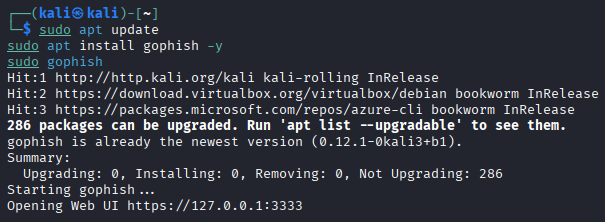

The **GoPhish ZIP archive** is downloaded from the official GitHub releases page.

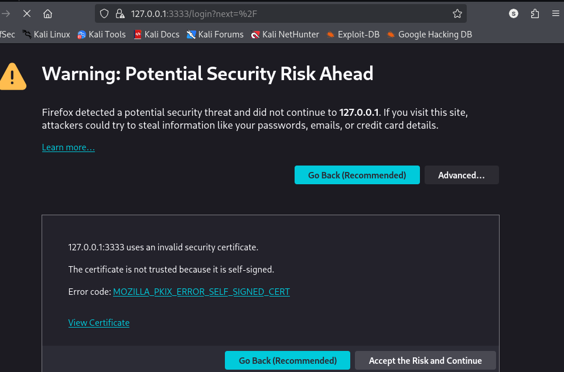

The archive is **extracted** and executable permissions are applied using **chmod +x** so the binary can be run.

### 2. Launching GoPhish & Admin Login

GoPhish is started from the terminal with **sudo** privileges. On first launch it prints an **auto-generated admin password**, and the admin panel becomes reachable at **https://127.0.0.1:3333**.

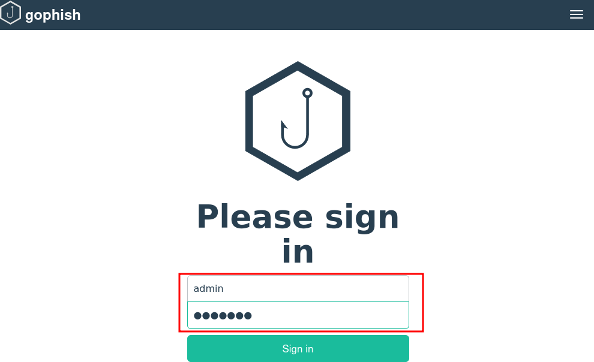

The **GoPhish login page** is accessed at **https://127.0.0.1:3333**, ready for the admin credentials.

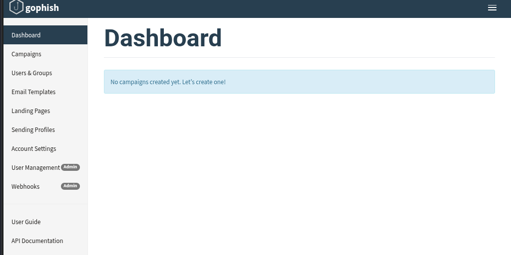

The **GoPhish dashboard** loads successfully, confirming the admin panel is working.

### 3. Creating a Sending Profile

A **Sending Profile** defines which email account GoPhish uses to deliver phishing emails, including **SMTP credentials** and server details.

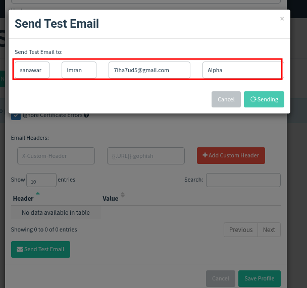

The **Sending Profile** is configured with SMTP server details and login credentials.

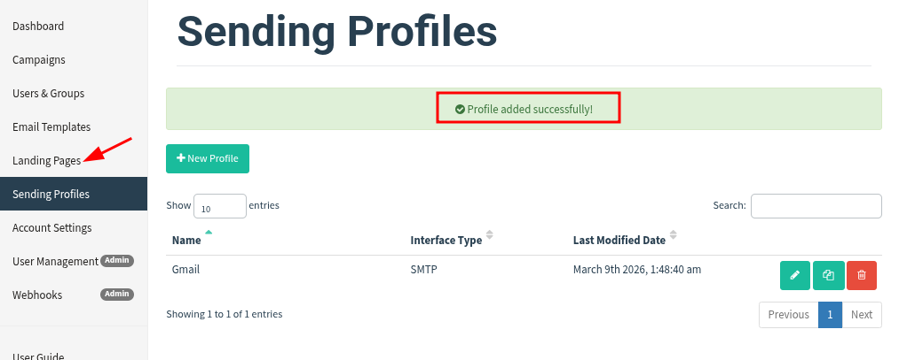

The **Sending Profile** is saved and now appears in the dashboard list.

### 4. Creating a Landing Page

The **Landing Page** is the page a victim lands on after clicking the phishing link. GoPhish can **clone any public website** directly through its Site Import feature.

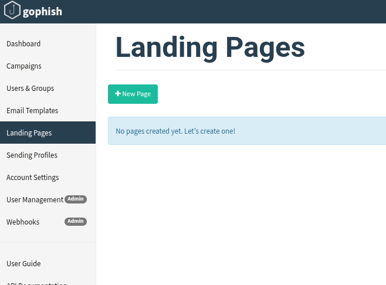

The **Landing Page setup** screen with the Site Import option and credential capture settings enabled.

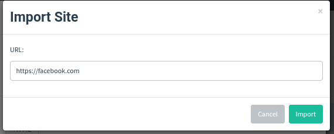

A **cloned website preview** is rendered inside the GoPhish landing page editor.

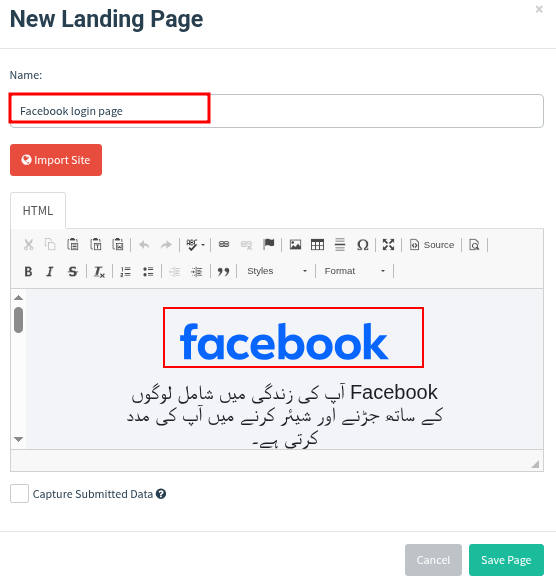

The **landing page is saved**, with a redirect URL set so victims are sent to the real site after submitting data.

### 5. Creating an Email Template

The **Email Template** defines the phishing message content, using GoPhish variables like **{{.FirstName}}** and **{{.URL}}** to personalize the email and embed the tracking link.

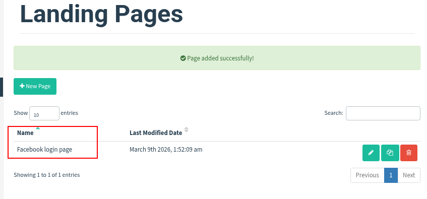

The **Email Template editor**, with HTML content and the **{{.URL}}** tracking variable inserted.

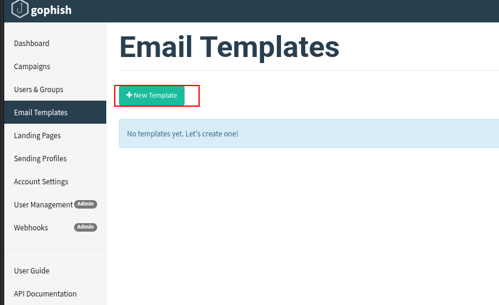

The template is configured with a **subject line**, **sender name** and the embedded phishing link.

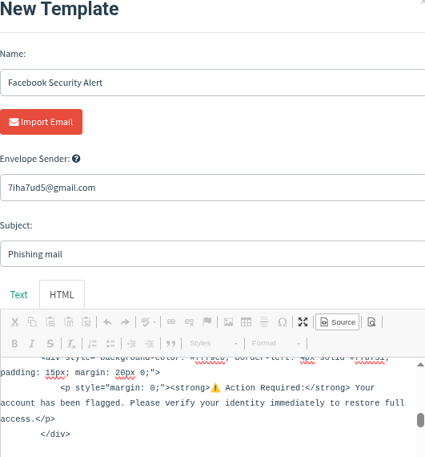

The **Email Template is saved** and now appears in the templates list.

### 6. Configuring Users & Groups (Target List)

The **Users & Groups** section builds the list of targets for a campaign, either added manually or imported from a **CSV file**.

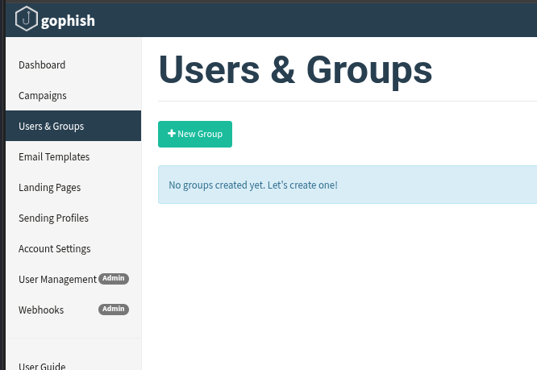

A **new group** is created and target employees are added manually.

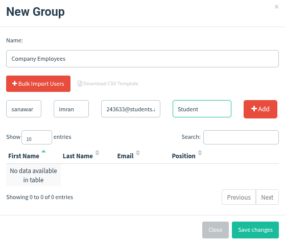

Target **details** such as name, email and job position are entered for each user.

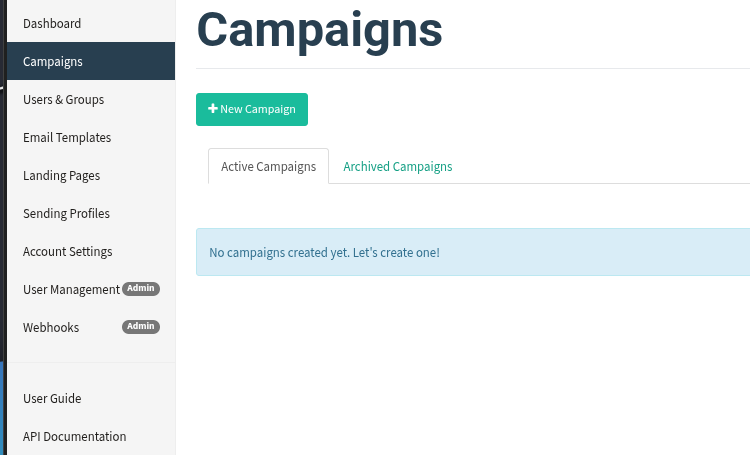

The **user group is saved** and confirmed inside the Users & Groups dashboard.

### 7. Launching a Phishing Campaign

With every component ready, a new campaign links together the **Sending Profile**, **Landing Page**, **Email Template** and **Target Group**, with the campaign URL pointed at the Kali machine's local IP.

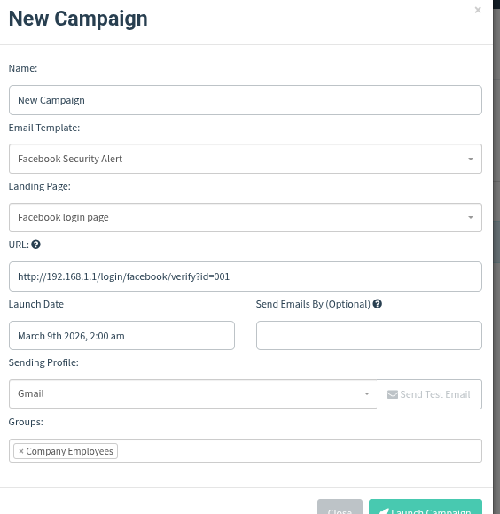

The **New Campaign** form shows all components linked together before launch.

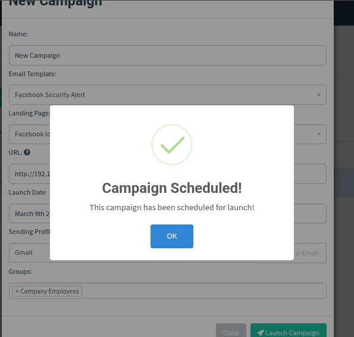

The **campaign is launched successfully** and transitions into active monitoring.

### 8. Campaign Results & Monitoring

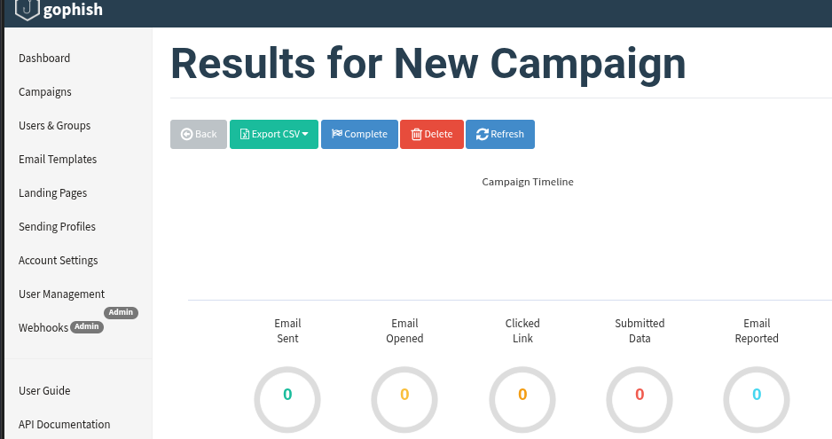

The **live campaign dashboard** tracks email sent, email opened, link clicked and data submitted — giving the security team real numbers on employee vulnerability.

**Conclusion (Task 4.2):** this lab demonstrated the complete GoPhish workflow, from **installation** and **SMTP setup** to **campaign execution** and **results monitoring**. It shows how convincing a phishing attack can look, reinforcing the need for ongoing employee **security awareness training**.

---

## **Cyber Threat Intelligence (Netcraft Site Analysis)**

**Objective:** use the **Netcraft** platform and browser extension to gather threat intelligence about a target domain, including its **hosting**, **network**, **SSL/TLS** and **geographical** information.

### Step 1 — Finding and Installing the Netcraft Extension

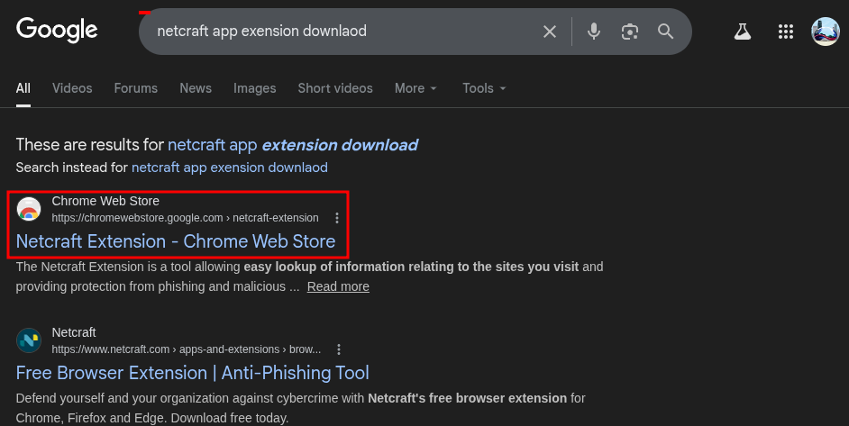

A **Google search** is used to locate the **Netcraft browser extension** for quick site lookups.

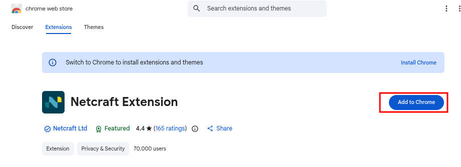

The **Netcraft Extension** page is opened on the **Chrome Web Store**, ready to be added to the browser.

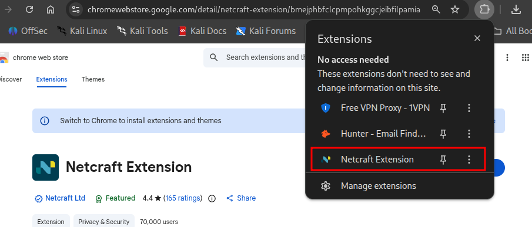

The extension is **added to Chrome**, confirming it is installed and available in the toolbar.

### Step 2 — Running a Site Report

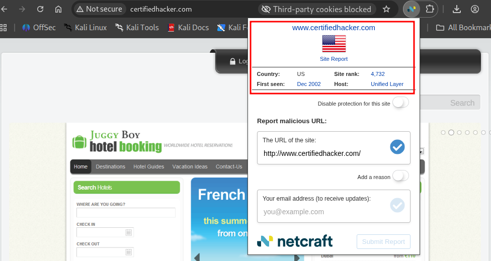

The Netcraft extension icon is used directly on the target site to pull up its **quick site report**.

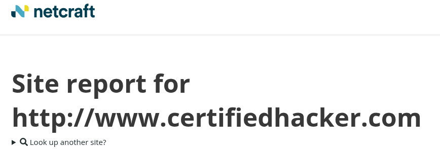

The full **Netcraft Site Report** for **www.certifiedhacker.com** opens, showing the **country**, **first seen date** and **hosting layer**.

### Step 3 — Background and Network Details

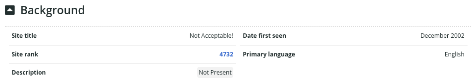

The **Background** section shows the **site rank**, **primary language** and the date the site was **first seen**.

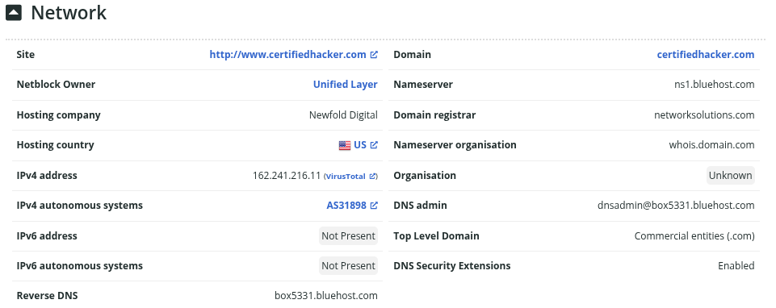

The **Network** section lists the **hosting company**, **nameservers**, **IPv4 address** and **DNS admin** contact for the domain.

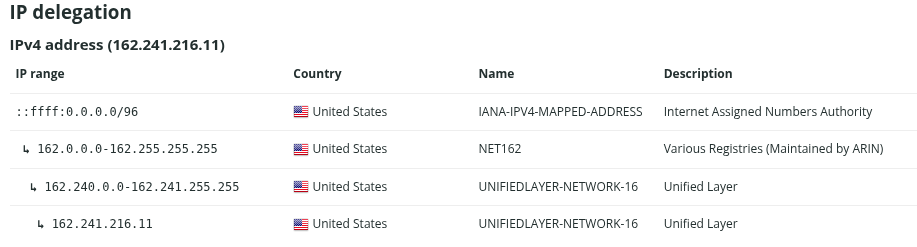

**IP delegation** details show the IP range, country and organisation that the address block belongs to.

### Step 4 — SSL/TLS and Certificate Information

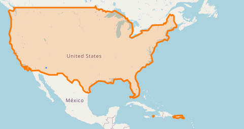

A **geographical map** highlights the country associated with the domain's hosting infrastructure.

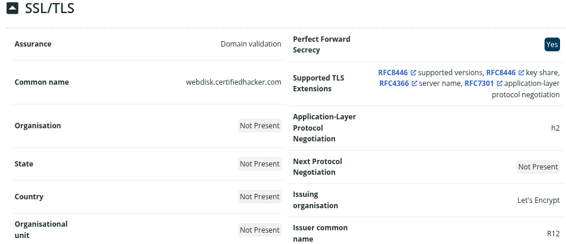

**SSL/TLS** details list the **assurance level**, **supported protocols** and the **issuing organisation** of the certificate.

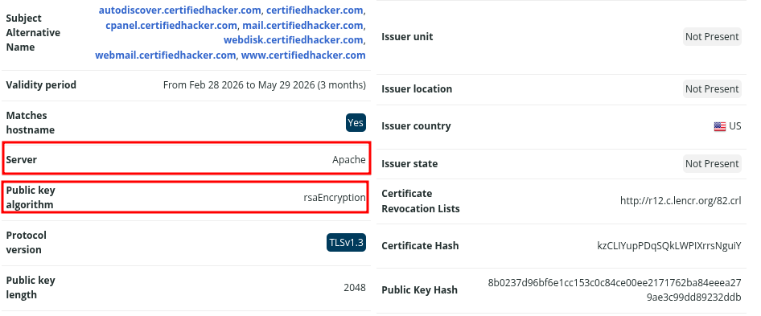

Certificate fields such as **server type (Apache)** and the **public key algorithm (rsaEncryption)** are shown.

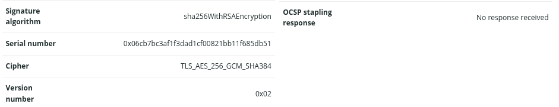

Further certificate data includes the **signature algorithm**, **serial number** and **cipher suite** used.

### Step 5 — Related Sites and Subject Alternative Names

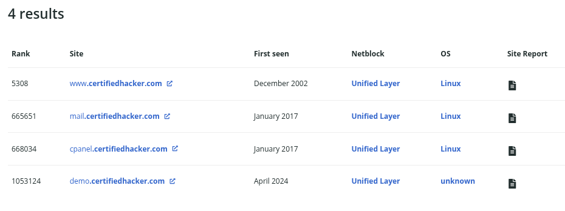

A list of **related sites** on the same netblock is shown, including subdomains like **mail**, **cpanel** and **demo**.

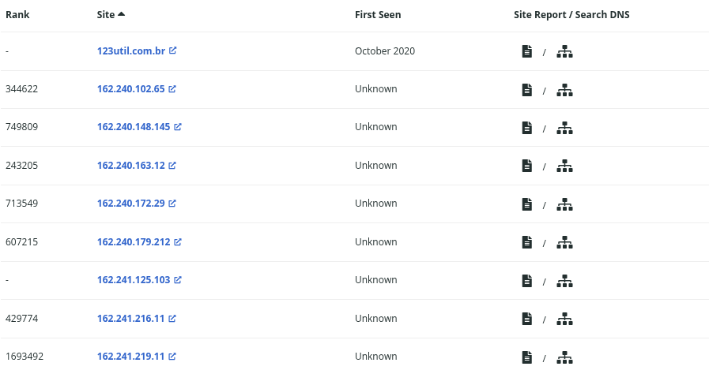

The certificate's **Subject Alternative Names** confirm every hostname covered, along with the **public key length** and **issuing authority**.

**Conclusion (Task 4.3):** this task showed how a single tool like **Netcraft** can reveal a large amount of **open-source threat intelligence** about a domain — its hosting provider, network ownership, SSL/TLS configuration and related infrastructure — all from publicly available data.

---

## **Overall Learnings**

- **Human error** is often the weakest link in cybersecurity, which both **SET** and **GoPhish** clearly demonstrate.
- A convincing **cloned website** and a well-written phishing email can bypass awareness almost instantly.
- **GoPhish** turns a phishing simulation into a measurable program with dashboards, templates and tracked results.
- **Netcraft** shows how much can be learned about a target's **infrastructure** using only **public information**, with no intrusive scanning required.
- Combining **offensive simulation tools** with **threat intelligence platforms** gives a complete picture — from testing employees to understanding an organization's external footprint.

---

## **Conclusion**

Together, these three tasks cover the **full lifecycle** of a modern social engineering and threat intelligence exercise — simulating an attack with **SET**, scaling it into a measurable campaign with **GoPhish**, and gathering **open-source intelligence** on a target with **Netcraft**. The exercises reinforce why organizations must invest in **continuous security awareness training**, **phishing simulations** and regular **threat intelligence reviews** to stay ahead of real-world attackers.

> **Note:** All work shown here was performed strictly for **academic and educational purposes** in an isolated lab environment.

---

## **Connect With Me**

  
  &nbsp;&nbsp;
  

<b>Thank you for reading!</b>

