<div align="center">


# 🛡️ Cyber Threat Intelligence 

### Malware Analysis & Data Collection


</div>

---

## 📑 Table of Contents

- [Lab Objectives](#-lab-objectives)
- [Repository Structure](#-repository-structure)
- [Task 1 — VirusTotal & Maltego](#task-1--virustotal--maltego-analysis)
- [Task 2 — ANY.RUN Sandbox](#task-2--anyrun-interactive-sandbox-analysis)
- [Task 3 — Hybrid Analysis (Falcon Sandbox)](#task-3--hybrid-analysis-falcon-sandbox)
- [Conclusion](#-conclusion)

---

## 🎯 Lab Objectives

This lab demonstrates the collection of Cyber Threat Intelligence (CTI) data through systematic malware analysis using three industry-standard platforms:

- Analyze malware using **VirusTotal** (multi-engine scanner) and **Maltego** (visual intelligence mapping)
- Analyze malware using the **ANY.RUN** interactive sandbox for dynamic behavioral analysis
- Analyze malware using **Hybrid Analysis (Falcon Sandbox)** for static and dynamic examination

> ⚠️ **Warning:** Malware samples must only be handled inside an isolated virtual machine. Never run them on your host system.

## 📁 Repository Structure

```text
.
├── README.md
└── images/
    ├── Cyber Threat Intelligence Poster.png
    ├── image_01.png
    ├── image_02.png
    ├── ...
    └── image_36.png
```

---

# Task 1 — VirusTotal & Maltego Analysis

**Goal:** Analyze malware using VirusTotal and map its indicators visually with Maltego.

## Step 1: Prepare the Virtual Machine Environment

Launch the **Windows 10** virtual machine and navigate to `D:\CTIA-Tools\CTIA Module 04 Data Collection and Processing\Malware` to access the malware samples.

Before proceeding, disable Windows Defender Firewall and real-time protection. Open the Windows Defender Security Center from the taskbar search.

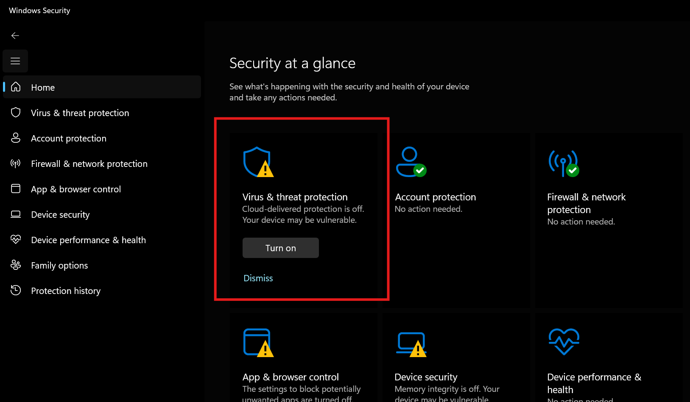

> 📌 The Windows 10 virtual machine is running with the malware directory visible at `D:\CTIA-Tools`, containing various malware samples ready for controlled analysis.

Verify all three protection toggles — **Virus & threat protection**, **Firewall & network protection**, and **App & browser control** — are disabled.

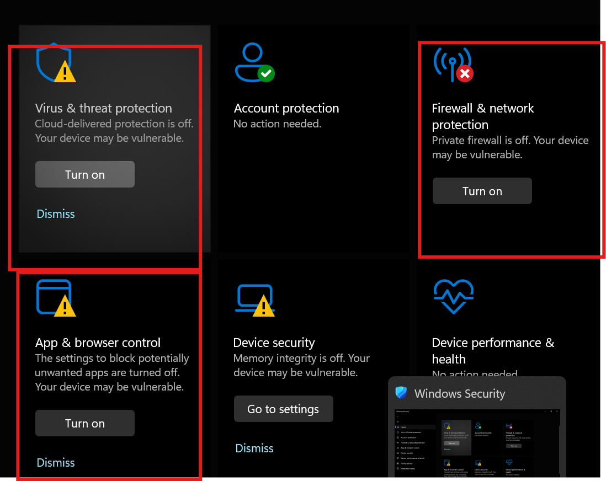

> 📌 The Windows Defender Security Center confirms all protections are fully disabled for safe lab execution.

## Step 2: Disable Real-Time Protection

> ⚠️ **Note:** If a yellow triangle appears next to Virus & threat protection, real-time protection is still active and must be disabled before proceeding.

1. Click **Virus & threat protection** in the Security Center dashboard.

   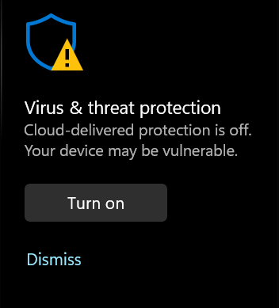

   > 📌 A yellow triangle warning icon signals that real-time protection is still active and must be turned off.

2. Click the **Virus & threat protection settings** link on the next page.

   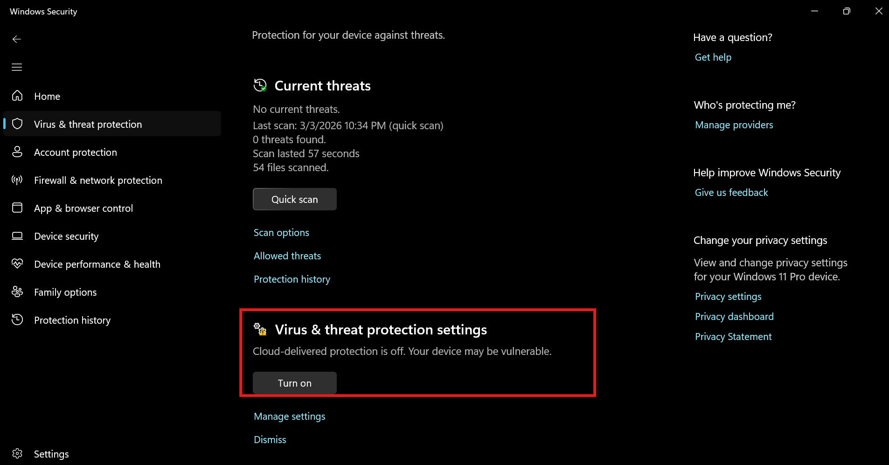

   > 📌 The settings page displays the Real-time protection toggle which needs to be switched to Off.

3. Toggle **Real-time protection** to **Off**. Confirm any UAC prompts by clicking **Yes**.

   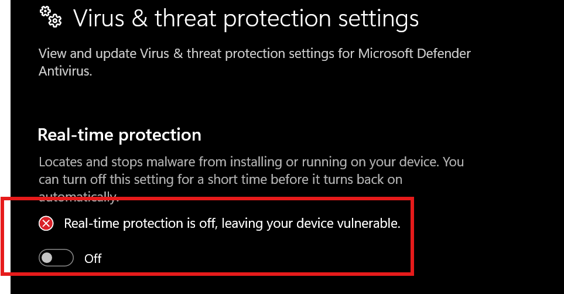

   > 📌 Real-time protection is now disabled — the system is prepared for safe malware analysis.

## Step 3: Upload Malware Sample to VirusTotal

Navigate to <https://www.virustotal.com/#/home/upload>. Click the **Choose File** button to upload your malware sample.

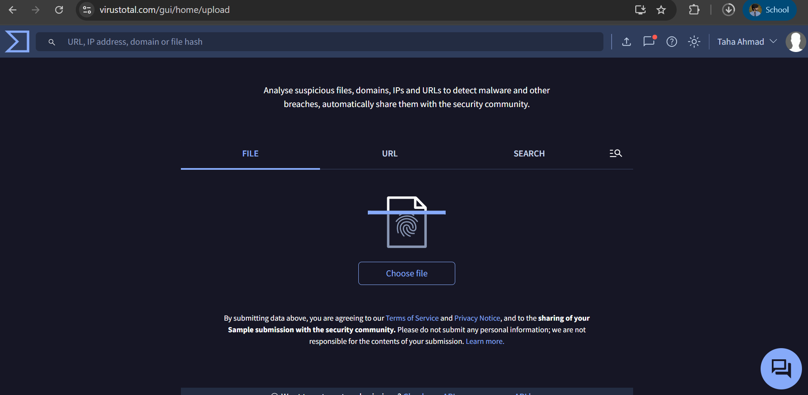

> 📌 The VirusTotal home page is open with the Choose File button visible, ready to accept a malware sample.

If no local sample is available, download one from **MalwareBazaar**, a public repository for malware research.

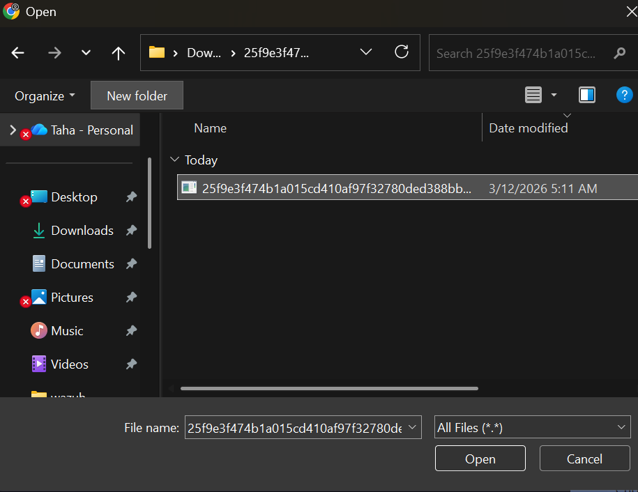

> 📌 A malware file has been selected from MalwareBazaar, a public repository for research purposes.

## Step 4: Review Detection Results

VirusTotal cross-references the file against 60+ antivirus engines and threat feeds, producing a detection score and detailed metadata.

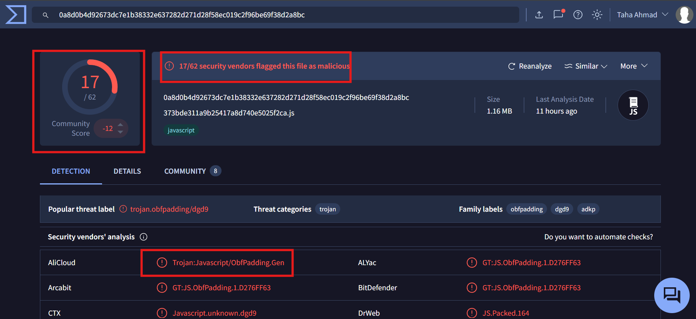

> 📌 VirusTotal analysis complete — a detection score of **17/62** engines is shown alongside file metadata and community scoring.

> 🔍 **Result:** The malware scored **17/62**, meaning 17 of 62 antivirus engines detected it as malicious.

Click the **Details** tab to extract IoCs: MD5, SHA-1, Authentihash, Imphash, SSDeep, TRiD, Tags, and File Names.

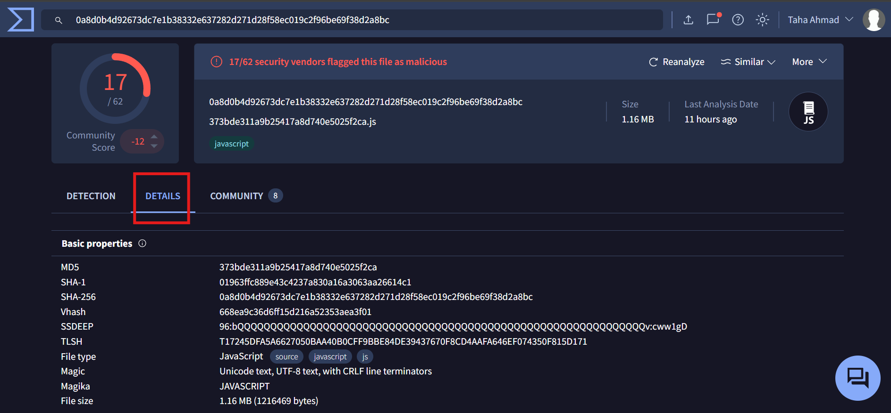

> 📌 The Details tab reveals Indicators of Compromise (IoCs) including MD5, SHA-1, Authentihash, Imphash and SSDeep.

Click the **Community** tab to view crowd-sourced votes and comments.

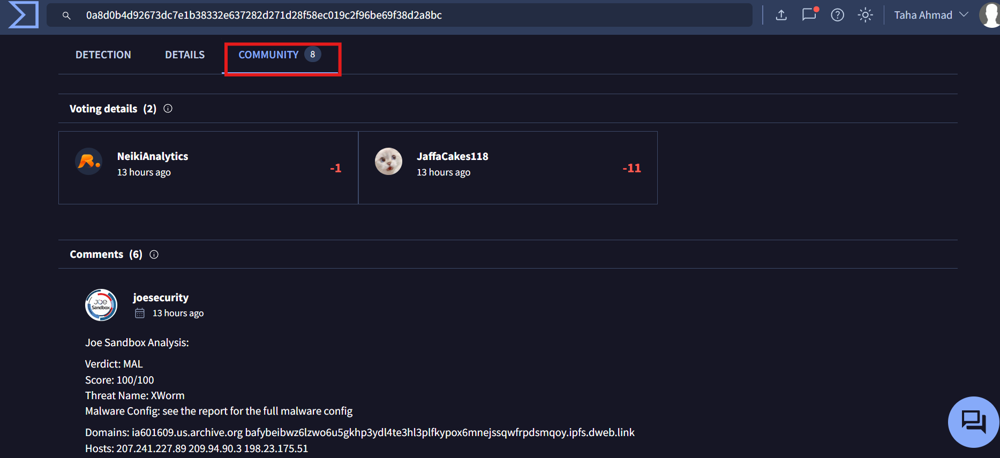

> 📌 The Community tab displays crowd-sourced votes and written comments, adding qualitative threat intelligence.

Leave the Details tab open — the MD5 hash will be used in the next phase with Maltego.

## Step 5: Install Maltego

Navigate to `D:\CTIA-Tools\CTIA Module 04 Data Collection and Processing\Maltego` and run `maltego_JRE64.v4.1.6.11045.exe`. Follow the default installation wizard.

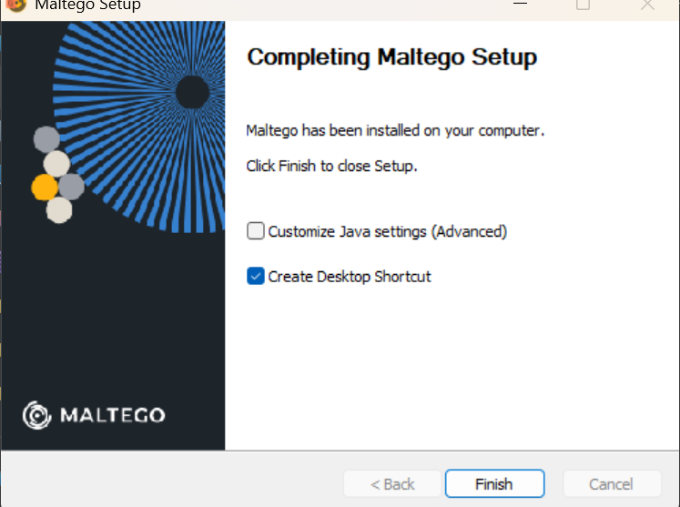

> 📌 The Maltego installation wizard has completed successfully with the Desktop Shortcut option checked.

Launch Maltego from the desktop shortcut. In the Product Selection wizard, select **Maltego CE (Free)** and click **Run**. Log in with your registered credentials.

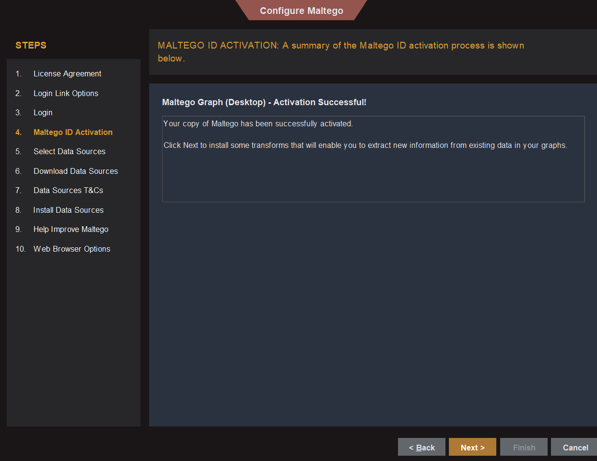

> 📌 The Maltego CE (Free) login screen requires registered email, password, and CAPTCHA verification.

## Step 6: Install VirusTotal API Transform

In the **Transform Hub** (right pane), locate **VirusTotal Public API** and click **Install**.

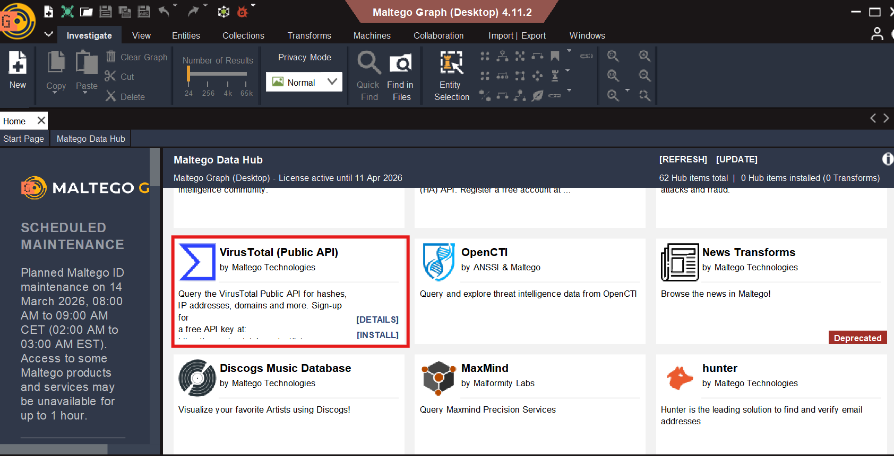

> 📌 The Transform Hub shows the VirusTotal Public API card with the Install button.

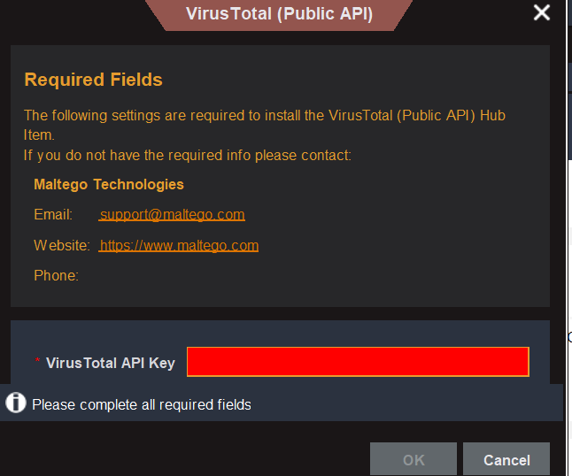

> 📌 The VirusTotal API integration is confirmed in Maltego and ready for hash-based queries.

## Step 7: Obtain and Configure VirusTotal API Key

Register at <https://www.virustotal.com/#/join-us> and activate your account via the confirmation email to access your API key.

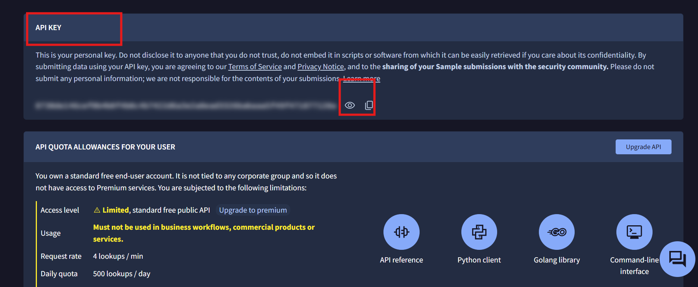

> 📌 The VirusTotal community registration page is open — a valid email is required to generate an API key.

Return to Maltego, paste the API key into the **VT Public API Key** field, and click **OK**.

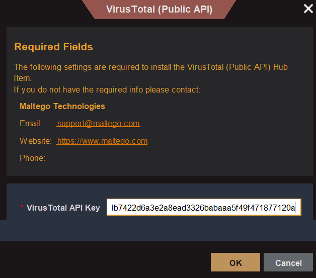

> 📌 The VT Public API Key field is shown with the copied key pasted in, ready for authentication.

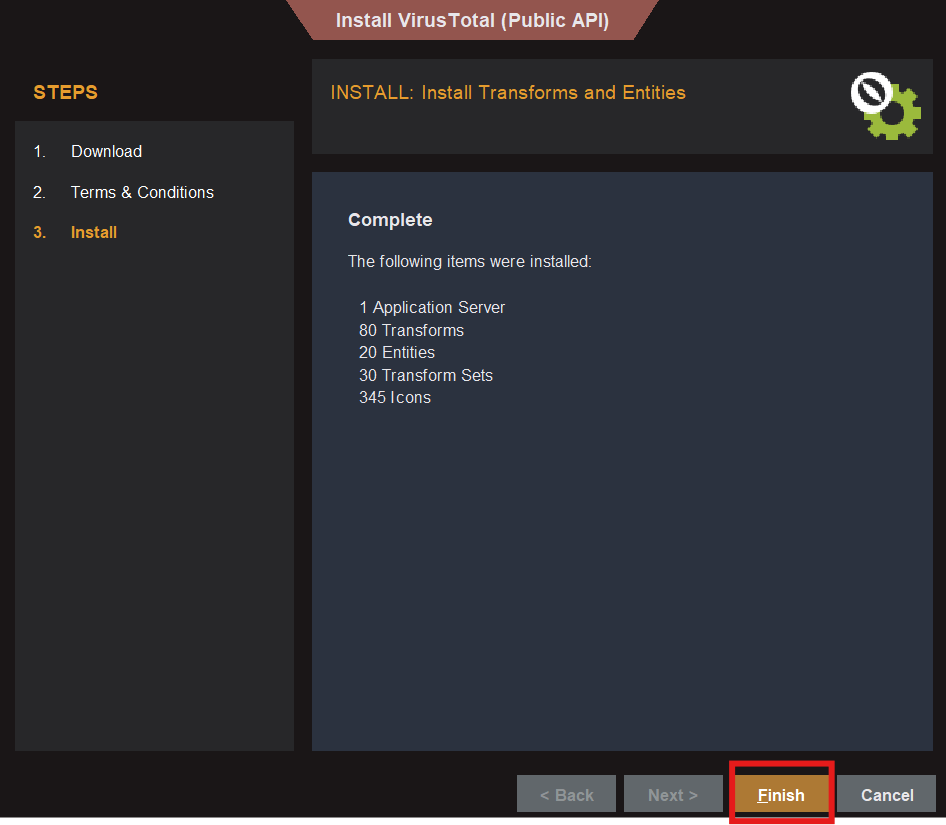

> 📌 The API installation confirmation screen shows the process is complete, with the Finish button available.

## Step 8: Build and Run Intelligence Graph

Click the **New Graph** icon in the top-left toolbar to open a fresh investigation workspace.

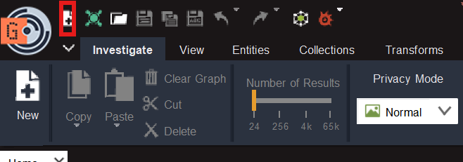

> 📌 The Maltego toolbar with the New Graph icon highlighted.

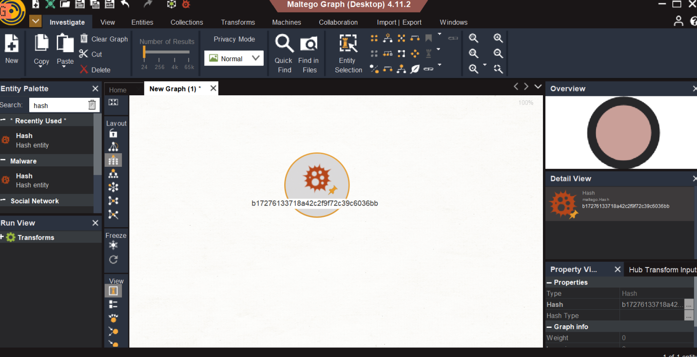

> 📌 The New Graph (1) workspace is open with the Entity Palette visible in the left pane.

Switch to the VirusTotal **Details** tab and copy the **MD5** hash of `wikiworm.exe` from the Basic Properties section.

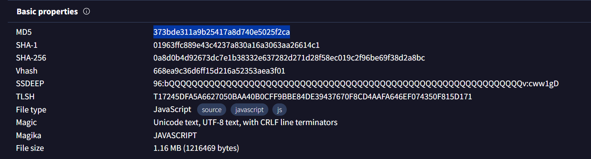

> 📌 The VirusTotal Details tab for `wikiworm.exe` displays the MD5 hash in Basic Properties.

In Maltego, double-click the hash entity and paste the MD5 value. Right-click to run the VirusTotal transform.

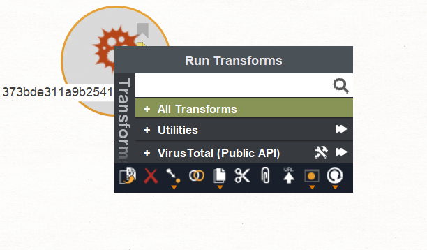

> 📌 The hash entity is updated with the MD5 value of `wikiworm.exe`, ready for the VirusTotal transform.

After execution, Maltego produces a comprehensive network graph mapping all threat entities associated with the malware hash.

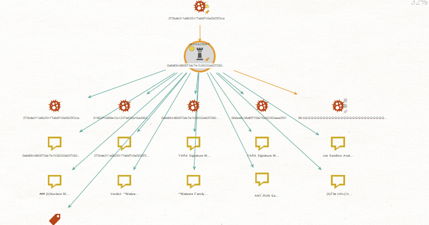

> 📌 The completed transform produces a network graph of all extracted entities — IPs, domains, file hashes, and threat actors.

### Additional APIs Available for Maltego

- **Cisco Threat Grid** — Enterprise-grade dynamic analysis
- **Kaspersky Lab** — Global threat intelligence feeds
- **ZETAlytics Massive Passive** — Passive DNS and IP intelligence
- **ThreatMiner** — Malware and indicator enrichment

---

# Task 2 — ANY.RUN Interactive Sandbox Analysis

**Goal:** Analyze malware behavior in real time using the ANY.RUN interactive sandbox.

## Step 1: Register and Access the ANY.RUN Platform

Navigate to <https://app.any.run/#register>. Complete the sign-up form and click **CREATE ACCOUNT**.

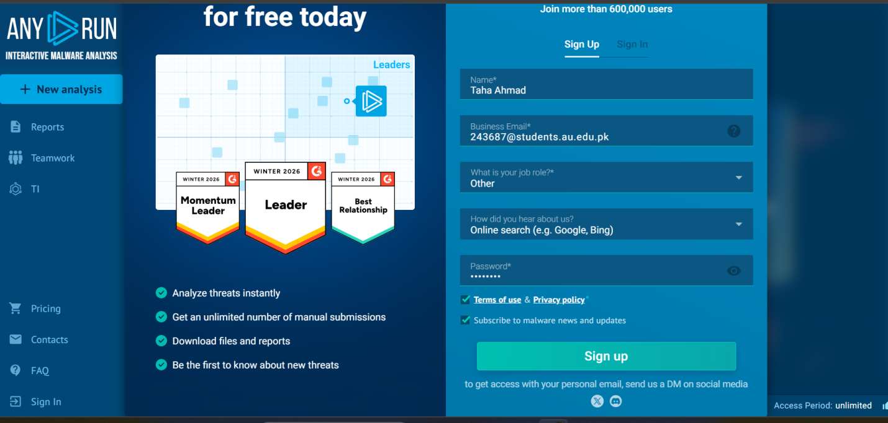

> 📌 The ANY.RUN registration form requires credentials to create an account.

After successful login, the ANY.RUN dashboard appears with options for submitting malware files and URLs.

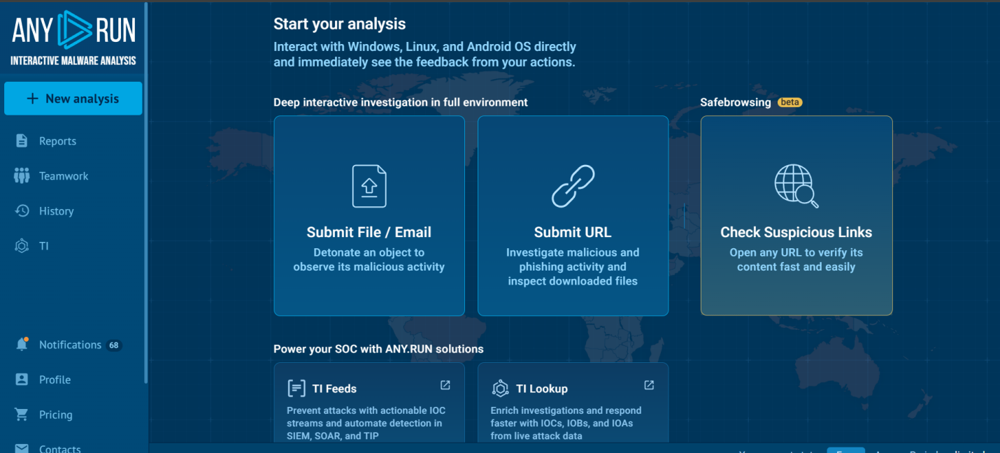

> 📌 The dashboard is shown after login, with options for submitting files and URLs for sandbox analysis.

## Step 2: Submit Malware for Sandbox Execution

Select the file submission option, upload your malware sample, and click **Run** to begin the live sandbox session.

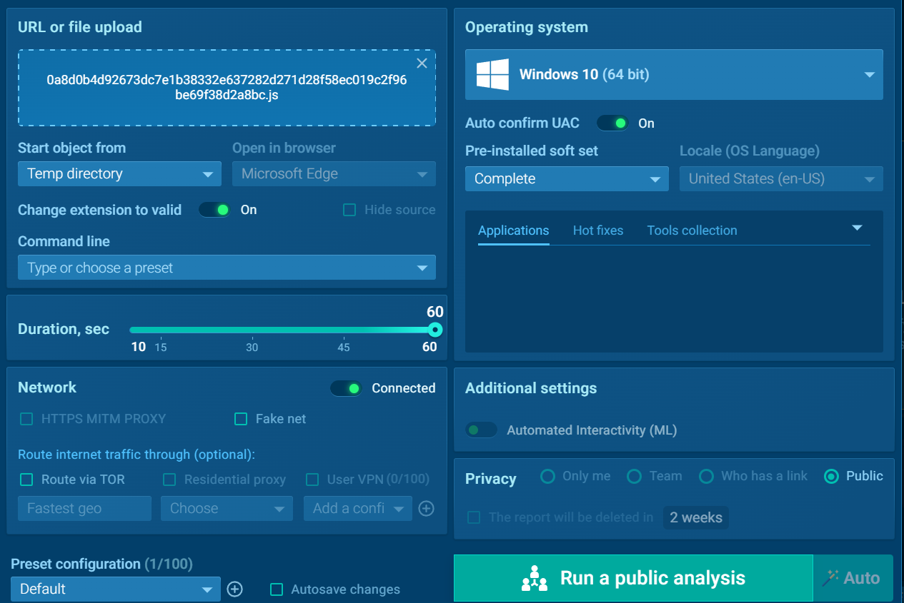

> 📌 A malware sample has been uploaded with the Run button active.

ANY.RUN executes the malware in a monitored environment and displays a real-time popup confirming malicious activity.

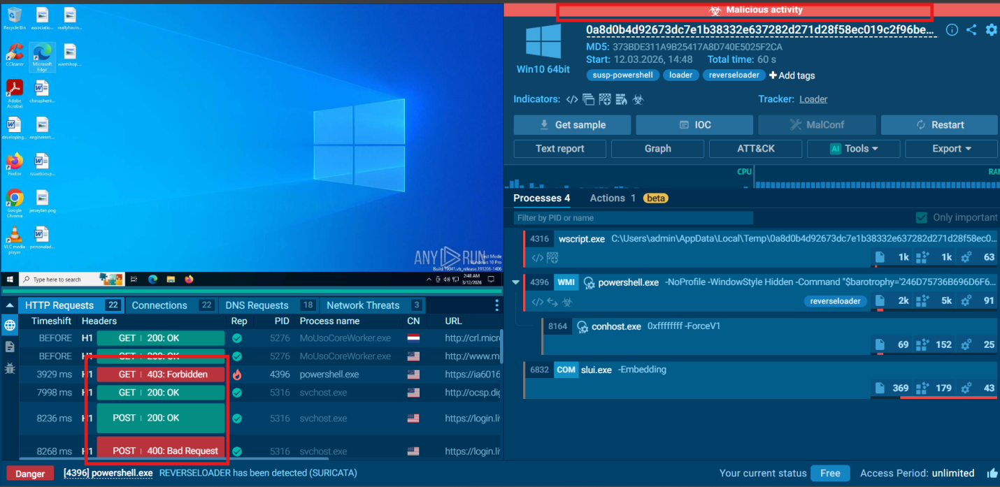

> 📌 A popup alert confirms the file has been flagged as malicious during live execution.

## Step 3: Analyze the Reports

> 💡 ANY.RUN provides three key views: **Text Report** (written behavioral log), **Graph** (process tree visualization), and **Attack** (MITRE ATT&CK mapping).

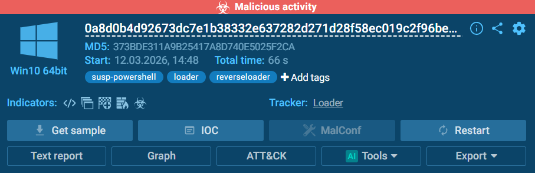

> 📌 The results panel presents multiple reporting options — Text Report, Process Graph, and MITRE ATT&CK mapping.

The **Text Report** provides a detailed breakdown of all processes, network calls, and file modifications made by the malware.

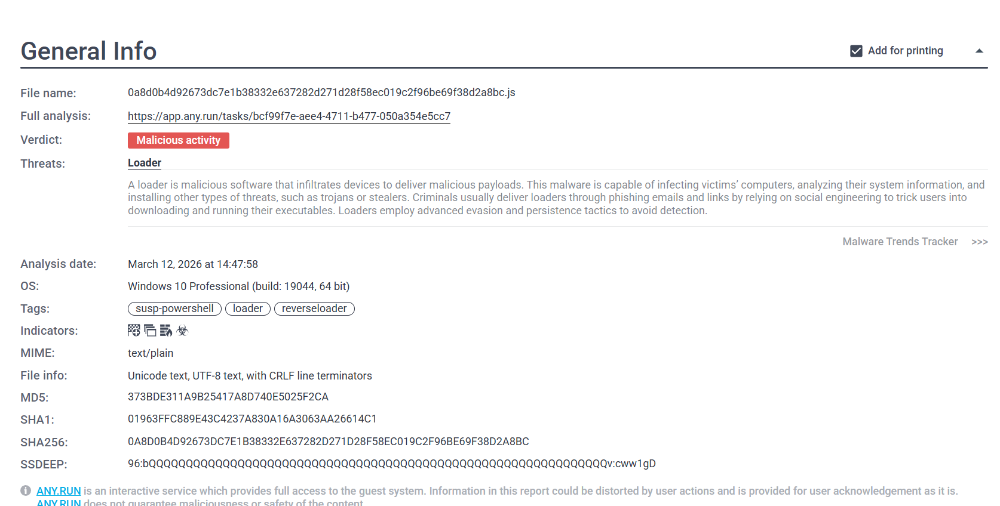

> 📌 The Text Report gives a written account of runtime behavior including process spawning and network connections.

The **Graph** view renders the execution chain as an interactive process tree showing parent-child relationships.

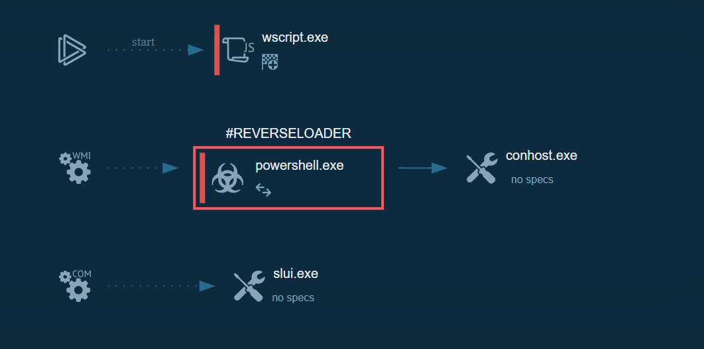

> 📌 The Graph view visualizes the complete execution chain as an interactive process tree.

The **Attack** section maps observed behaviors to MITRE ATT&CK entries for structured threat categorization.

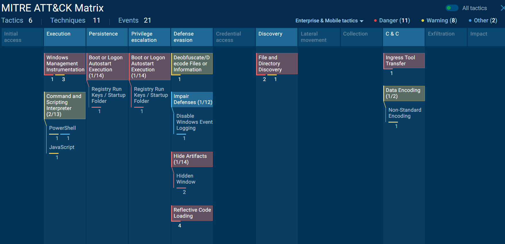

> 📌 The Attack section maps the malware's behaviors to MITRE ATT&CK tactics and techniques.

---

# Task 3 — Hybrid Analysis (Falcon Sandbox)

**Goal:** Perform static and dynamic malware analysis using Hybrid Analysis.

## Step 1: Register and Login to Hybrid Analysis

Open Google Chrome and navigate to <https://hybrid-analysis.com/>. Click **SIGN IN → CREATE AN ACCOUNT → START SUBSCRIPTION FOR FREE**.

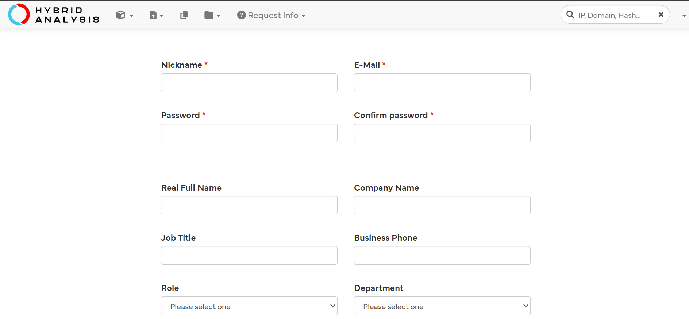

> 📌 The Hybrid Analysis Sign Up page, where credentials are entered to create a free account.

## Step 2: Submit Malware File

After login, the Falcon Sandbox dashboard appears. Click **Analyze New File** in the top-right corner.

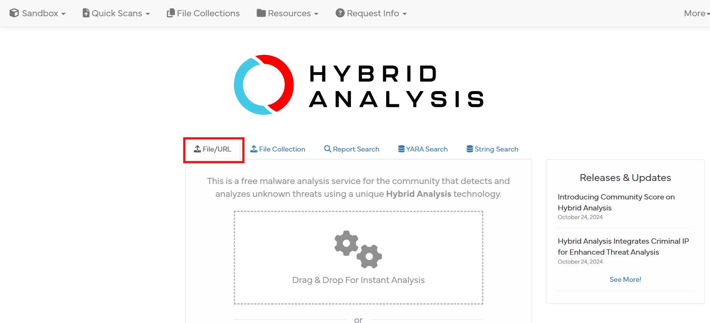

> 📌 The dashboard is displayed after login, with the Analyze New File button in the top-right corner.

In the Analyze File window, click **Select File**, navigate to the CTIA malware directory, select the target file, and click **Open**.

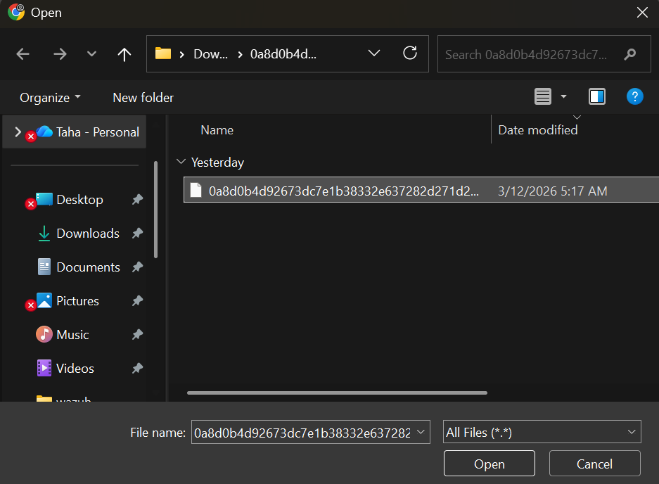

> 📌 The file picker shows the malware file selected from the CTIA Module 04 directory.

Click **Analyze** to submit the file. Hybrid Analysis will execute it in an isolated environment and generate a verdict.

## Step 3: Review Falcon Sandbox Results

The **Summary** tab displays the malware verdict along with key file attributes: File Name, File Type, SHA-1, MD5 hash, and analysis timestamp.

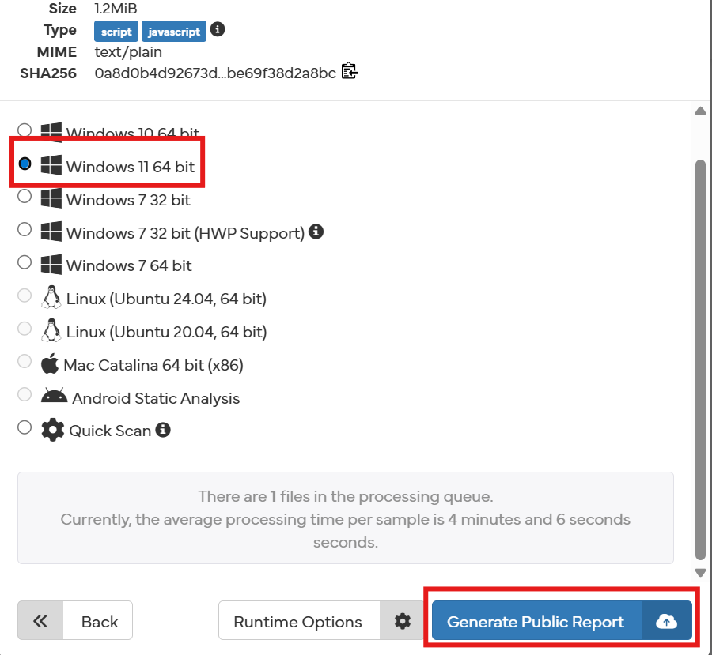

> 📌 The Summary tab displays the Falcon Sandbox verdict along with file metadata.

> 📊 Four detailed tabs are available: **Static Analysis**, **Dynamic Analysis**, **Precise Detectors**, and **File Details**.

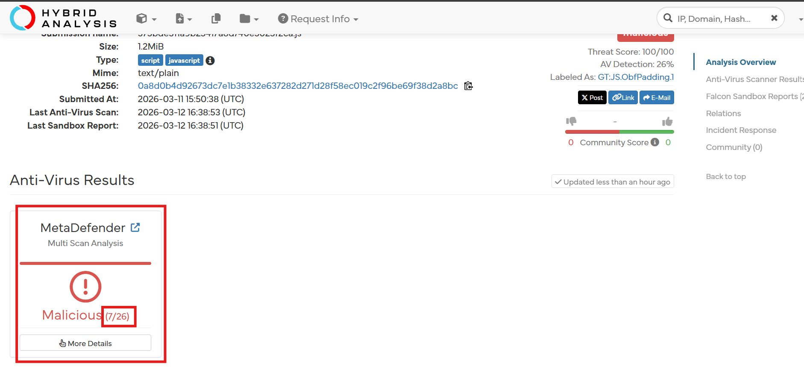

> 📌 The detailed analysis tabs offer layered insight into the malware's behavior.

## Step 4: Export the Analysis Report

Click **Export Results To PDF** to download a professional report suitable for documentation, incident response reporting, and stakeholder sharing.

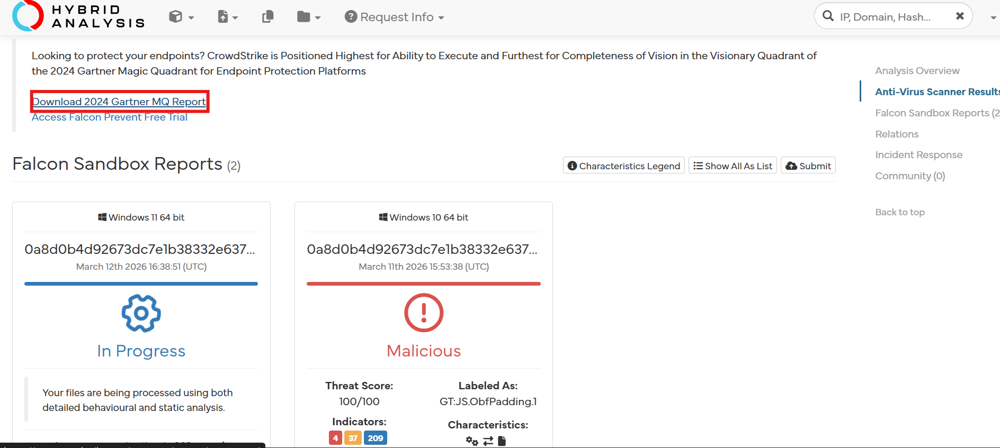

> 📌 The exported PDF report presents the complete malware analysis summary.

---

## ✅ Conclusion

This laboratory demonstrated a multi-platform approach to malware analysis for cyber threat intelligence collection. Each tool provided complementary capabilities:

| Tool | Capability |
|------|------------|
| 🔍 **VirusTotal + Maltego** | Multi-engine hash scanning with visual relationship mapping of IoCs and threat actors. |
| ⚡ **ANY.RUN Sandbox** | Real-time behavioral analysis with process trees and MITRE ATT&CK mapping. |
| 🦅 **Hybrid Analysis** | Combined static and dynamic analysis with exportable professional PDF reports. |

Together, these three platforms form a robust **Cyber Threat Intelligence (CTI) pipeline** — transforming raw malware samples into structured, actionable intelligence suitable for threat hunting, incident response, and security operations center (SOC) workflows.
