

  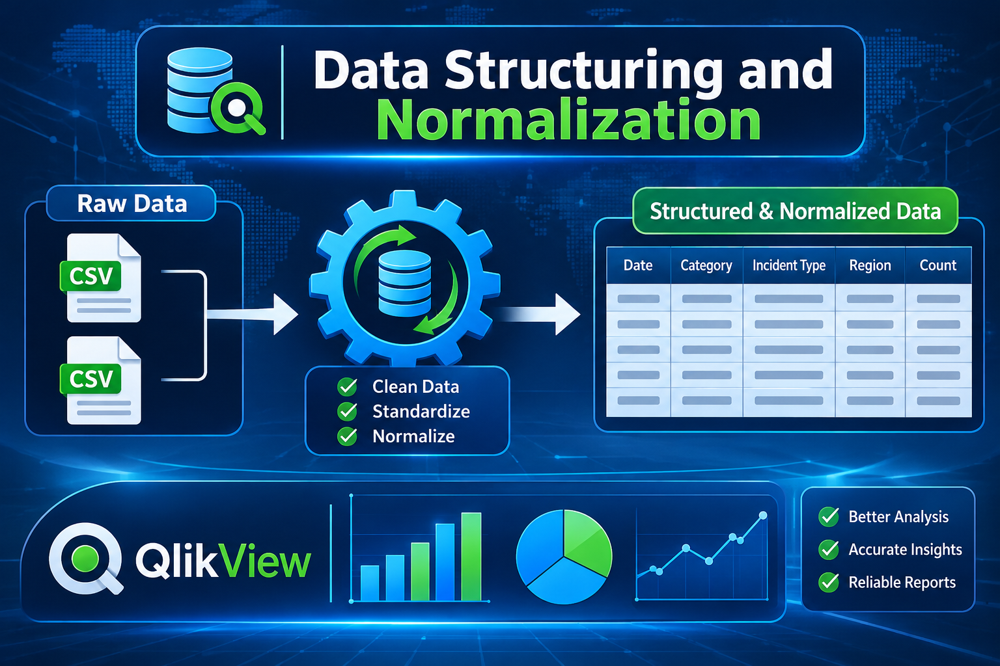

# Data Structuring and Normalization 

---

## **Table of Contents**

| **Section** | **Topic** |
| --- | --- |
| [Overview](#overview) | Lab goal, tools and datasets |
| [Step 1 – 2](#step-1--searching-for-qlikview) | Searching and downloading QlikView |
| [Step 3 – 7](#step-3--installation-wizard-begins) | Installation of QlikView |
| [Step 8 – 9](#step-8--qlikview-launch-with-splash-screen) | Launching QlikView and Start Page |
| [Step 10](#step-10--opening-edit-script) | Opening Edit Script |
| [Step 11 – 14](#step-11--writing-the-initial-load-script) | Loading CSV files and fixing errors |
| [Step 15 – 17](#step-15--inspecting-breachescsv) | Inspecting columns and final script |
| [Step 18](#step-18--data-loaded-successfully) | Successful data load |
| [Step 19 – 23](#step-19--sheet-properties-available-fields) | Sheet Properties, fields and listboxes |
| [What I Learned](#what-i-learned) | Key skills gained |
| [Conclusion](#conclusion) | Final summary |

---

## **Overview**

This **Lab Task** shows how **Cyber Threat Intelligence (CTI)** data is **structured and normalized** using **QlikView**, a **Business Intelligence (BI)** tool. Two raw CSV files, **breaches.csv** and **HHSCyberSecurityBreaches.csv**, were loaded with the **QlikView load script**, cleaned, and mapped to proper **column names** so the data can be analyzed.

| **Item** | **Details** |
| --- | --- |
| **Tool** | QlikView x64 Personal Edition (September 2025 SR1) |
| **Operating System** | Windows x64 |
| **Dataset 1** | breaches.csv (Date_Posted_or_Updated, Summary, breach_start, breach_end, year) |
| **Dataset 2** | HHSCyberSecurityBreaches.csv (Covered Entity Name, State, Entity Type, Affected Individuals, etc.) |
| **Goal** | Load, clean, normalize and structure CTI data for analysis |

---

## **Step 1 – Searching for QlikView**

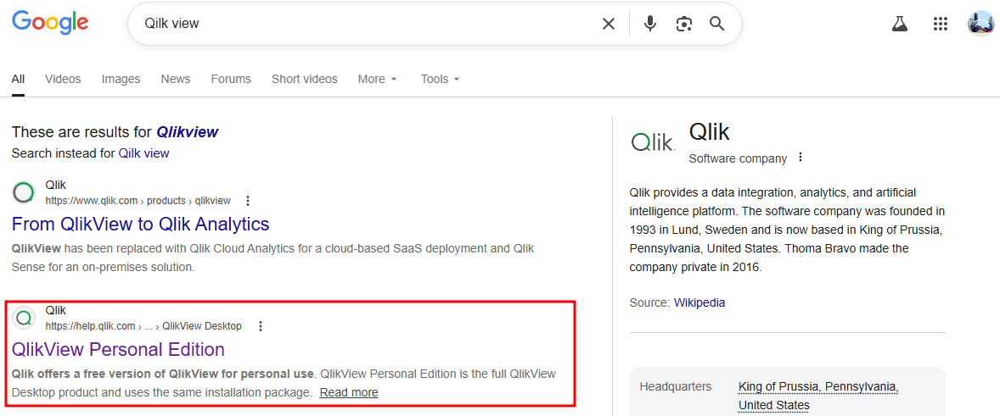

**Description:** The browser was opened and **QlikView download** was searched on the web. This is the first **method** to find the official source of the installer.

## **Step 2 – Official QlikView Website**

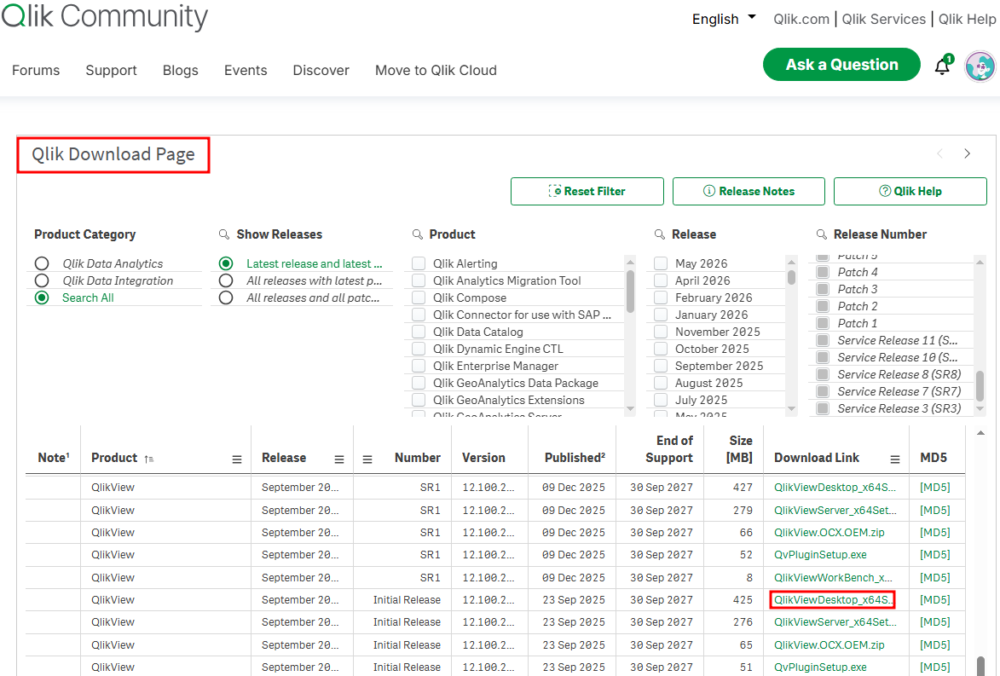

**Description:** The **official Qlik website** was opened to find the download options. The **Personal Edition (x64)** installer was selected and downloaded.

## **Step 3 – Installation Wizard Begins**

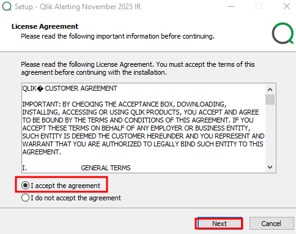

**Description:** The downloaded **installer** was launched on the Windows machine. The **setup wizard** opened and guided the installation from the beginning.

## **Step 4 – Installation Progress**

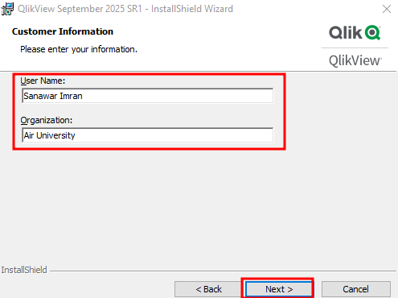

**Description:** The wizard showed the **installation progress** while QlikView files were being copied. This screen confirms that the setup is running without problems.

## **Step 5 – License Agreement**

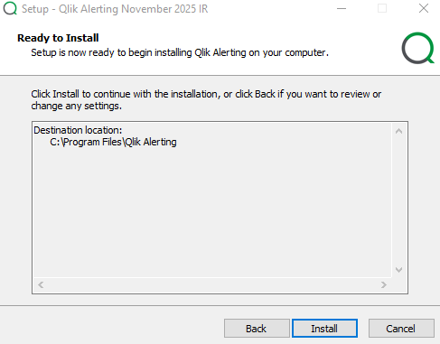

**Description:** The **license agreement** screen appeared during setup. The terms were accepted to continue with the **installation**.

## **Step 6 – Installation Directory and Options**

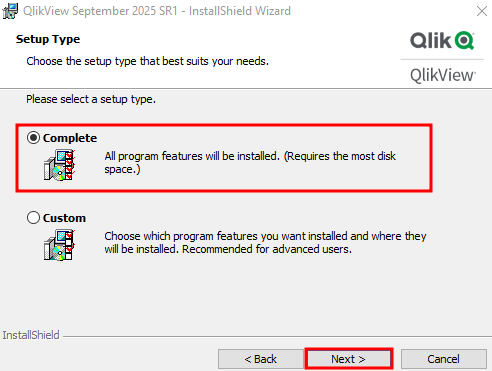

**Description:** In this step the **installation directory** and other setup options were chosen. The default options were kept and the process moved forward.

## **Step 7 – Installation Complete**

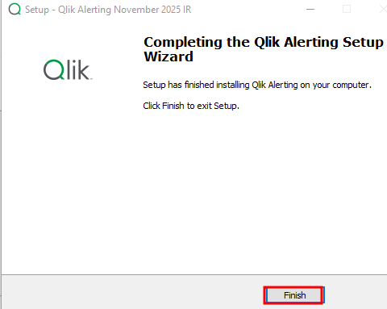

**Description:** The **completion screen** confirmed that QlikView was installed successfully. The tool is now ready to be opened and used.

## **Step 8 – QlikView Launch with Splash Screen**

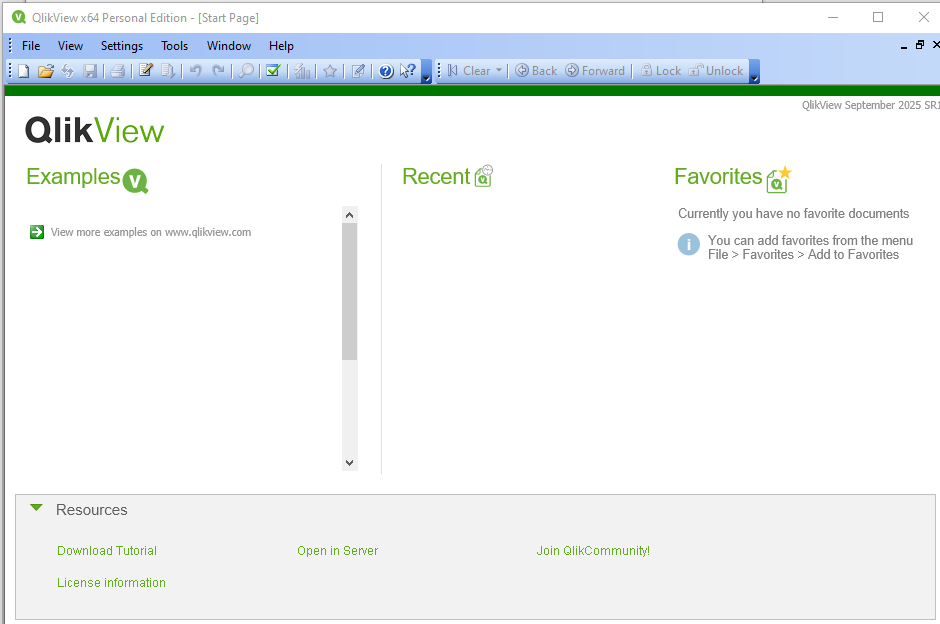

**Description:** QlikView was launched and the **splash screen** appeared with the **version information**. It shows QlikView **September 2025 SR1** running as the **Personal Edition** on Windows x64.

## **Step 9 – QlikView Start Page**

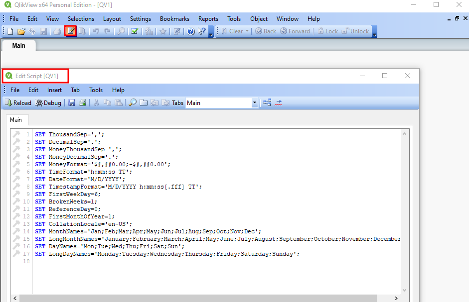

**Description:** After the splash screen closed, the **Start Page** became visible. It has three sections: **Examples**, **Recent** and **Favorites**.

## **Step 10 – Opening Edit Script**

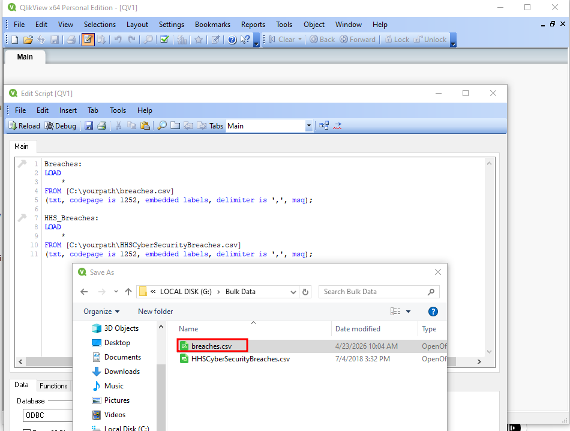

**Description:** The **Edit Script** window was opened with **Ctrl+E** or **File → Edit Script**. This is where the **QlikView load script** is written, and the default **SET statements** are already present at the top.

## **Step 11 – Writing the Initial Load Script**

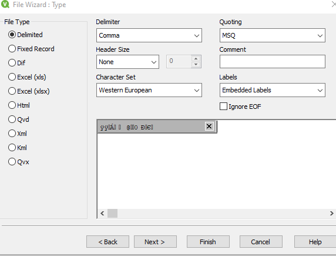

**Description:** A script was written below the default statements to load both CSV files from the **G:\Bulk Data\\** folder. The **LOAD \* FROM** method was used, with **embedded labels** for breaches.csv.

## **Step 12 – Error: Blank Field Name Not Allowed**

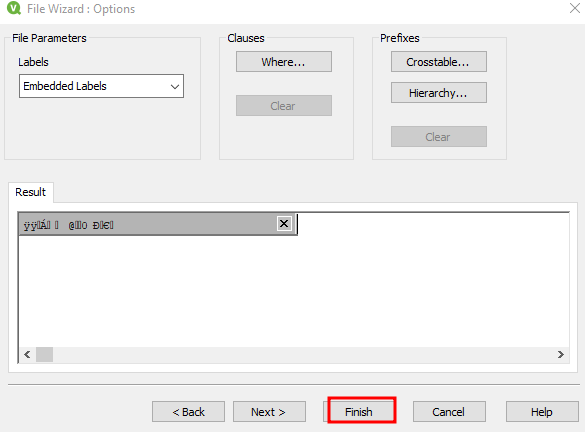

**Description:** On reload with **Ctrl+R**, the error **Blank field name not allowed** appeared. It happened because HHSCyberSecurityBreaches.csv has an **empty column header** in the first row.

## **Step 13 – Table Files Wizard**

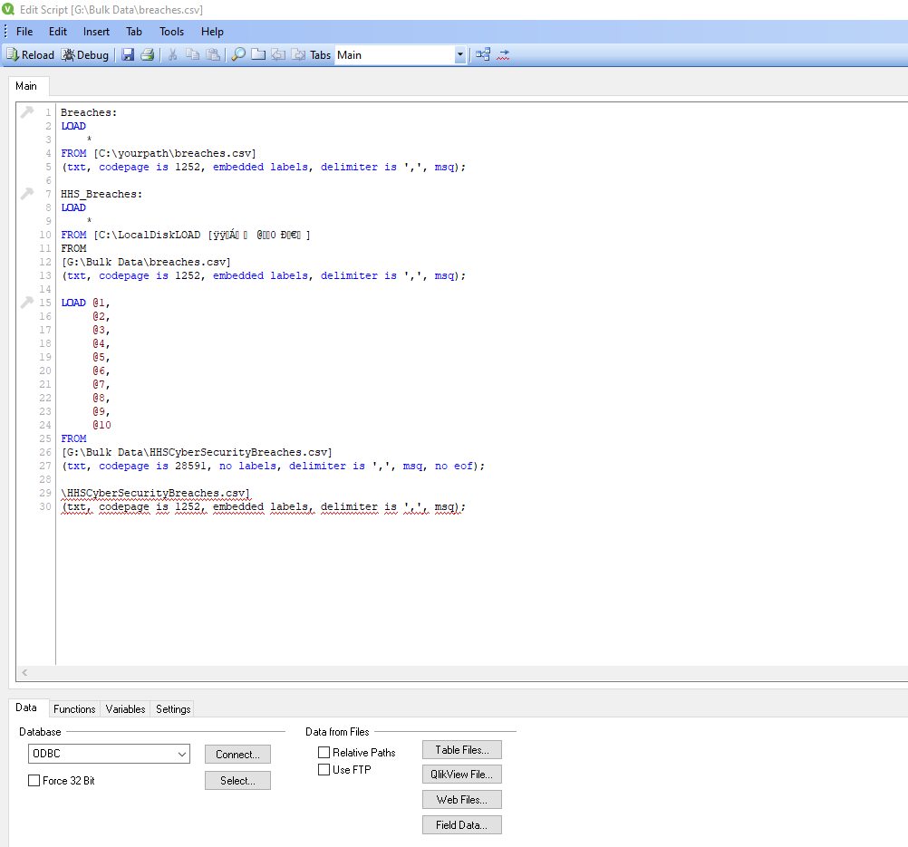

**Description:** The **Table Files...** button in the Script Editor was used as an easier method. This **wizard** detects the **format, delimiter and encoding** of the file automatically.

## **Step 14 – Fix Using No Labels**

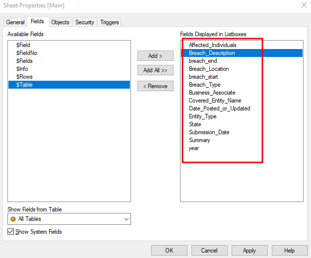

**Description:** The script was updated to use **no labels** for HHSCyberSecurityBreaches.csv. Columns were referenced by **position** (**@1 to @9**), which removed the error.

## **Step 15 – Inspecting breaches.csv**

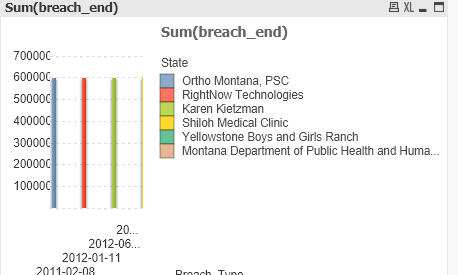

**Description:** breaches.csv was opened in **Excel** to read the real column names. It contains **Date_Posted_or_Updated, Summary, breach_start, breach_end** and **year**.

## **Step 16 – Inspecting HHSCyberSecurityBreaches.csv**

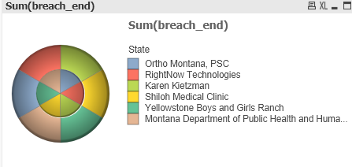

**Description:** The second file was also checked in **Excel** to find its **column headers**. It includes **Covered Entity Name, State, Entity Type, Affected Individuals** and more.

## **Step 17 – Final Script with Proper Column Names**

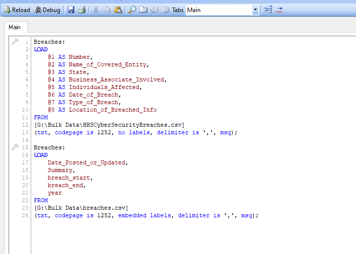

**Description:** The script was rewritten and every positional reference was mapped to a proper name, such as **@1 AS Covered_Entity_Name** and **@2 AS State**. This is the **normalization** step that gives each field a clear **column name**.

## **Step 18 – Data Loaded Successfully**

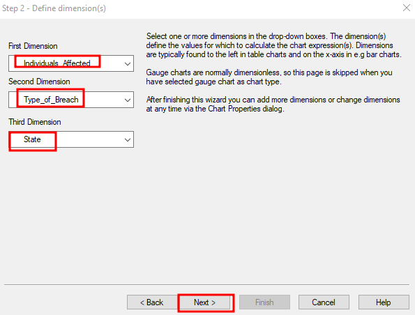

**Description:** The corrected script was reloaded with **Ctrl+R** and the **Script Execution Progress** window finished with no errors. Both tables, **Breaches** and **HHSBreaches**, are now in QlikView memory.

## **Step 19 – Sheet Properties: Available Fields**

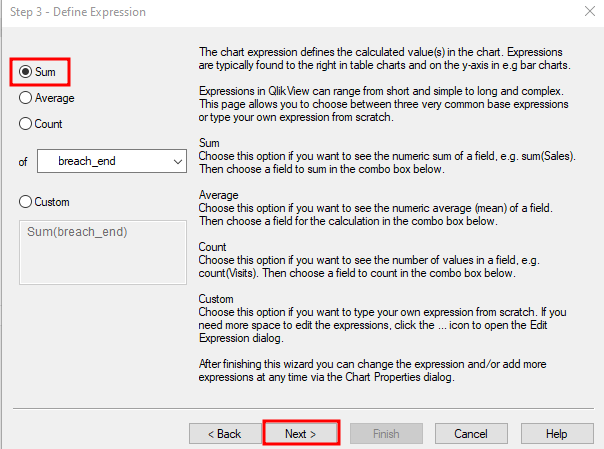

**Description:** The **Sheet Properties** window was opened to check the loaded data. The **Available Fields** list shows all fields from both tables.

## **Step 20 – Adding Fields to Listboxes**

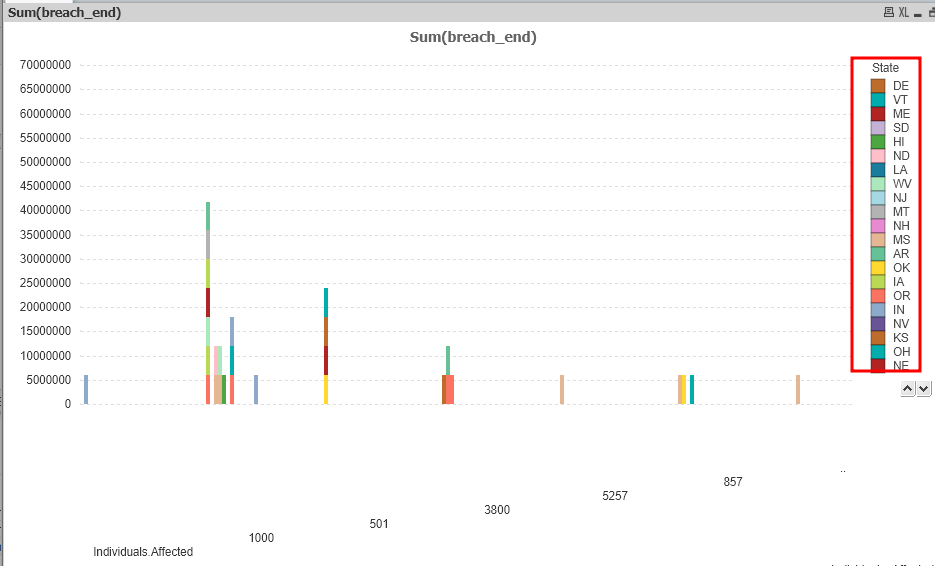

**Description:** Under the **Fields** tab, selected fields were moved to **Fields Displayed in Listboxes**. The fields added were **Breach_Type, Covered_Entity_Name, Entity_Type, State** and **year**.

## **Step 21 – Listboxes on the Sheet**

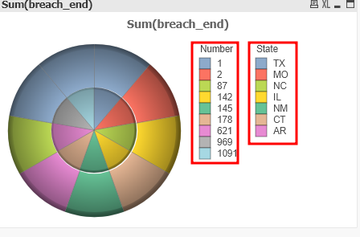

**Description:** The chosen fields now appear as interactive **Listboxes** on the main sheet. They can be clicked to **filter** and explore the data.

## **Step 22 – Complete Field List of Normalized Tables**

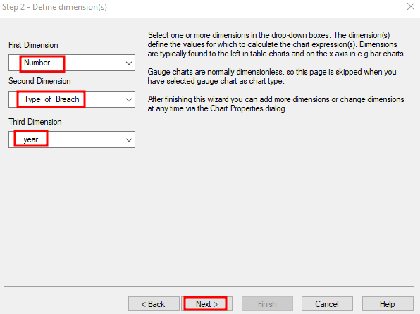

**Description:** The Sheet Properties window was checked again to confirm the **complete field list**. All **normalized fields** from both tables are available.

## **Step 23 – Final Data Model View**

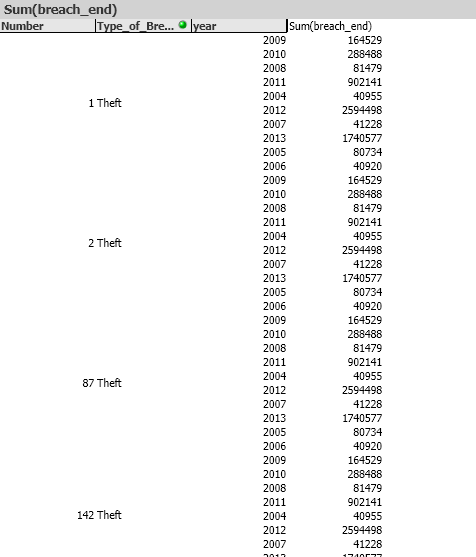

**Description:** This is the final view of the QlikView application with the **data model** fully loaded. The data is **structured, normalized** and ready for **analysis and visualization**.

---

## **What I Learned**

In this lab I learned how to **install and configure QlikView** and how to write a **LOAD script** to import **CSV data**. I learned to handle the **Blank field name not allowed** error using **no labels** and **positional references** (@1, @2, @3). I also learned to use the **Table Files wizard** and to verify loaded data through **Sheet Properties**, **Fields** and **Listboxes**.

## **Conclusion**

QlikView **x64 Personal Edition** was installed and used to load and **normalize CTI data** from **breaches.csv** and **HHSCyberSecurityBreaches.csv**. Assigning **proper column names** turned raw, error-prone files into a clean **data model** that is ready for **analysis**. This lab built a strong base for working with **structured threat intelligence data**.
