

  

# **Data Analysis, Threat Modeling & Reporting Tools**

**Subject:** Cyber Threat Intelligence (CTI)

---

## **Table of Contents**

| **Section** |
| --- |
| [Overview](#overview) |
| [Analysis of Competing Hypotheses (ACH)](#analysis-of-competing-hypotheses-ach) |
| [Threat Modeling with Microsoft Threat Modeling Tool](#threat-modeling-with-microsoft-threat-modeling-tool) |
| [Data Analysis with Zoho Reports](#data-analysis-with-zoho-reports) |
| [Threat Intelligence via AlienVault OTX](#threat-intelligence-via-alienvault-otx) |
| [Threat Intelligence via IBM X-Force Exchange](#threat-intelligence-via-ibm-x-force-exchange) |
| [Comparing OTX vs IBM X-Force](#comparing-otx-vs-ibm-x-force) |
| [What I Learned](#what-i-learned) |
| [Conclusion](#conclusion) |

---

## **Overview**

This documentation covers five **Cyber Threat Intelligence (CTI)** tools used for **data analysis, threat modeling and reporting**. Each section has screenshots with a short description of the method used.

| **No.** | **Tool** | **Purpose** |
| --- | --- | --- |
| **1** | PARC ACH | **Analysis of Competing Hypotheses** to reduce bias |
| **2** | Microsoft Threat Modeling Tool | **STRIDE** threat modeling of a web architecture |
| **3** | Zoho Reports (Zoho Analytics) | **Data analysis** and dashboards for threat data |
| **4** | AlienVault OTX | **Open threat intelligence** and IOC lookup |
| **5** | IBM X-Force Exchange | **IP, domain and malware reputation** analysis |

---

## **Analysis of Competing Hypotheses (ACH)**

The **ACH** technique tests many **competing hypotheses** against the same **evidence** to reduce **cognitive bias**. The **PARC ACH** web tool was used to build and score the matrix.

### **Step 1 – PARC ACH Main Dashboard**

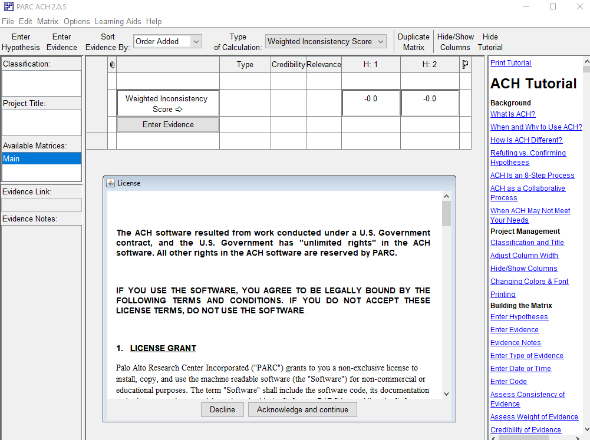

**Description:** The **PARC ACH** tool was opened in the browser and the **main dashboard** appeared. This is the starting point for creating a new analysis.

### **Step 2 – Creating a New Project and Hypotheses**

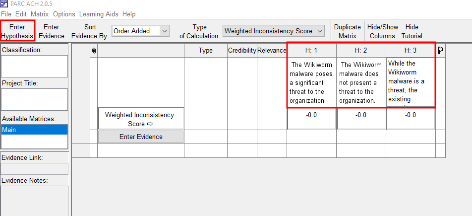

**Description:** A new **ACH project** was created and **three or more competing hypotheses** were entered. Each hypothesis is a possible explanation of the threat or event.

### **Step 3 – Evidence Entry and Matrix**

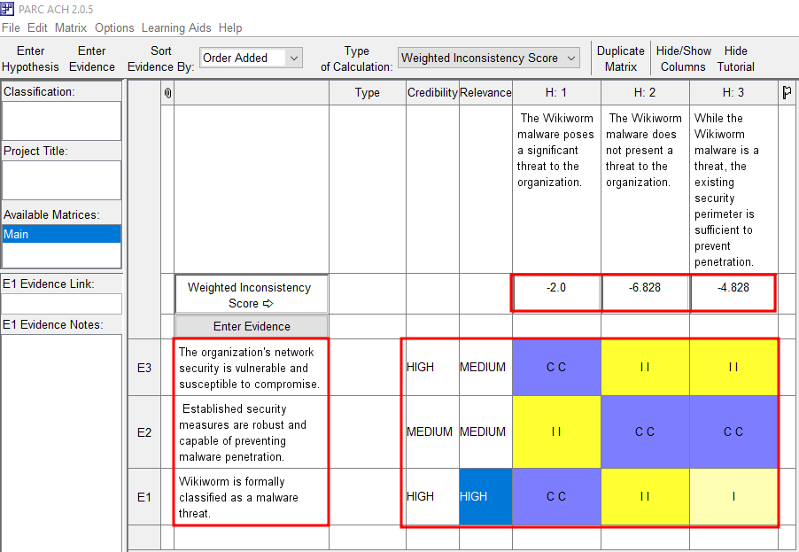

**Description:** All relevant **evidence** from OSINT, logs or threat feeds was added to the list. The **hypothesis matrix** now shows evidence against every hypothesis.

### **Step 4 – Completed Matrix with Scoring**

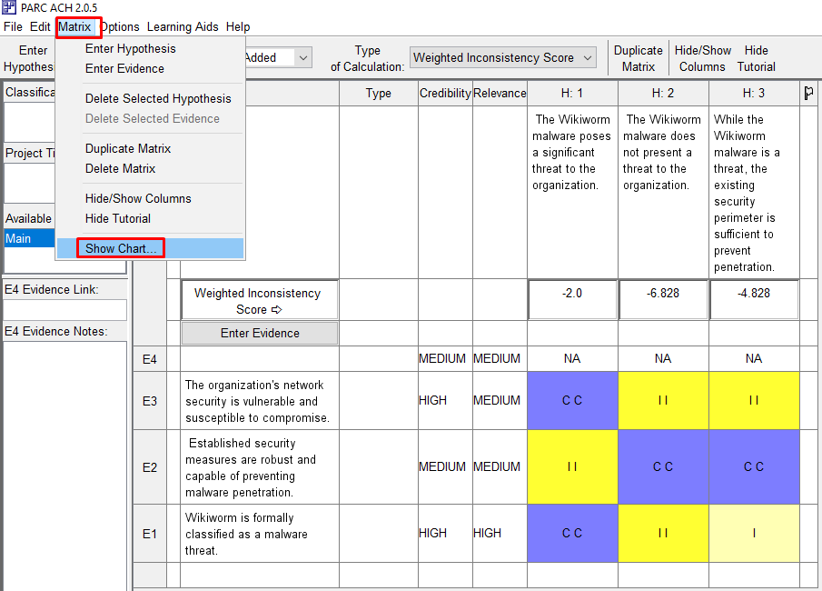

**Description:** Each evidence item was scored as **Consistent (C)**, **Inconsistent (I)** or **Not Applicable (N/A)**. This **scoring method** forces the analyst to test every hypothesis.

### **Step 5 – ACH Result Summary**

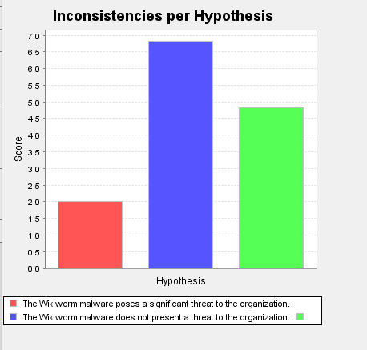

**Description:** The **result summary** view was opened to see the overall outcome. It shows how the hypotheses rank after scoring.

### **Step 6 – Hypothesis Scoring Result**

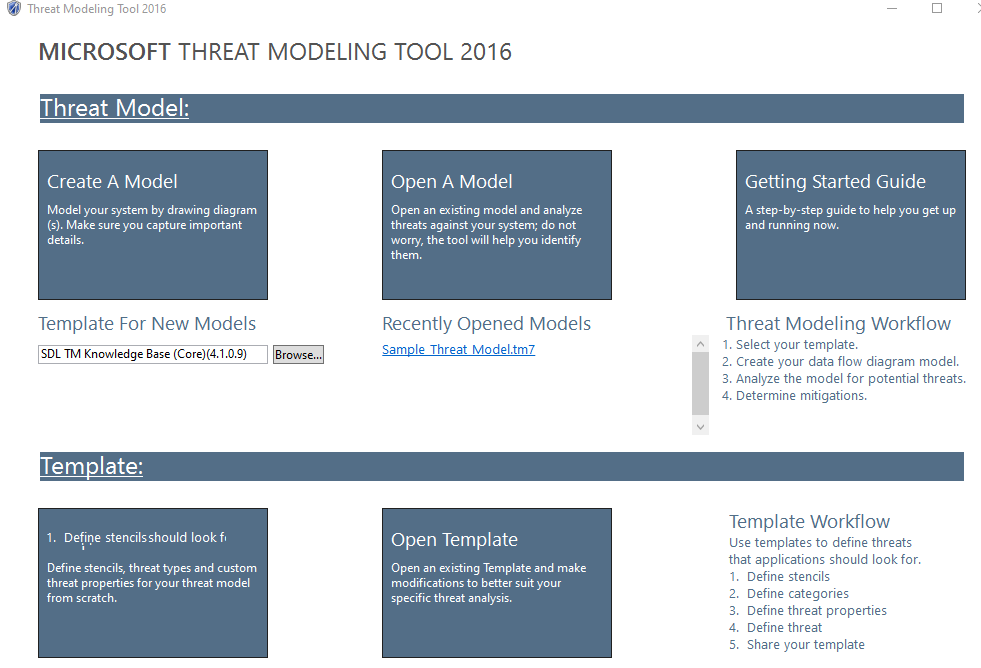

**Description:** The scoring result shows the **most likely** and **least likely** conclusions. The hypothesis with the **most inconsistencies** is the weakest one.

### **Step 7 – Final ACH Analysis Matrix**

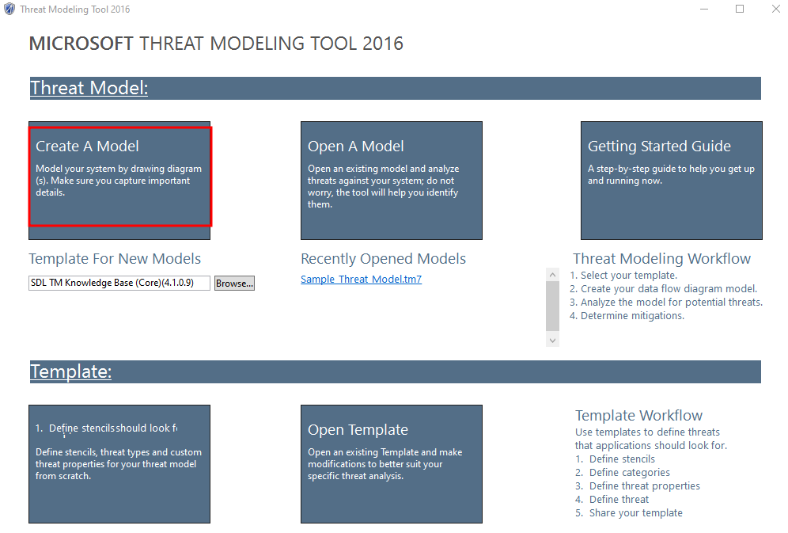

**Description:** The **final matrix** was reviewed with all scores in place. The most plausible hypothesis is the one with the **fewest inconsistencies**.

### **Step 8 – Exporting the ACH Results**

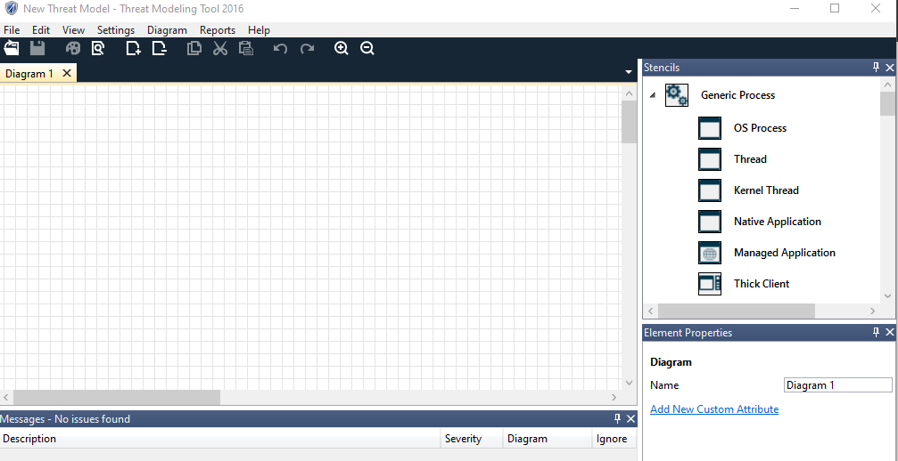

**Description:** The finished analysis was **exported / saved** for documentation. This keeps the **ACH result** available for the final report.

---

## **Threat Modeling with Microsoft Threat Modeling Tool**

**Threat modeling** finds and reduces risks during system design. The **Microsoft Threat Modeling Tool** was used with the **STRIDE** framework: **Spoofing, Tampering, Repudiation, Information Disclosure, Denial of Service** and **Elevation of Privilege**.

**Threat Model Details – Web Request Model:** the tool identified **14 threats**, all listed below by **STRIDE** category.

| **#** | **Threat Name** | **Category** | **Description** |
| --- | --- | --- | --- |
| **1** | **Elevation Using Impersonation** | Elevation of Privilege | Web Application may impersonate the context of Human User to gain additional privilege. |
| **2** | **Cross Site Scripting (XSS)** | Tampering | Web server does not sanitize untrusted input, making it vulnerable to XSS attacks. |
| **3** | **Spoofing Human User (HTTP)** | Spoofing | Human User may be spoofed, leading to unauthorized access to the Web Application. |
| **4** | **Spoofing Human User (HTTP 2)** | Spoofing | Attacker impersonates Human User via second HTTP interaction. |
| **5** | **Cross Site Scripting (HTTP 2)** | Tampering | Second HTTP request path also vulnerable to XSS due to lack of input sanitization. |
| **6** | **Elevation Using Impersonation (HTTP 2)** | Elevation of Privilege | Web Application may gain additional privileges by impersonating Human User. |
| **7** | **Spoofing Cloud Storage (UDP)** | Spoofing | Cloud Storage may be spoofed, causing data to be written to attacker's target. |
| **8** | **Excessive Resource Consumption** | Denial of Service | Web Server or Cloud Storage may not control resource consumption properly. |
| **9** | **Spoofing Cloud Storage (UDP Response)** | Spoofing | Cloud Storage spoofed in UDP response, leading to data redirection. |
| **10** | **DoS via UDP Response** | Denial of Service | Resource consumption via UDP response may cause service disruption. |
| **11** | **XSS via UDP Query** | Tampering | Web Server vulnerable to XSS through UDP query request path. |
| **12** | **Elevation via UDP Query** | Elevation of Privilege | Web Server may impersonate Web Application context to gain privilege. |
| **13** | **XSS via UDP Query Response** | Tampering | Web Server could be subject to XSS in the UDP query response interaction. |
| **14** | **Elevation via UDP Response** | Elevation of Privilege | Web Server may impersonate Web Application in UDP query response. |

### **Step 9 – Tool Startup Screen**

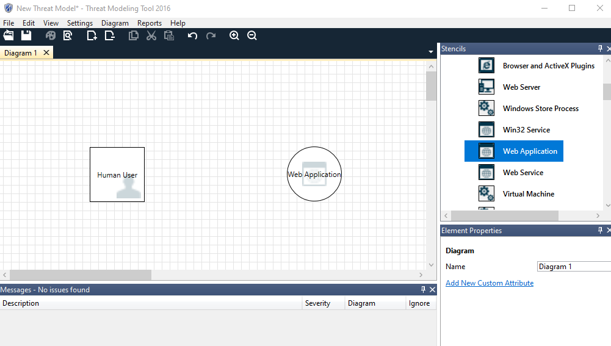

**Description:** The **Microsoft Threat Modeling Tool** was launched and its **startup screen** appeared. From here a new threat model can be created.

### **Step 10 – Creating a New Threat Model**

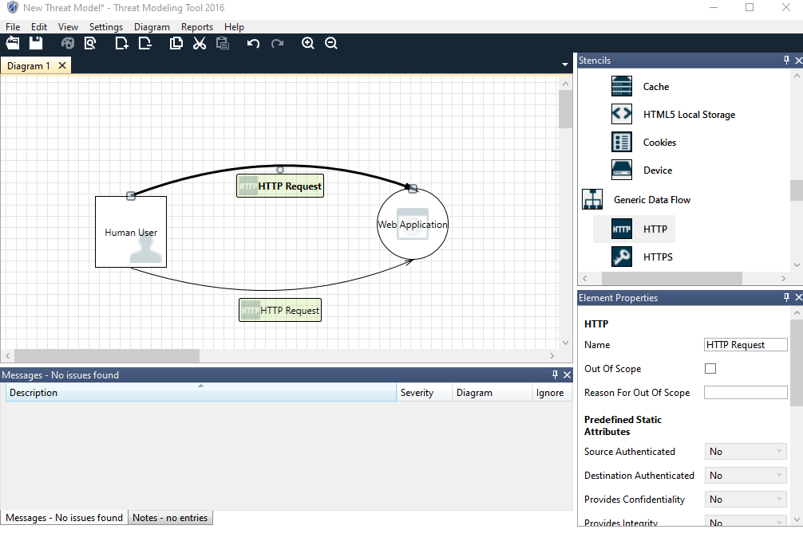

**Description:** A new **threat model** was created by entering the **model name, owner, reviewer** and **contributors**. This sets up the project before drawing the diagram.

### **Step 11 – Diagram Canvas with Elements**

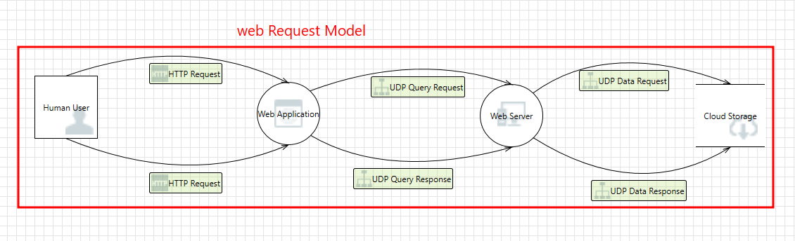

**Description:** The **diagram editor** was opened and elements were dragged onto the canvas. These are **Human User**, **Web Application**, **Web Server** and **Cloud Storage**.

### **Step 12 – Complete Data Flow Diagram**

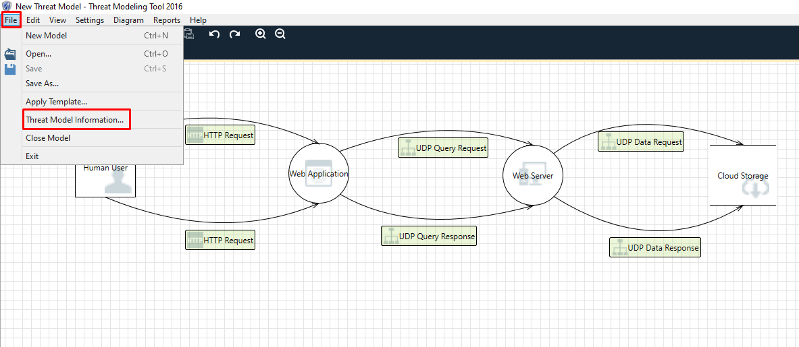

**Description:** The elements were connected with **data flows** such as **HTTP Request** and **UDP Data**. The diagram shows **Human User → Web Application → Web Server → Cloud Storage**.

### **Step 13 – Threat Model Properties**

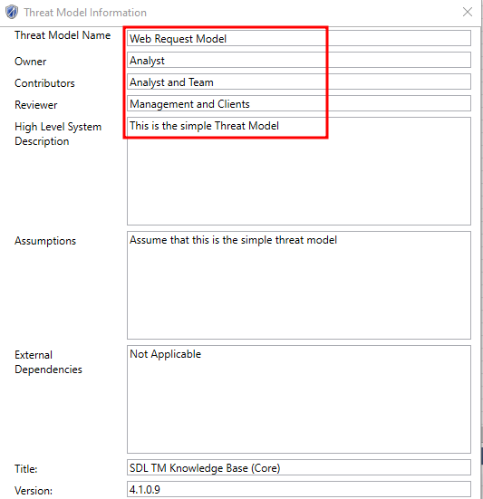

**Description:** The **properties panel** was used to configure the model details. This is needed so the tool can generate threats for each interaction.

### **Step 14 – Auto-Generated STRIDE Threat List**

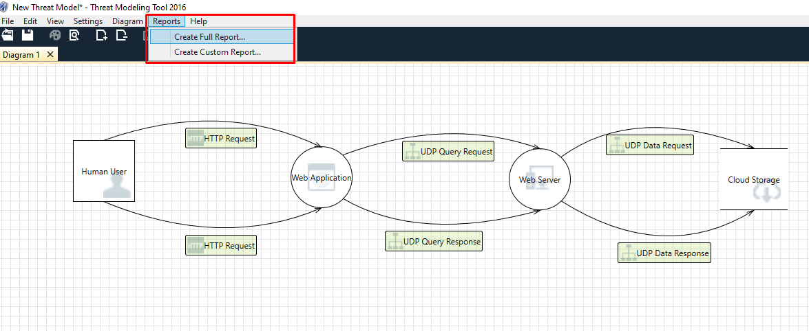

**Description:** The tool automatically created a **STRIDE-based threat list** from the diagram. Every **interaction** gets its own list of possible threats.

### **Step 15 – Threat Summary Statistics**

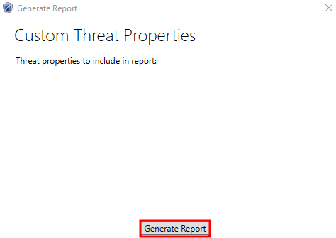

**Description:** The **summary statistics** show that **14 threats** were identified. All of them are listed by **category** and **priority**.

### **Step 16 – Report Header Details**

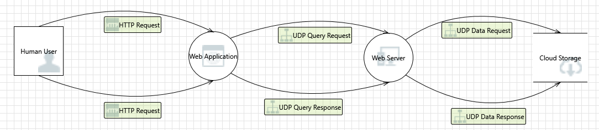

**Description:** The exported **threat model report** starts with a **header** that holds the model details. This is the first page of the documentation.

### **Step 17 – Threat 1: Elevation Using Impersonation**

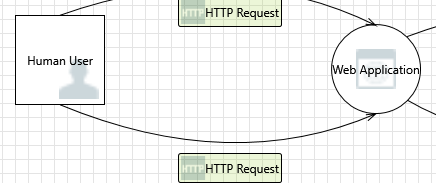

**Description:** Threat 1 shows that the **Web Application** may **impersonate** the Human User to gain more privilege. It belongs to the **Elevation of Privilege** category.

### **Step 18 – Threat 2: Cross Site Scripting**

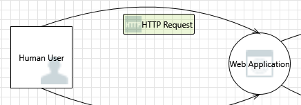

**Description:** Threat 2 explains that the **Web Server** does not **sanitize untrusted input**. This makes it open to **XSS** attacks, a **Tampering** threat.

### **Step 19 – Threat 3: Spoofing of Human User**

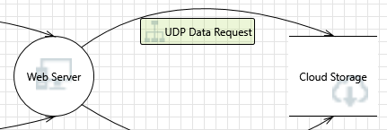

**Description:** Threat 3 shows that the **Human User** can be **spoofed** over HTTP. This may give an attacker **unauthorized access** to the Web Application.

### **Step 20 – Threat 7: Spoofing of Cloud Storage**

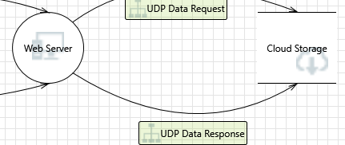

**Description:** Threat 7 shows that **Cloud Storage** can be **spoofed** in the UDP interaction. Data may then be written to the **attacker's target**.

### **Step 21 – Threat 8: Denial of Service**

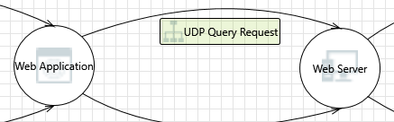

**Description:** Threat 8 shows that the **Web Server** or **Cloud Storage** may not control **resource consumption**. This can lead to a **Denial of Service**.

### **Step 22 – Threat 12: Elevation via UDP Query**

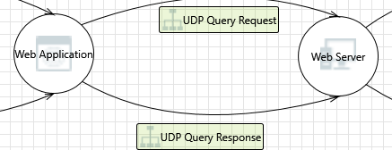

**Description:** Threat 12 shows that the **Web Server** may **impersonate** the Web Application context. This allows **Elevation of Privilege** through the UDP query.

---

## **Data Analysis with Zoho Reports**

**Zoho Reports** (now **Zoho Analytics**) is a cloud **BI** platform used to **import, visualize and analyze** threat data. Here it was used to turn raw **CTI data** into charts and a **dashboard**.

### **Step 23 – Zoho Analytics Main Dashboard**

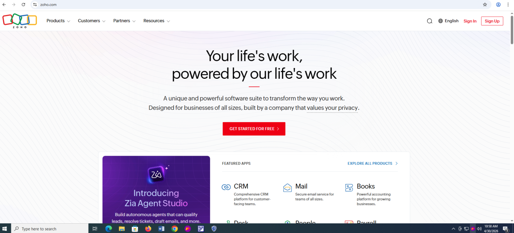

**Description:** The **Zoho Analytics** main dashboard was opened after sign in. It shows the **workspace** where the threat data will be stored.

### **Step 24 – Creating a Table and Importing Data**

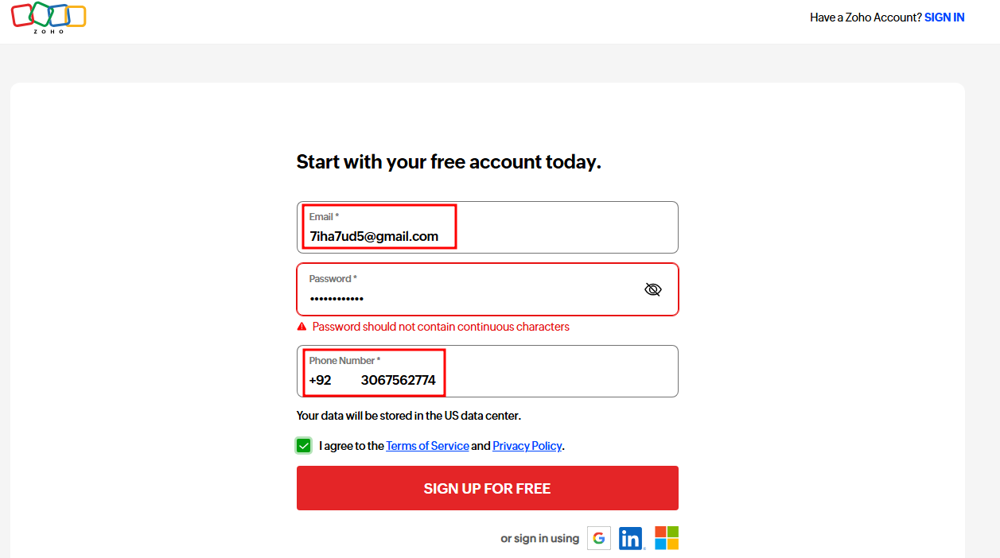

**Description:** A new **workspace** and **table** were created. The threat data was added through **CSV upload** or manual entry.

### **Step 25 – Data Table with Threat Entries**

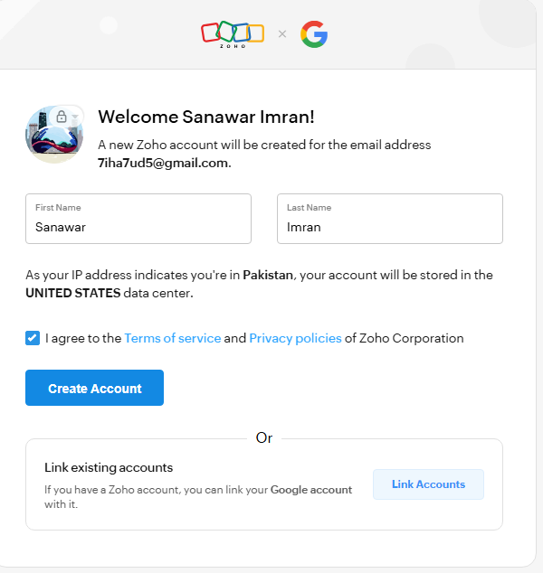

**Description:** The imported **data table** shows the **threat intelligence entries**. This is the base data used for all charts.

### **Step 26 – Chart Builder**

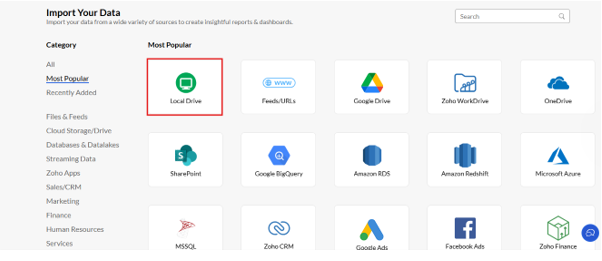

**Description:** The **chart builder** was used to set the **axes** and the **chart type**. **Bar charts, pie charts** and **trend lines** are the most useful for CTI data.

### **Step 27 – Completed Analytical Dashboard**

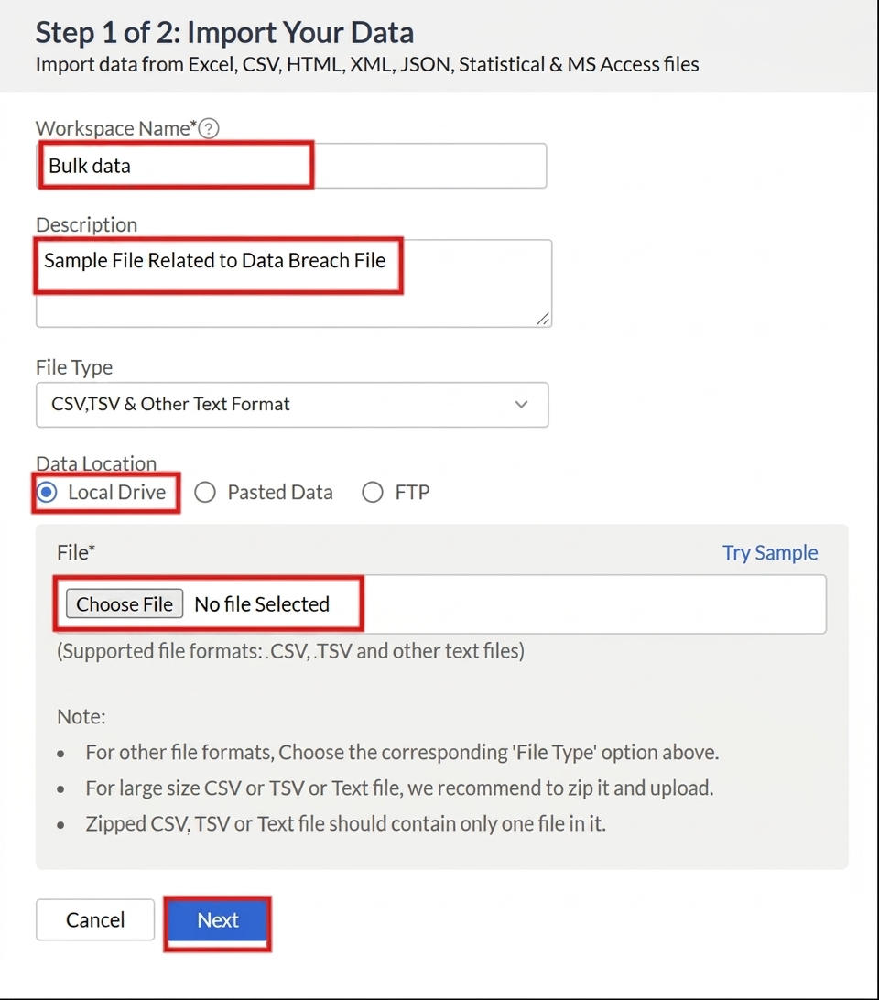

**Description:** Several reports were combined into one **dashboard** with the **threat data visualization**. This view is useful for **executive presentations**.

### **Step 28 – Summary Report Ready for Export**

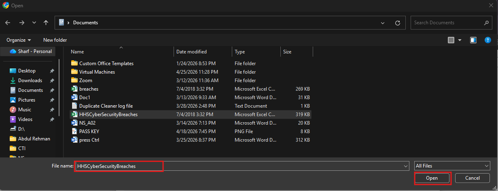

**Description:** The final **summary report** was opened and is ready to be exported. It can be saved as a **PDF** or shared with a **URL**.

---

## **Threat Intelligence via AlienVault OTX**

**AlienVault OTX** is a large open **threat intelligence** community where **Pulses** (collections of **IOCs**) are shared. Each pulse can map threats to **MITRE ATT&CK** techniques.

### **Step 29 – OTX Main Portal and Search**

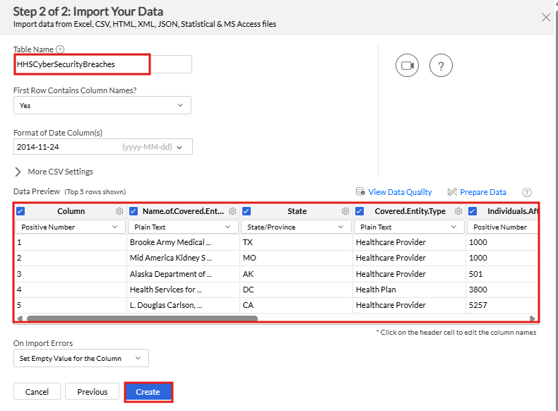

**Description:** The **OTX portal** was opened and the **search interface** was used. IPs, domains, file hashes or CVEs can be searched here.

### **Step 30 – Pulse Detail View**

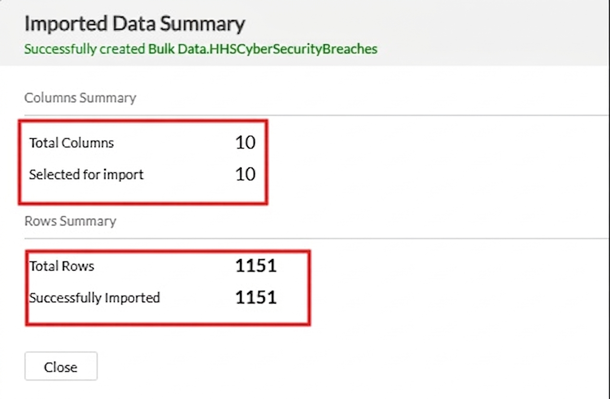

**Description:** A **Pulse** was opened to see its **IOCs**, **MITRE ATT&CK mapping** and **related threat actors**. This gives context about the campaign behind the indicator.

### **Step 31 – IOC Analysis for a Suspicious IP**

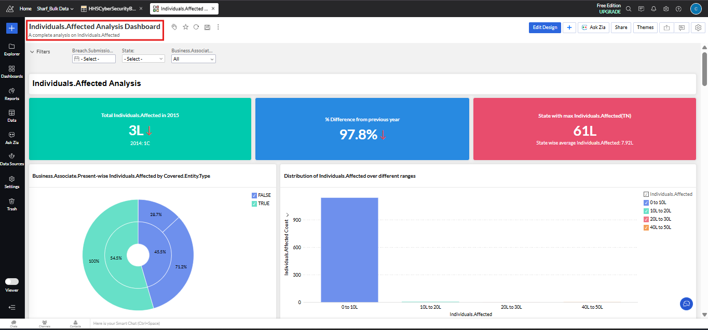

**Description:** A suspicious **IP address** was searched and the **IOC analysis results** appeared. They show whether the IP is linked to known **malware or threat actors**.

---

## **Threat Intelligence via IBM X-Force Exchange**

**IBM X-Force Exchange** is a cloud **threat intelligence** platform with **IP reputation**, **URL analysis** and **malware hash lookup**. It gives a **risk score (1-10)** to help analysts triage indicators.

### **Step 32 – IP Reputation Search**

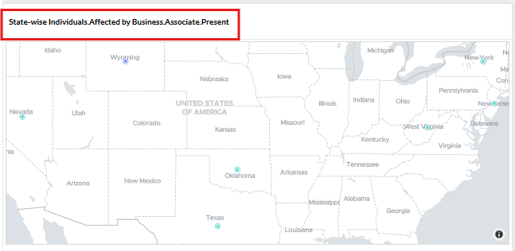

**Description:** The **X-Force Exchange** interface was opened and an IP was searched in the search bar. This starts the **IP reputation** check.

### **Step 33 – Threat Score and Category Breakdown**

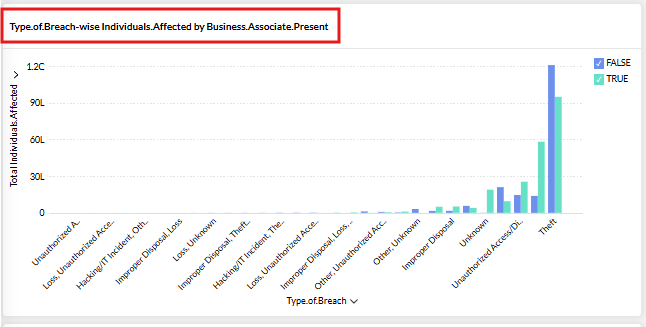

**Description:** The result shows the **threat score** and **category breakdown** for a malicious IP. The **risk score** helps to quickly decide how serious the indicator is.

### **Step 34 – Full Threat Context View**

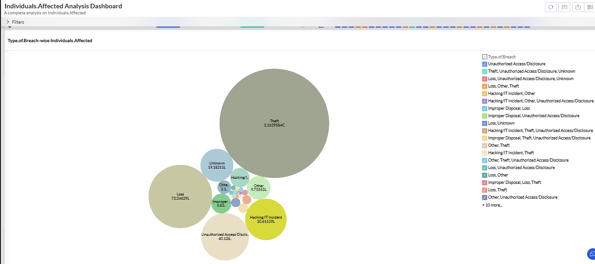

**Description:** The full view shows **DNS history** and **linked malware** for the same indicator. Tabs like **Passive DNS** and **Associated Malware** give the complete context.

## **Comparing OTX vs IBM X-Force**

| **Feature** | **AlienVault OTX** | **IBM X-Force Exchange** |
| --- | --- | --- |
| **Community Model** | Open community, anyone can contribute | Primarily IBM researchers with community input |
| **Data Coverage** | High volume community pulses | Deep commercial-grade threat intelligence |
| **MITRE ATT&CK** | Yes, mapped in each pulse | Partial mapping available |
| **API Access** | Free REST API | Free tier with rate limits |
| **Best For** | OSINT enrichment, open sharing | Enterprise SOC, IP/domain reputation |
| **Cost** | Free | Free tier + paid enterprise plans |

---

## **What I Learned**

From this work I learned how **ACH** reduces **confirmation bias** by scoring evidence against every hypothesis. I learned to build a **data flow diagram** and generate **STRIDE threats** in the Microsoft Threat Modeling Tool, and to make **charts and dashboards** in **Zoho Analytics**. I also learned to search **IOCs** in **AlienVault OTX** and **IBM X-Force Exchange** and to compare both platforms.

## **Conclusion**

All five sections showed how **structured analysis, threat modeling, data visualization** and **threat intelligence feeds** work together in CTI. The **14 threats** found in the baseline model were all **High priority**, which shows how exposed an unprotected web architecture is. Using **OTX** and **X-Force** together gives a more complete picture of any **threat landscape**.
