<div align="center">

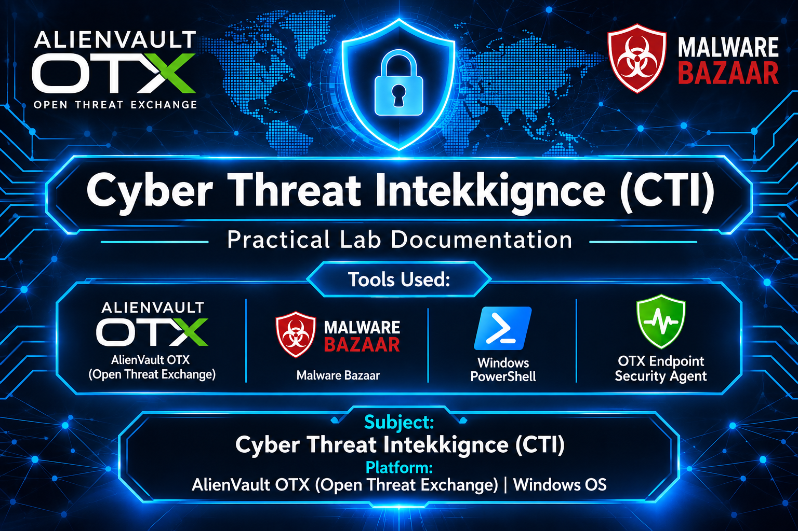

# 🛡️ Cyber Threat Intelligence (CTI) Task

### Practical Lab Documentation — AlienVault OTX & Malware Analysis


**Prepared By:** Sanawar Imran &nbsp;|&nbsp; **Roll No:** 243633

**Subject:** Cyber Threat Intelligence

</div>

---

## 🧰 Tools Used

| Item | Details |
|------|---------|
| **Tools** | AlienVault OTX, Malware Bazaar, Windows PowerShell, OTX Endpoint Security Agent |
| **Platform** | AlienVault OTX (Open Threat Exchange), Windows OS |
| **Task** | Practical Lab on AlienVault OTX & Malware Analysis |

## 📑 Table of Contents

| Section | Description |
|---------|-------------|
| [Introduction](#introduction) | Overview of the lab, AlienVault OTX and Malware Bazaar |
| [Login to AlienVault OTX Platform](#login-to-alienvault-otx-platform) | Signing in to the OTX platform and accessing the dashboard |
| [Exploring Malware Categories](#exploring-malware-categories) | Browsing and filtering threat data by malware category |
| [Trojan Category — Detailed Analysis](#trojan-category--detailed-analysis) | Viewing pulses and indicators related to Trojan malware |
| [Related Pulses and Subscribed Pulses](#related-pulses-and-subscribed-pulses) | Switching between related pulses and subscribed pulses |
| [Exploring More Pulses](#exploring-more-pulses) | Loading additional pulses to widen the investigation |
| [Pulse Details and Indicators](#pulse-details-and-indicators) | Reading pulse descriptions, indicators, tags and references |
| [User Group Creation Features](#user-group-creation-features) | Creating and managing groups for collaborative threat sharing |
| [Download Options in OTX](#download-options-in-otx) | Exporting threat intelligence data in different formats |
| [Endpoint Security Analysis on AlienVault OTX](#endpoint-security-analysis-on-alienvault-otx) | Understanding the OTX Endpoint Security Agent |
| [Downloading OTX Endpoint Security Agent for Windows](#downloading-otx-endpoint-security-agent-for-windows) | Getting the Windows agent installer |
| [Windows PowerShell — Running as Administrator](#windows-powershell--running-as-administrator) | Opening PowerShell with elevated privileges |
| [Running Commands in Windows PowerShell](#running-commands-in-windows-powershell) | Installing and configuring the agent with commands |
| [Agent Successfully Connected](#agent-successfully-connected) | Confirming the agent is connected to OTX |
| [Malware Bazaar — Introduction](#malware-bazaar--introduction) | Overview of the Malware Bazaar repository |
| [Downloading Malware Sample from Malware Bazaar](#downloading-malware-sample-from-malware-bazaar) | Safely downloading a sample for analysis |
| [Malware Running in the Background](#malware-running-in-the-background) | Observing the sample's background activity |
| [Malware Analysis Results](#malware-analysis-results) | Reviewing the behavior recorded during execution |
| [OTX Dashboard Overview](#otx-dashboard-overview) | Exploring the main OTX dashboard |
| [Related Pulses — Dashboard View](#related-pulses--dashboard-view) | Finding related pulses from the dashboard |
| [Creating YARA Rules](#creating-yara-rules) | Writing YARA rules from the analysis findings |
| [Creating a Custom Windows Indicator Pulse](#creating-a-custom-windows-indicator-pulse) | Building a custom pulse with indicators |
| [Pulse Successfully Created](#pulse-successfully-created) | Confirming the new pulse on the platform |
| [New Indicator Creation](#new-indicator-creation) | Adding a new indicator in OTX |
| [Conclusion and What I Learned](#conclusion-and-what-i-learned) | Key takeaways, skills acquired and reflection |

## 📁 Repository Structure

```text
.
├── README.md
└── images/
    ├── ai.png
    ├── image_01.png
    ├── ...
    └── image_55.png
```

---

## Introduction

This document presents a comprehensive practical lab report on Cyber Threat Intelligence (CTI) using the AlienVault OTX (Open Threat Exchange) platform and Malware Bazaar. The task involved hands-on exploration of threat intelligence features including malware categorization, pulse analysis, YARA rule creation, endpoint security agent deployment, and malware behavioral analysis. Every step of the process has been documented with screenshots and explanations to demonstrate understanding of each feature and operation performed.

AlienVault OTX is a globally recognized, open threat intelligence community that enables security researchers and analysts to collaboratively share and study cyber threat data. Malware Bazaar complements this by providing a repository for malware samples that can be used for analysis and testing in controlled environments.

---

## Login to AlienVault OTX Platform

The first step in this practical task was to log into the AlienVault OTX (Open Threat Exchange) platform. AlienVault OTX is a community-driven threat intelligence platform where security researchers share indicators of compromise (IOCs), malware samples, and threat data. Upon successful login, the user gains access to the full dashboard including pulses, indicators, and analysis tools.

The platform offers a clean, user-friendly interface that displays subscribed pulses, trending threats, and community activity. Logging in allows users to access personalized feeds, create their own pulses, and interact with the global threat intelligence community. The login process is secured with standard authentication mechanisms to protect user accounts and sensitive data.

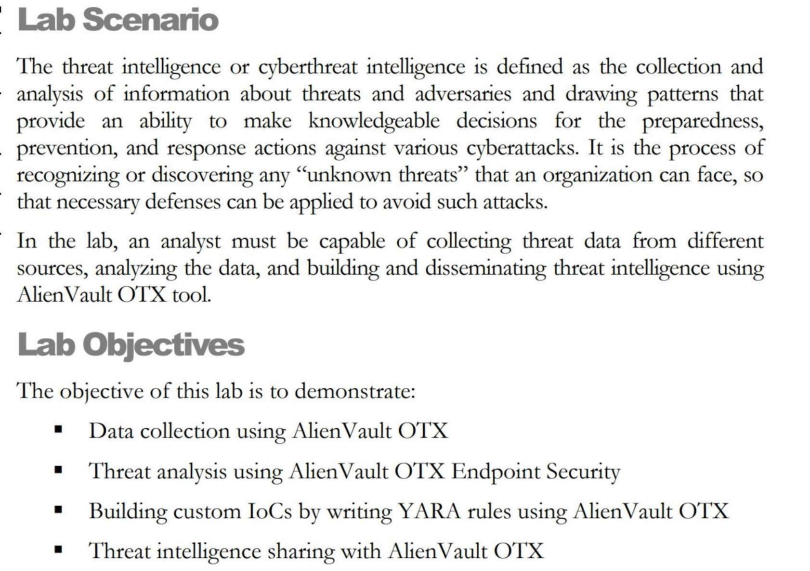

**Description:** This screenshot shows the successful login screen of the AlienVault OTX platform. The interface confirms authentication was completed and the user is now inside the OTX dashboard environment with full access to all platform features.

---

## Exploring Malware Categories

After logging in, the next step was to explore the malware categories available on the OTX platform. AlienVault OTX organizes threat data into various malware categories to help analysts quickly filter and identify relevant threat types. These categories include Trojan, Ransomware, Spyware, Adware, Worms, and many more — each representing a different family or behavior type of malware.

Browsing through malware categories allows analysts to scope their investigation to specific threat types. This is especially useful when investigating incidents where a particular type of malware is suspected. The categorization system helps streamline the threat intelligence workflow by reducing noise and presenting only the most relevant threat data to the analyst.

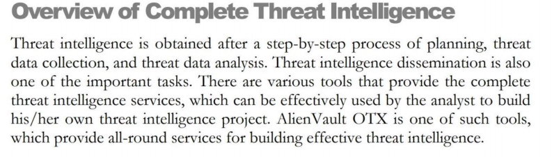

**Description:** This screenshot shows the malware categories panel within the AlienVault OTX platform. The interface clearly lists different types of malware families, allowing the user to filter and navigate threat intelligence data by specific malware type.

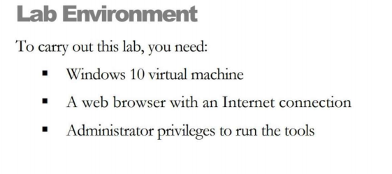

**Description:** A closer view of the categories selection panel. The user can see specific category labels and can click any category to narrow down pulse results to only that malware type, streamlining the search for relevant threat information.

---

## Trojan Category — Detailed Analysis

Selecting the Trojan category from the malware categories list filters the OTX platform to display only threat intelligence pulses related to Trojan malware. Trojans are among the most dangerous and commonly encountered types of malware. They disguise themselves as legitimate software but execute malicious payloads once installed, which may include data theft, remote access, or system damage.

By clicking on the Trojan category, the OTX platform immediately updates the pulse feed to display all threat data specifically tagged or associated with Trojan malware. This allows the analyst to investigate Trojan-related indicators of compromise (IOCs), associated IP addresses, file hashes, and domains in a focused manner.

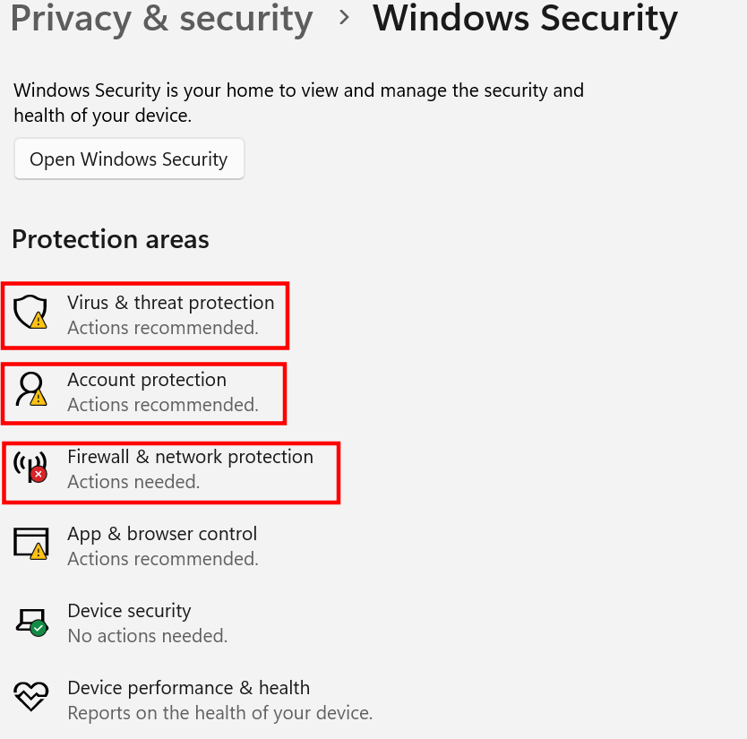

**Description:** This screenshot captures the result after selecting the Trojan category. The platform now displays all pulses and threat data specifically tagged under the Trojan malware family, showing related indicators and pulse details.

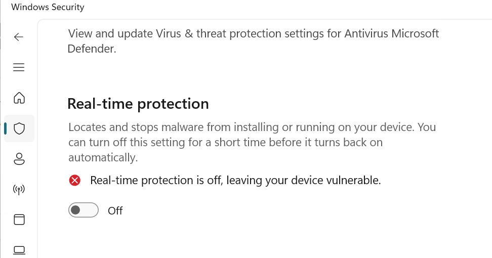

**Description:** An expanded view of the Trojan category results page. Multiple pulses are visible, each containing specific threat intelligence data such as malware hashes, domains, and descriptions associated with Trojan threats.

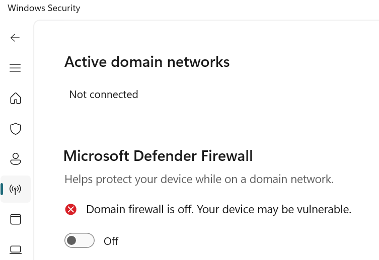

**Description:** This screenshot shows additional detail when browsing through Trojan-related pulses. The platform provides rich metadata for each pulse including creation date, author, indicators count, and a brief description of the threat.

---

## Related Pulses and Subscribed Pulses

The Related Pulses section on OTX displays threat pulses that are related to the currently selected malware or threat category. These related pulses help analysts identify connections between different threats, discover new malware families linked to the same threat actor, or find previously unknown attack vectors associated with a known threat. This feature greatly enhances the depth of threat intelligence research.

When the malware selection is cleared or reset, the platform switches back to showing Subscribed Pulses — these are pulses that the user has actively chosen to follow. Subscribed pulses form a personalized threat intelligence feed, keeping the analyst updated on specific threats they are monitoring. This dual-mode view allows for both broad exploration and focused monitoring.

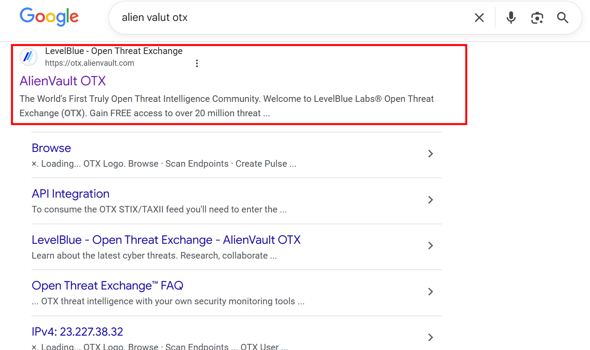

**Description:** This screenshot shows the Related Pulses section, where pulses associated with the selected malware category are displayed. The list includes threat names, author information, and indicator counts for each related pulse.


**Description:** After clearing the malware category selection, the platform reverts to displaying Subscribed Pulses. This view shows all the threat intelligence feeds the user has subscribed to, providing a personalized and curated threat intelligence experience.

---

## Exploring More Pulses

The 'More Pulses' option on the OTX platform expands the view beyond the default displayed results to show a broader range of threat intelligence pulses. This is useful when the initial filtered results do not contain sufficient information and the analyst needs to explore additional pulses to find relevant threat data. Clicking 'More Pulses' dynamically loads additional entries from the OTX database.

Exploring more pulses helps analysts uncover less prominent but potentially critical threat intelligence that may not appear in the default view. It enables a more thorough investigation, especially when tracking advanced persistent threats (APTs) or newly emerging malware families that may not yet have a large number of associated pulses.

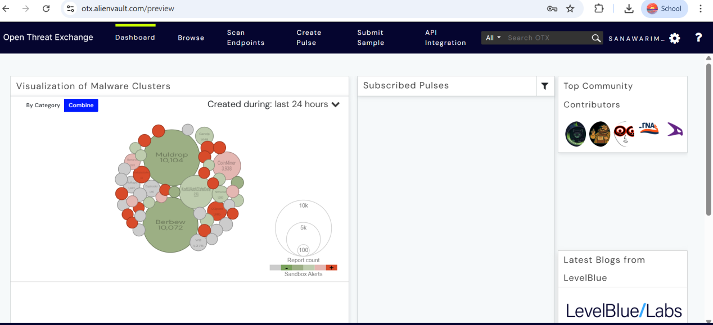

**Description:** This screenshot shows the result after clicking 'More Pulses'. Additional threat intelligence pulses are now displayed beyond the initial results, providing a wider view of the threat landscape and more options for the analyst to explore.

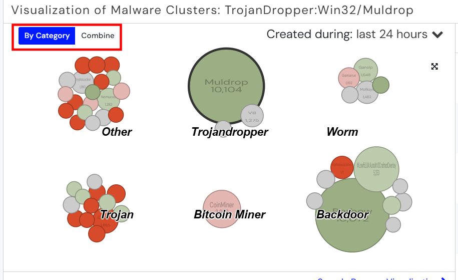

**Description:** A further expanded view of additional pulses available on the platform. Each pulse entry includes the pulse name, author, creation date, and the number of indicators associated with it, helping the analyst prioritize which pulses to investigate further.

---

## Pulse Details and Indicators

When a specific pulse is clicked, the OTX platform displays a detailed view of that pulse including its full description, all associated indicators of compromise (IOCs), tags, references, and contributor information. This detailed view is the core of the threat intelligence workflow — analysts can extract specific file hashes, IP addresses, domain names, and URLs to block or monitor in their security infrastructure.

The pulse detail page also shows relationships between the selected pulse and other related pulses, providing a more comprehensive picture of the threat. Indicators can be downloaded in various formats for integration with SIEM tools, firewalls, or endpoint security systems, making OTX a practical and actionable threat intelligence source.

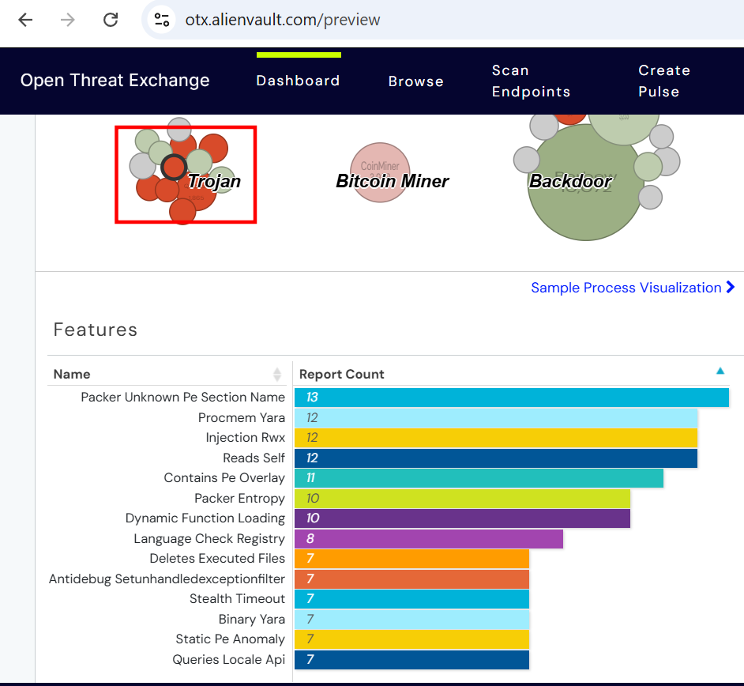

**Description:** This screenshot shows the detailed view of a selected pulse. The full pulse description, all indicators of compromise, associated tags, and references are visible, giving the analyst complete information about the specific threat being investigated.

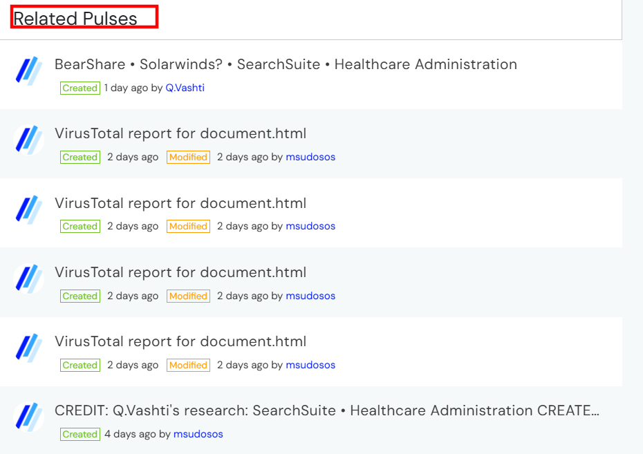

**Description:** An additional view of pulse details showing the list of indicators within the pulse. Each indicator is categorized by type such as IPv4, domain, file hash, or URL, along with metadata that helps identify the relevance and severity of each threat indicator.

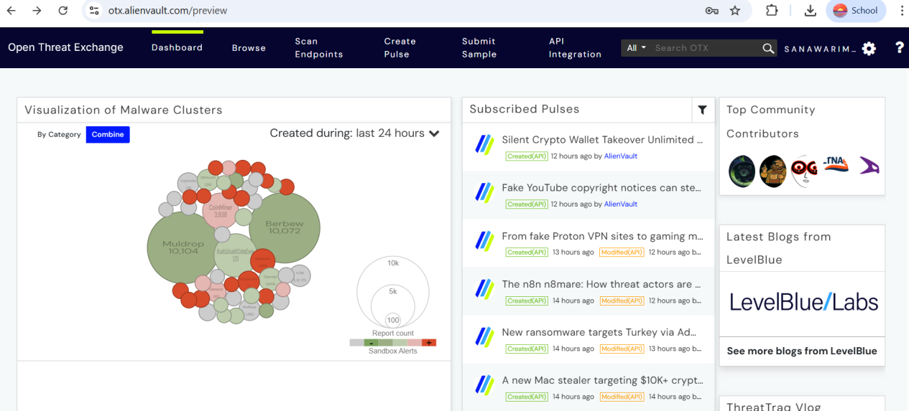

**Description:** This screenshot captures the lower section of the pulse detail page, showing more indicators and reference links. The platform provides direct access to external references and related reports that analysts can use to further investigate the threat.

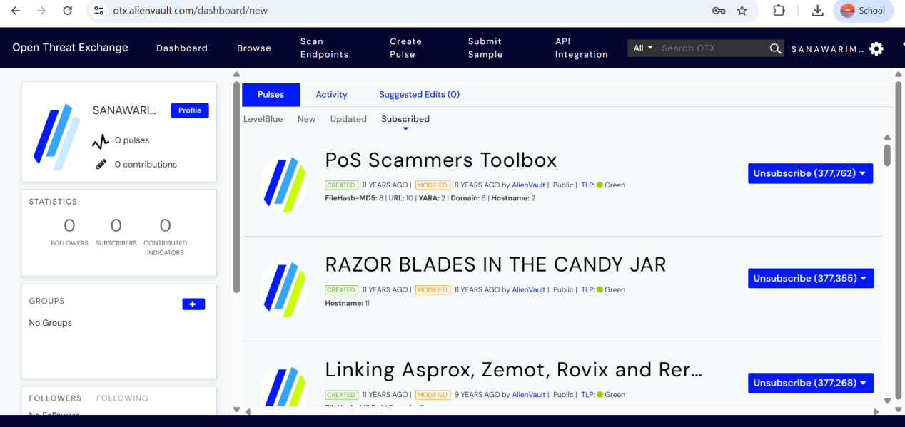

**Description:** A continuation of the pulse details, showing additional indicator data and supporting information. The breadth of indicators available confirms that this pulse contains substantial threat intelligence that can be operationalized immediately.

---

## User Group Creation Features

AlienVault OTX provides features for users to create and manage groups within the platform. These group features allow organizations, teams, or individual researchers to collaborate by sharing threat intelligence data within a closed or semi-open group environment. Groups can have specific members, defined roles, and customized access levels.

Creating a group on OTX enables collaborative threat hunting, where multiple analysts can contribute to the same pulse or share indicators privately before publishing to the broader community. This feature is particularly valuable for enterprise security teams that need to maintain some level of confidentiality while still benefiting from collaborative threat intelligence sharing.

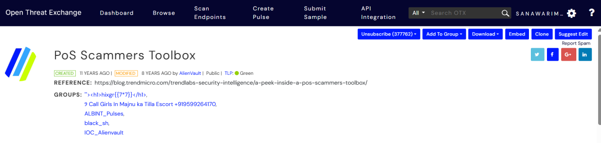

**Description:** This screenshot shows the Group Creation features available on the OTX platform. The interface displays options for creating a new group, setting group visibility, and managing group membership for collaborative threat intelligence work.

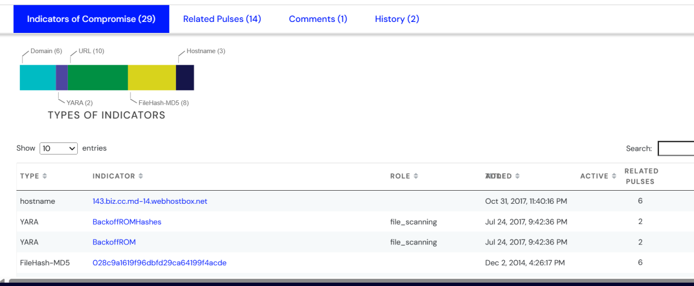

**Description:** An expanded view of the group management options. Users can configure group settings, invite members, and define the purpose or scope of the group for organized and secure sharing of threat intelligence within teams or organizations.

---

## Download Options in OTX

The Download section within AlienVault OTX provides users with the ability to export threat intelligence data in various formats for offline analysis or integration with other security tools. Available formats may include CSV, JSON, STIX, OpenIOC, and others — each suited for different security applications and tools.

The download functionality is critical for operationalizing threat intelligence. By downloading indicators in the appropriate format, security teams can import IOCs directly into their SIEM platforms, intrusion detection systems, endpoint protection tools, or firewalls. This bridges the gap between raw threat intelligence and active defensive measures within an organization's security infrastructure.

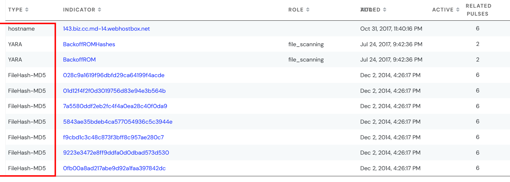

**Description:** This screenshot displays the Download Options section of the OTX platform. Multiple download format options are available, allowing users to export threat intelligence data in the format most suitable for their security tools and workflows.

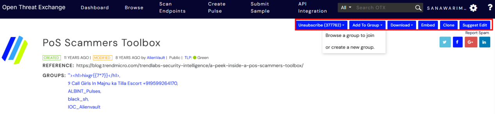

**Description:** A closer view of specific download format options. The platform supports various export formats including structured data formats that can be directly imported into popular SIEM and threat intelligence tools used by security operations centers.

---

## Endpoint Security Analysis on AlienVault OTX

Endpoint security analysis is a critical component of the AlienVault OTX platform. OTX provides an Endpoint Security Agent that can be deployed on Windows, macOS, or Linux systems to monitor for threats and report findings back to the OTX platform. This agent scans the endpoint for known IOCs, suspicious processes, and potential malware activity.

The endpoint security feature bridges the gap between threat intelligence and active monitoring. By deploying the OTX agent on a system, security analysts can validate whether a machine has been exposed to specific threats documented in OTX pulses. This makes it a valuable tool for incident response, threat hunting, and proactive security monitoring in organizational environments.

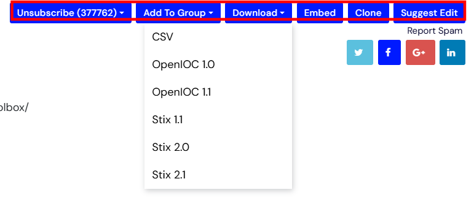

**Description:** This screenshot shows the Endpoint Security section of the OTX platform. The interface provides information about the endpoint security capabilities and options available for deploying agents to monitored systems.

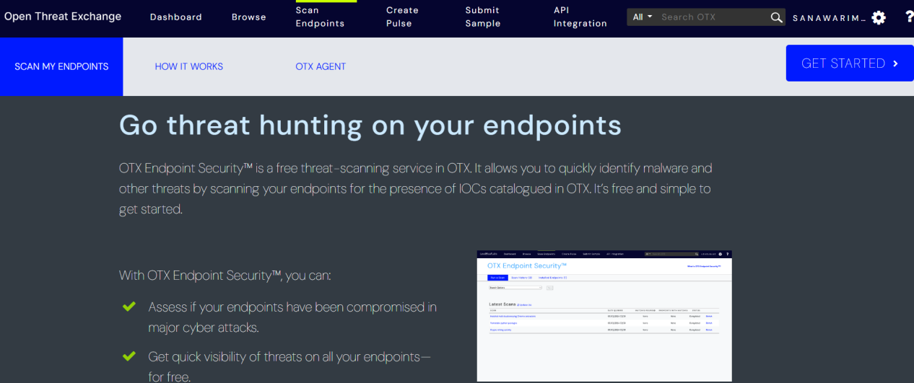

**Description:** A detailed view of the endpoint security configuration options. Users can see the available agents for different operating systems and the steps required to connect an endpoint to the OTX platform for continuous threat monitoring.

---

## Downloading OTX Endpoint Security Agent for Windows

To begin the endpoint security analysis, the OTX Endpoint Security Agent must first be downloaded for the Windows operating system. The download process is straightforward — users navigate to the endpoint security section of the platform and select the appropriate agent for their OS. The Windows agent comes as a standard installer package.

Once downloaded, the agent needs to be installed on the target Windows system. The installation process sets up the agent as a background service that continuously monitors the system for threats. The agent communicates with the OTX platform to compare local activity against known threat indicators, providing real-time threat intelligence coverage at the endpoint level.

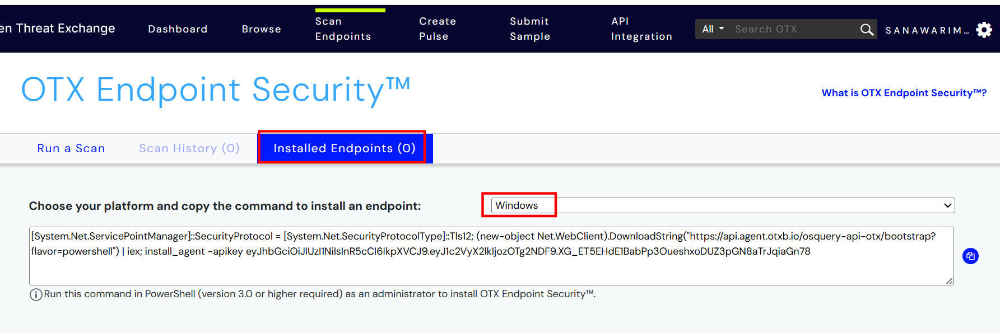

**Description:** This screenshot shows the download page for the OTX Endpoint Security Agent for Windows. The download link and instructions are clearly displayed, making it easy for users to obtain the correct agent version for their Windows system.

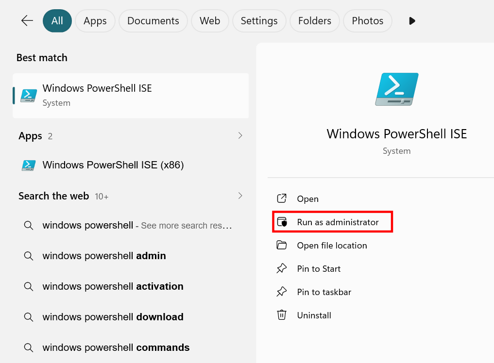

**Description:** The download process is underway, showing the Windows installer file being retrieved. This agent installer package will be used to set up the OTX endpoint monitoring service on the Windows machine for threat detection and reporting.

---

## Windows PowerShell — Running as Administrator

After downloading the OTX Endpoint Security Agent installer, the next step involves using Windows PowerShell to execute installation commands. PowerShell must be run with Administrator privileges to allow the agent to install its services and access system-level resources. This is a standard requirement for security agent installations on Windows.

Running PowerShell as Administrator grants elevated permissions necessary for writing to protected directories, registering Windows services, and configuring firewall rules. The OTX agent relies on these elevated permissions to properly integrate with the Windows OS and maintain persistent monitoring without being disrupted by standard user-level security restrictions.

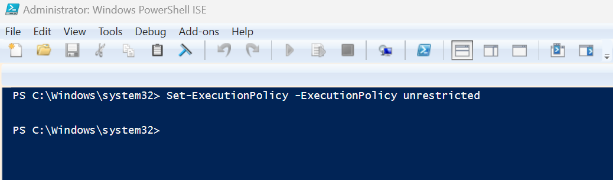

**Description:** This screenshot shows Windows PowerShell being opened with Administrator privileges. The elevated prompt is required to execute the OTX agent installation commands and ensure the agent has the necessary system access for proper operation.

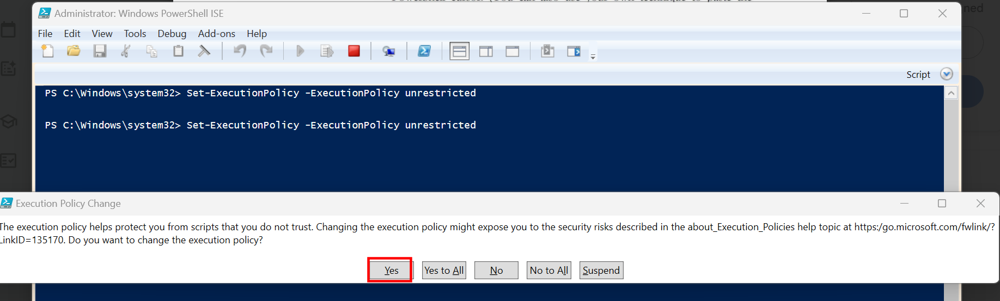

**Description:** The PowerShell terminal is now open with Administrator rights, ready to receive and execute commands. The command prompt confirms Administrator status, which is essential for the successful installation and configuration of the OTX Endpoint Security Agent.

---

## Running Commands in Windows PowerShell

With PowerShell running in Administrator mode, the necessary commands to install and configure the OTX Endpoint Security Agent are executed. The commands typically include navigating to the download directory, running the installer, and providing the OTX API key to link the agent to the user's OTX account for reporting and monitoring.

Executing these commands correctly is essential for the agent to establish a successful connection with the OTX backend. Any errors during this step — such as incorrect API key, network issues, or insufficient permissions — will prevent the agent from connecting. The PowerShell output provides real-time feedback on the installation progress and any errors that occur.

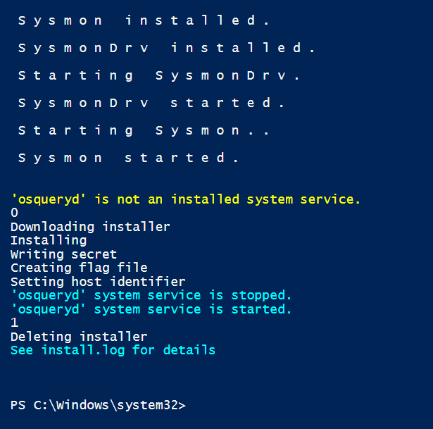

**Description:** This screenshot captures the PowerShell terminal with commands being entered to install and configure the OTX Endpoint Security Agent. The command output shows the installation process progressing through various setup stages.

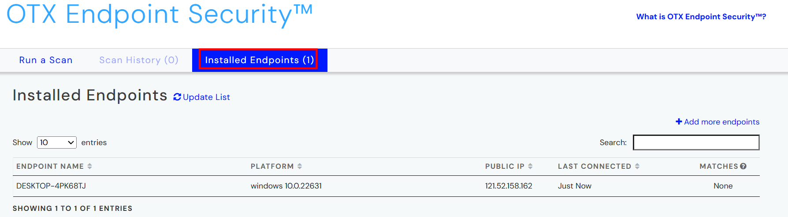

**Description:** Additional command execution is shown in this screenshot, with the terminal displaying output from the agent installation. The process involves multiple steps including service registration, configuration file setup, and initial connection testing with the OTX server.

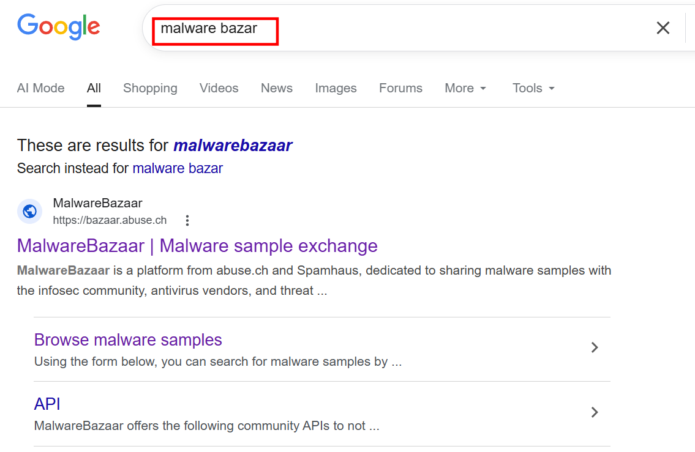

**Description:** The terminal output at a later stage of the installation shows the agent completing its setup procedure. Each line of output confirms a successful step in the configuration process, bringing the agent closer to establishing its live connection with the OTX platform.

---

## Agent Successfully Connected

After successfully running all the required PowerShell commands, the OTX Endpoint Security Agent establishes a connection with the AlienVault OTX backend. This connection is confirmed by a success message displayed in the PowerShell terminal and, subsequently, the agent appearing as 'Connected' in the OTX platform's endpoint security dashboard.

A successfully connected agent begins its monitoring routine immediately after connection. It scans the endpoint for known malicious files, suspicious processes, network connections, and registry modifications — comparing findings against OTX's comprehensive threat intelligence database. Any detected threats are reported back to the OTX platform for analyst review and action.

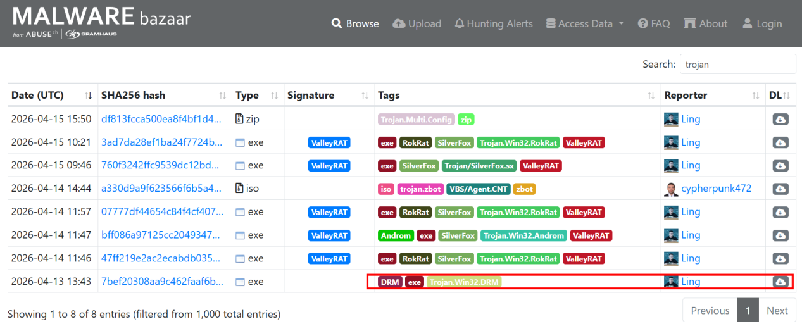

**Description:** This screenshot shows the confirmation that the OTX Endpoint Security Agent has successfully connected to the platform. The connection status is displayed clearly, indicating the agent is now active and monitoring the Windows endpoint for threats.

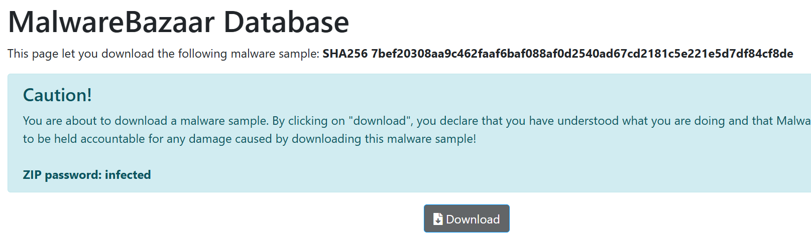

**Description:** A supplementary view confirming the agent's connected state. The endpoint is now visible in the OTX dashboard, showing its connection details and current monitoring status, which confirms successful deployment of the endpoint security agent.

---

## Malware Bazaar — Introduction

Malware Bazaar is a free online malware repository operated by abuse.ch. It allows security researchers, analysts, and incident responders to upload, download, and share malware samples for analysis purposes. The platform provides detailed metadata for each sample including file hashes (MD5, SHA1, SHA256), file type, size, first seen date, and associated tags or signatures.

Malware Bazaar serves as an invaluable resource for threat intelligence and malware analysis. By downloading actual malware samples, analysts can study their behavior in controlled sandbox environments, develop detection signatures, and test security tool effectiveness. In this task, Malware Bazaar was used to obtain a malware sample for behavioral analysis on a controlled Windows system.

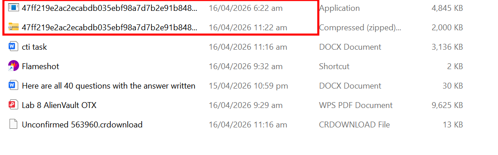

**Description:** This screenshot shows the Malware Bazaar platform interface. The homepage displays recent malware uploads with metadata including file hashes, malware family tags, and upload timestamps, providing a comprehensive overview of newly submitted samples.

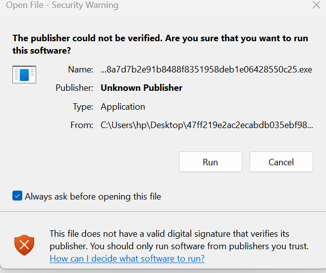

**Description:** A search or filter result within Malware Bazaar, showing specific malware samples available for download. Each sample is clearly labeled with its hash, type, and associated threat tags, making it easy to identify samples relevant to a specific investigation.

---

## Downloading Malware Sample from Malware Bazaar

To proceed with the behavioral analysis, a malware sample was downloaded from Malware Bazaar. The download process on Malware Bazaar requires users to confirm that they understand the risks associated with handling live malware samples. Samples are typically provided in password-protected ZIP archives to prevent accidental execution.

Once downloaded, the malware sample must be handled in a controlled environment — specifically an isolated virtual machine or sandbox — to prevent it from causing damage to the host system or spreading to other network-connected devices. In this task, appropriate precautions were taken to ensure the sample was handled safely throughout the analysis process.

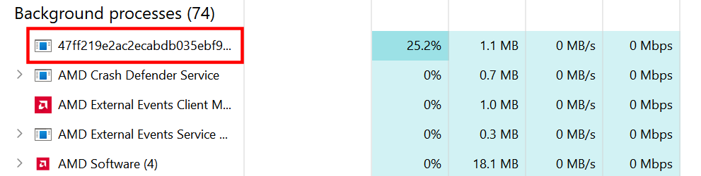

**Description:** This screenshot captures the malware sample download page on Malware Bazaar. The interface shows the sample's metadata and the download option, along with file hash information that can be used to verify the integrity of the downloaded sample.

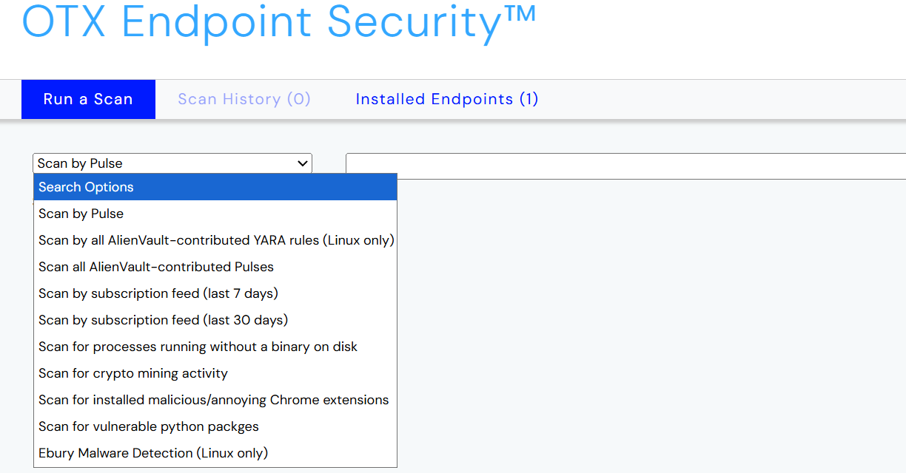

**Description:** The download process is shown in progress in this screenshot. The malware sample is being retrieved from the Malware Bazaar repository in a password-protected archive, ready to be safely extracted and analyzed in the controlled test environment.

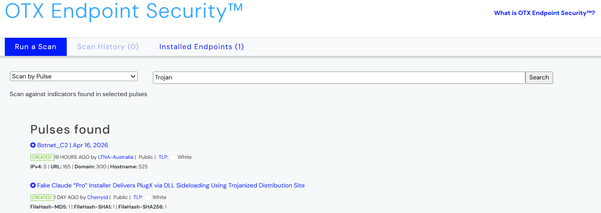

**Description:** Confirmation of the completed download is visible in this screenshot. The archive file containing the malware sample is now saved to the local system, ready for extraction and subsequent behavioral analysis in the isolated Windows environment.

---

## Malware Running in the Background

After extracting the malware sample from the downloaded archive in the controlled environment, the malware was executed to observe its behavior. Once run, the malware began operating in the background of the Windows system — a common characteristic of many malware types that attempt to conceal their activity from the user while performing malicious operations.

Observing malware running in the background allows analysts to document its behavior including process creation, file modifications, network connections, registry changes, and any other system-level activities. This behavioral analysis forms a key part of malware threat intelligence, helping security teams develop better detection methods and mitigation strategies for similar threats.

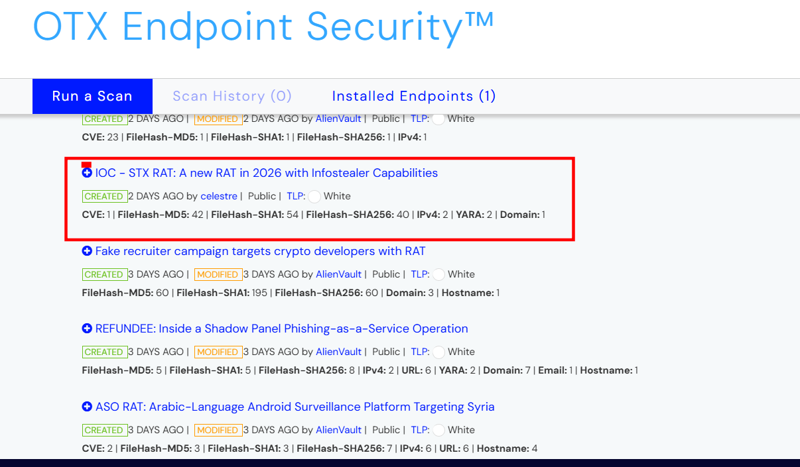

**Description:** This screenshot shows evidence of the malware running in the background of the Windows system. The task manager or process monitor reveals the malware's process, demonstrating its stealth behavior and background execution pattern typical of this type of threat.

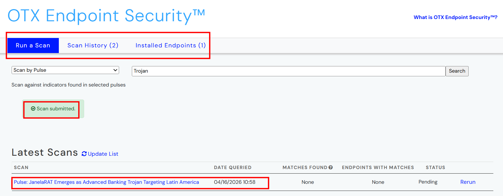

**Description:** A further view of the malware's activity in the background. System monitoring tools reveal the malware's resource usage, network connections, or file system activities, providing valuable behavioral data for the threat intelligence report.

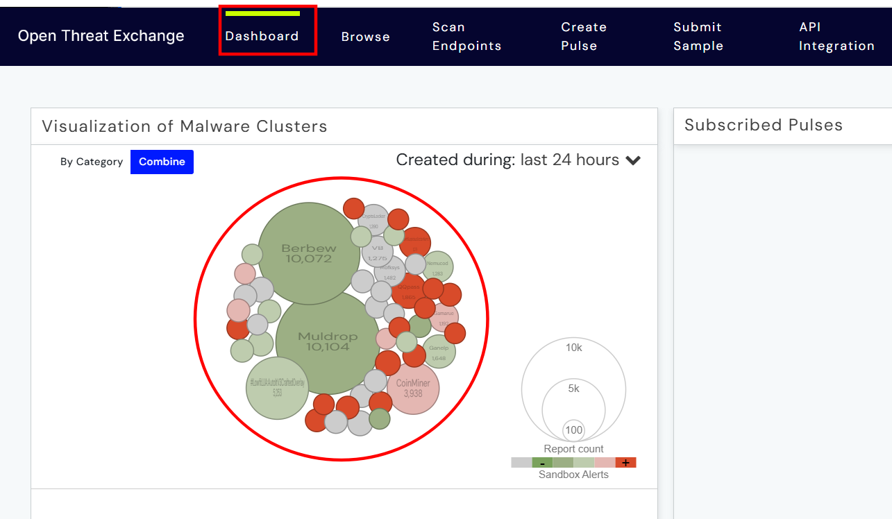

**Description:** Additional evidence of the malware's background operation is captured in this screenshot. The ongoing activity demonstrates the persistence mechanism of the malware and its ability to continue executing without visible user interface elements.

---

## Malware Analysis Results

After allowing the malware to execute in the controlled environment for a sufficient observation period, the results of the behavioral analysis were reviewed. The analysis results provide detailed information about what the malware did during execution, including any files it created, network connections it attempted to establish, registry keys it modified, and processes it spawned.

These results are invaluable for understanding the true capability and intent of the malware sample. By correlating the behavioral results with the threat intelligence data available on OTX and Malware Bazaar, analysts can build a comprehensive profile of the threat, identify its origins, and develop effective countermeasures to detect and remove it from infected systems.

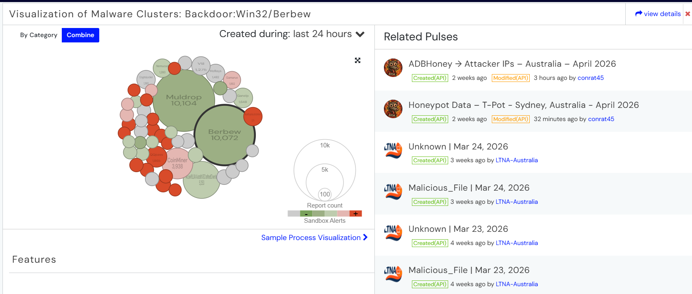

**Description:** This screenshot shows the malware analysis results after execution in the controlled environment. The results clearly document the malware's activities, providing specific evidence of its behavior such as file creation, network activity, or registry modifications.

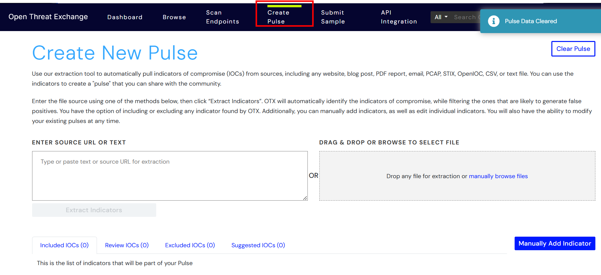

**Description:** A more detailed view of the analysis output, showing specific indicators and behaviors observed during the malware's execution. This data can be directly used to create detection signatures, YARA rules, or update security tool configurations to block similar threats.

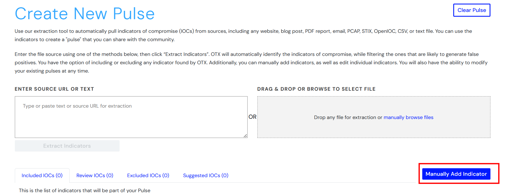

**Description:** The final results view shows a comprehensive summary of all activities recorded during the malware analysis session. This complete behavioral profile forms the core evidence for the threat intelligence report and will guide defensive measures against this specific malware.

---

## OTX Dashboard Overview

The OTX Dashboard serves as the central hub of the AlienVault OTX platform, providing a consolidated view of all threat intelligence activity. The dashboard displays subscribed pulses, recent community activity, trending threats, and personal statistics such as pulses created, indicators submitted, and group memberships. It provides an at-a-glance understanding of the current threat landscape.

A well-configured OTX dashboard serves as a daily briefing tool for security analysts. By customizing subscriptions and group memberships, analysts can ensure their dashboard reflects the threats most relevant to their organization or research focus. The dashboard also provides quick access to all other platform features, making it the logical starting point for any threat intelligence workflow.

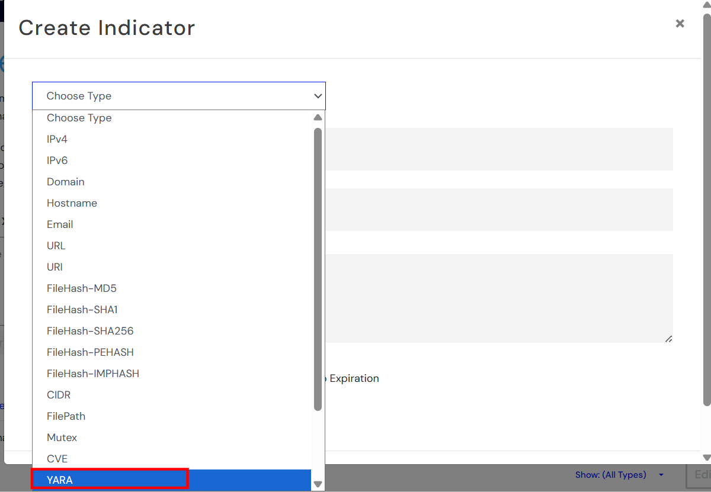

**Description:** This screenshot shows the main OTX Dashboard. The interface presents a comprehensive overview of the user's subscribed pulses, community activity, trending threats, and platform navigation options in a single, organized view.

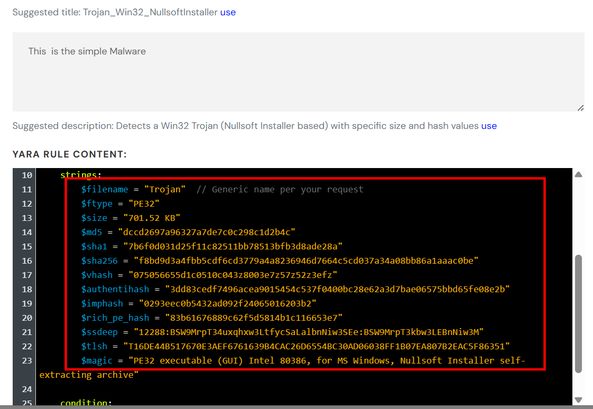

**Description:** A detailed look at the dashboard's pulse feed section, showing recent updates from subscribed threat intelligence sources. The feed displays newly added pulses with timestamps and indicator counts, helping analysts stay current with evolving threats.

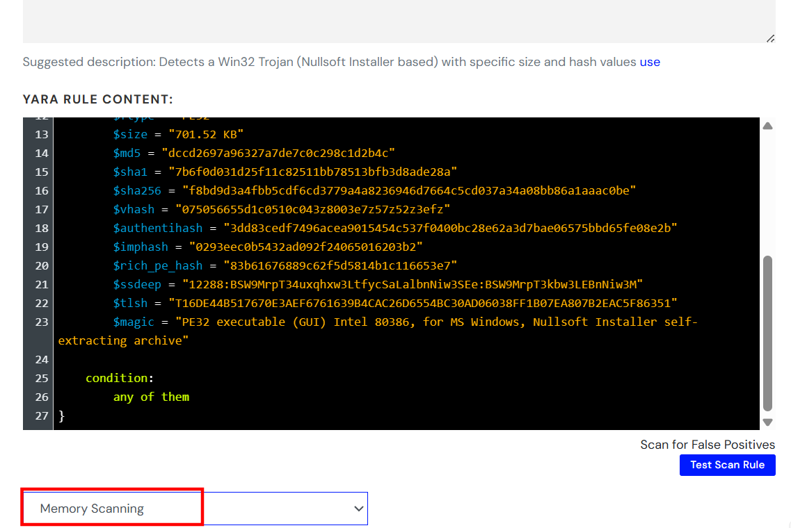

**Description:** The lower portion of the OTX Dashboard is shown in this screenshot, revealing additional platform features and statistics. Community statistics, trending tags, and quick links to frequently used platform features are visible in this view.

---

## Related Pulses — Dashboard View

The Related Pulses section within the OTX Dashboard provides contextual threat intelligence by showing pulses that share indicators or tags with the content currently being viewed. This feature helps analysts discover connections between different threats and understand the broader context of a specific threat they are investigating.

By reviewing related pulses directly from the dashboard, analysts can quickly expand their investigation without manually searching for connections. The platform's intelligent linking of related pulses saves significant time during threat investigations and helps analysts build a more complete picture of the threat actor's tactics, techniques, and procedures (TTPs).

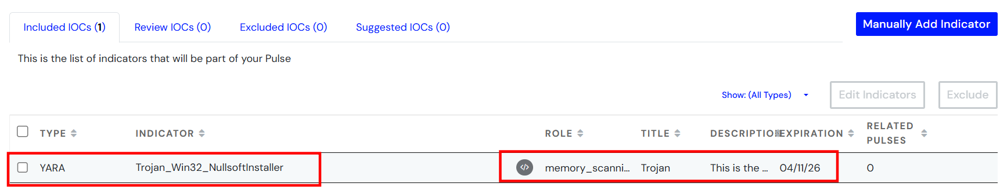

**Description:** This screenshot shows the Related Pulses section as seen from the dashboard view. Connected pulses are displayed with their names, indicators count, and author information, making it easy to identify and access related threat intelligence quickly.

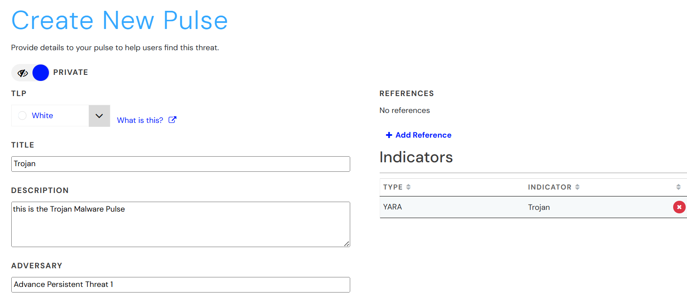

**Description:** An expanded view of related pulses showing additional entries. The platform highlights the relationships between pulses through shared indicators and tags, helping the analyst trace connections between different threat actors, campaigns, or malware families.

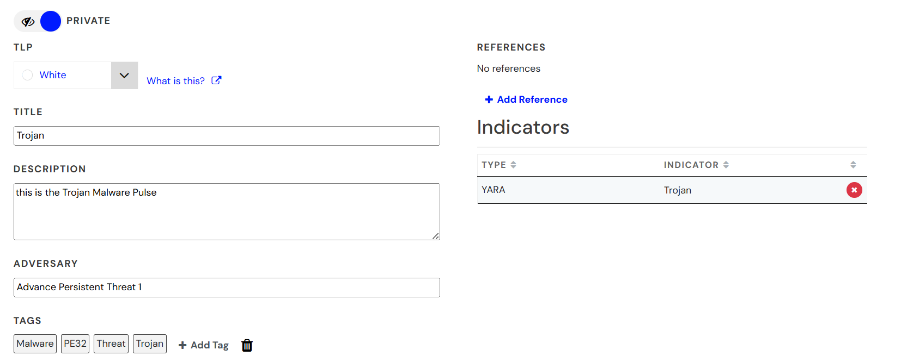

**Description:** This screenshot captures a detailed look at one of the related pulses visible in the dashboard view. The pulse details include its full description, indicator count, and associated tags, providing enough information to decide whether to investigate this pulse further.

---

## Creating YARA Rules

YARA is a tool designed to help malware researchers identify and classify malware samples. YARA rules are pattern-matching rules that describe the characteristics of specific malware families. Creating YARA rules based on the analyzed malware sample is an important outcome of any malware analysis session, as these rules can be used to detect similar threats across large file repositories.

AlienVault OTX supports YARA rules as a type of indicator within pulses. Creating and publishing YARA rules on OTX contributes to the community's collective ability to detect and respond to specific threats. In this task, YARA rules were created based on the behavioral analysis results of the downloaded malware sample, capturing its unique characteristics for future detection.

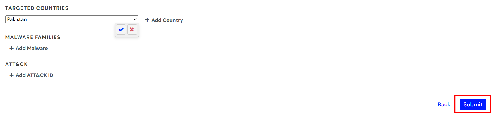

**Description:** This screenshot shows the YARA rule creation interface within the OTX platform. The user has started writing a YARA rule based on the malware analysis findings, defining specific patterns and conditions that will identify the analyzed malware in future scans.

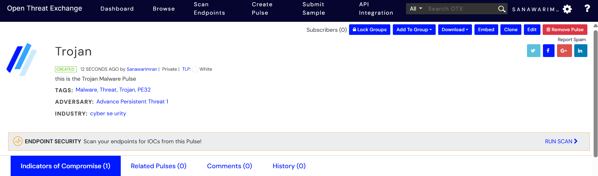

**Description:** The YARA rule writing process is further along in this screenshot, with the rule body containing specific strings and conditions derived from the malware analysis. The rule structure follows the standard YARA format with meta, strings, and condition sections.

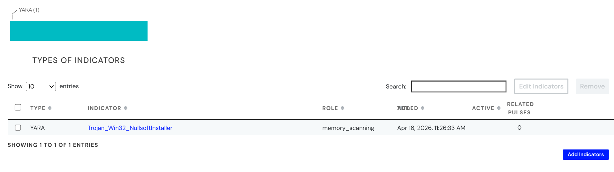

**Description:** The completed YARA rule is shown in this screenshot, ready to be saved and published. The rule encapsulates the key behavioral signatures of the analyzed malware, providing a reusable detection mechanism that can be applied across security tools and platforms.

---

## Creating a Custom Windows Indicator Pulse

After completing the malware analysis and creating YARA rules, the next step was to create a custom pulse on OTX to document and share the threat intelligence gathered during this task. Creating a pulse allows the analyst to package all discovered indicators — file hashes, YARA rules, domains, IP addresses, and URLs — into a single, shareable threat intelligence report on the OTX platform.

A well-crafted pulse serves as a comprehensive threat intelligence artifact that can be shared with the OTX community or kept private for internal use. It includes a title, description, tags, references, and all associated indicators. Publishing a pulse contributes to the community's collective intelligence and helps other security teams detect and respond to the same threat more effectively.

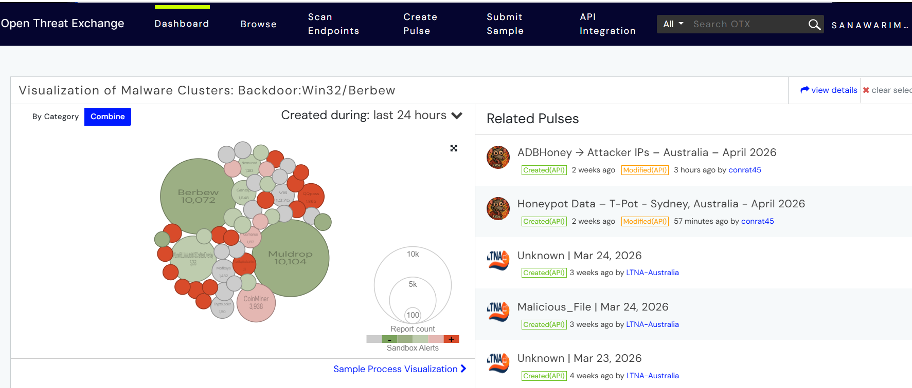

**Description:** This screenshot shows the pulse creation interface on OTX. The user is in the process of creating a new pulse with a custom title and description to document the Windows malware threat intelligence gathered during this practical task.


**Description:** The pulse configuration is progressing, with tags, references, and indicator types being added to the pulse. This structured approach ensures that the pulse contains all necessary information for other analysts to understand and act on the shared threat intelligence.


**Description:** This screenshot captures the indicator addition step within the pulse creation process. Specific threat indicators such as file hashes, YARA rules, or domain names derived from the malware analysis are being added to enrich the pulse content.

---

## Pulse Successfully Created

After entering all the required information and indicators, the custom pulse was successfully created and saved on the AlienVault OTX platform. The successful creation of a pulse marks the completion of the threat intelligence documentation process, transforming raw analysis findings into a structured, shareable threat intelligence artifact.

A successfully created pulse is immediately accessible on the OTX platform and can be subscribed to by other community members. The pulse serves as a permanent record of the threat investigation, containing all indicators, analysis notes, and references compiled during the task. It contributes directly to the collective intelligence of the OTX community.


**Description:** This screenshot shows the confirmation that the custom pulse has been successfully created on the OTX platform. The pulse is now live on the platform with all its indicators and descriptions visible, ready to be shared with the community or used for internal threat monitoring.


**Description:** A detailed view of the newly created pulse's page is shown in this screenshot. The pulse displays all the information entered during creation including the title, description, tags, indicators, and references that were compiled from the malware analysis findings.

---

## New Indicator Creation

The final practical step in this task was creating a new indicator within the OTX platform. Indicators are individual pieces of threat intelligence data — such as a file hash, domain name, IP address, or YARA rule — that provide specific evidence of a threat. Creating new indicators ensures that the most granular and actionable pieces of threat data are properly documented and accessible.

New indicators can be added directly to existing pulses or created independently and associated with pulses later. The OTX indicator creation process allows analysts to specify the indicator type, value, description, and associated pulse, ensuring that each piece of threat intelligence is properly categorized and contextualized within the broader threat picture.


**Description:** This final screenshot shows the New Indicator Creation interface on the AlienVault OTX platform. The user is completing the process of adding a specific threat indicator, which marks the final step in the practical lab task of documenting and sharing threat intelligence gathered during this session.

---

## Conclusion and What I Learned

This practical lab on Cyber Threat Intelligence provided a comprehensive, hands-on experience with two of the most widely used platforms in the field of threat intelligence and malware analysis — AlienVault OTX and Malware Bazaar. Throughout the task, every step was carefully documented to demonstrate not just technical execution but a deeper understanding of the tools, their purposes, and how they contribute to a complete threat intelligence workflow.

The most significant learning from this task is the power of community-driven threat intelligence. AlienVault OTX exemplifies how the cybersecurity community can collectively build a more robust defense by sharing threat data, indicators, and analysis findings openly. A single analyst's discovery, when shared as a pulse on OTX, can protect thousands of organizations worldwide from the same threat — demonstrating the true value of collaborative security intelligence.

### Key Takeaways and Skills Acquired

Through this practical exercise, a broad set of technical skills and conceptual knowledge was acquired. Navigating the AlienVault OTX platform became intuitive through hands-on use — from browsing malware categories and subscribing to relevant pulses, to creating custom pulses and indicators. Understanding how pulse-based threat intelligence works, how indicators are structured, and how they relate to each other is a foundational skill for any threat intelligence analyst.

The deployment of the OTX Endpoint Security Agent on a Windows system using PowerShell was a particularly valuable experience. It demonstrated the practical application of threat intelligence at the endpoint level — connecting raw intelligence data to actual system monitoring. The process reinforced the importance of following precise installation procedures and the role of API-based integration in modern security tool ecosystems.

Working with Malware Bazaar to obtain, safely handle, and analyze a live malware sample was one of the most impactful experiences of this task. It provided direct insight into how malware behaves in a real environment — running in the background, evading user detection, and performing its malicious activities. This experience is invaluable for developing practical intuition about threat behavior that cannot be gained from theory alone.

### Platform and Tool Proficiency

This task built strong proficiency with both AlienVault OTX and Malware Bazaar as professional-grade threat intelligence platforms. The ability to navigate OTX effectively — including pulse creation, indicator management, YARA rule development, and community group interaction — represents a core competency in the field of Cyber Threat Intelligence. These skills are directly applicable to professional roles in security operations, incident response, and threat intelligence analysis.

Creating YARA rules based on real malware behavioral analysis was particularly instructive. YARA is a foundational skill in malware research and detection engineering, and hands-on experience creating rules from actual analysis findings is far more valuable than classroom exercises. The rules created during this task can be directly applied to security scanning tools to detect the same or similar malware in future incidents.

### Overall Reflection

Overall, this Cyber Threat Intelligence practical task successfully demonstrated the complete lifecycle of a threat intelligence workflow — from initial platform exploration and threat discovery, through malware acquisition and behavioral analysis, to the creation and sharing of actionable threat intelligence through OTX pulses and indicators. Each step built upon the previous one, creating a coherent and professionally structured intelligence report.

The experience reinforced the critical importance of documentation in cybersecurity work. Every screenshot, every command executed, and every observation recorded in this report represents evidence-based analysis — the standard by which professional threat intelligence work is evaluated. The skills developed through this task form a strong foundation for advanced study and professional practice in the field of Cyber Threat Intelligence and Information Security.

---
