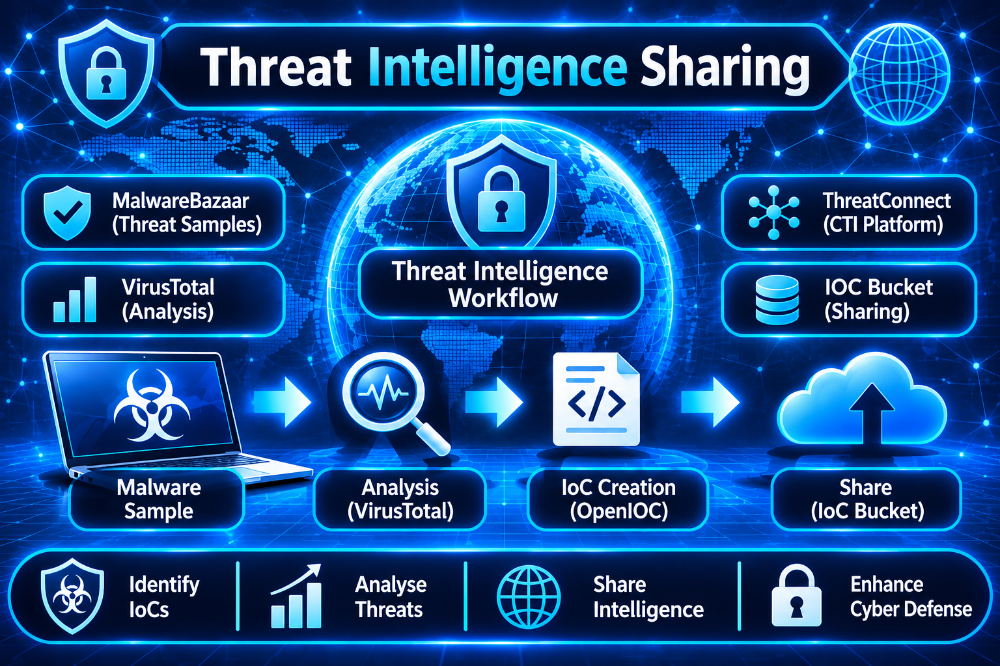

# Threat Intelligence Sharing : IoC Creation and VirusTotal Analysis

## Overview

This lab shows the complete **Cyber Threat Intelligence (CTI)** workflow from start to finish. A real malware sample is downloaded from **MalwareBazaar**, analysed on **VirusTotal**, turned into an **Indicator of Compromise (IoC)** with the **OpenIOC Editor**, and finally shared with the community on **IOC Bucket**. **ThreatConnect** is also explored as an example of a professional threat intelligence platform.

| Tool | Purpose |
|---|---|
| **MalwareBazaar** | Community repository of malware samples by abuse.ch |
| **VirusTotal** | Multi-engine scanner for files, URLs and IPs |
| **ThreatConnect** | Enterprise threat intelligence platform |
| **OpenIOC Editor** | Graphical tool to build structured IoC files |
| **IOC Bucket** | Free community platform to share and find IoCs |

All malware samples must be handled inside an **isolated virtual machine** with the network disabled.

---

## Step by Step

### Step 1: Search for MalwareBazaar on Google

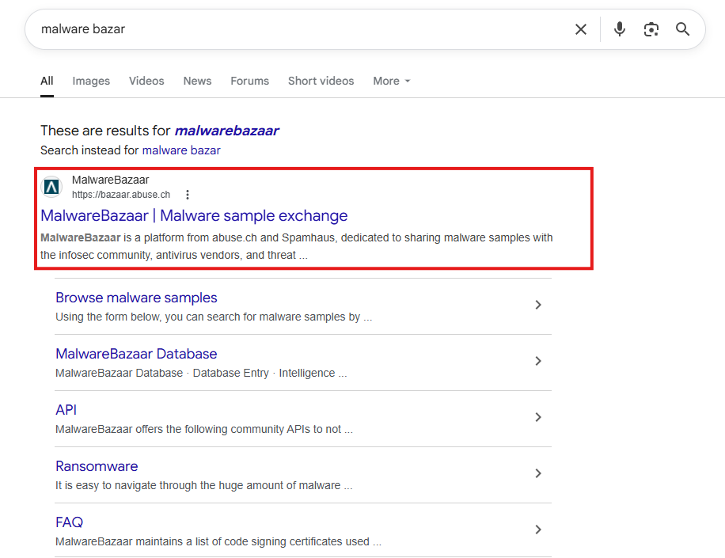

The lab starts by searching **malware bazar** on Google. The top result is the official site **bazaar.abuse.ch**, a trusted platform where researchers share malware samples. Each sample is listed with its **SHA256 hash**, file type and malware family.

### Step 2: Download the Malware Sample

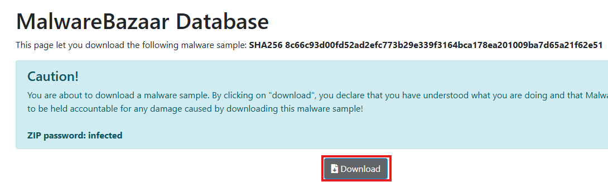

On the sample page the **SHA256 hash** is shown together with a **Download** button. The sample is saved as a password-protected ZIP file, and the standard password is **infected**. The hash should be noted down because it is needed later for the VirusTotal analysis.

### Step 3: Navigate to VirusTotal

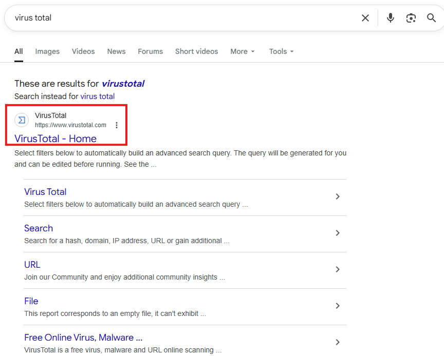

Next, **virus total** is searched on Google and the official site **virustotal.com** is opened. It is important to confirm the correct domain before uploading anything. VirusTotal checks a file with more than **70 antivirus engines** at the same time.

### Step 4: Upload the File to VirusTotal

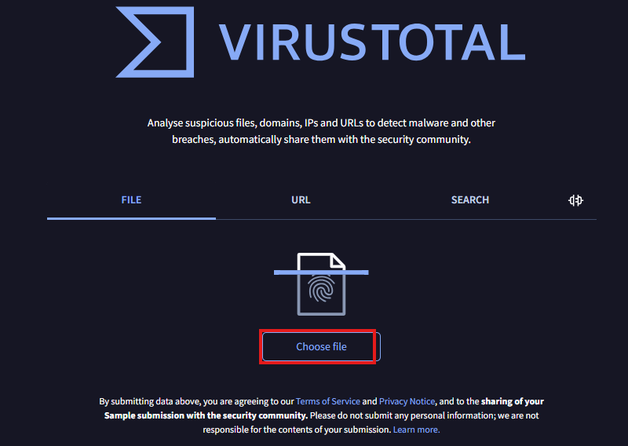

On the VirusTotal homepage the **FILE** tab is selected and the **Choose file** button is clicked. VirusTotal accepts executables, documents, scripts and archives. If the file was scanned before, the **cached results** may appear straight away.

### Step 5: Select the Malware File in the File Browser

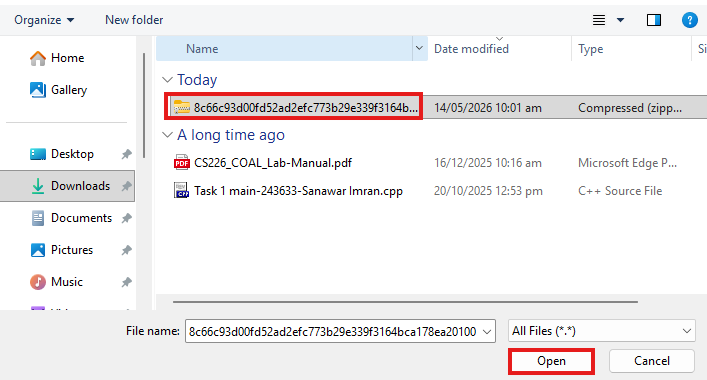

The Windows file browser opens and the malware file is picked from the **Downloads** folder. The file name is its full **SHA256 hash**, which makes it easy to match with the MalwareBazaar record. After clicking **Open**, the upload and scan start automatically.

### Step 6: Analyse the VirusTotal Results

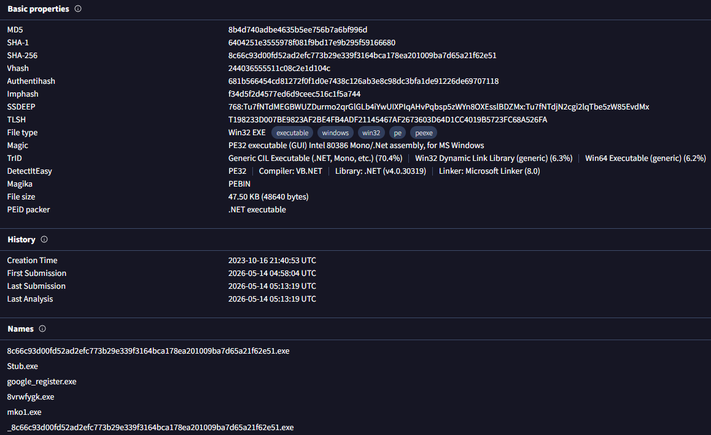

The results page shows the **MD5**, **SHA1** and **SHA256** hashes, the file type (**PE32 executable**) and the file size. The **History** section lists the creation time, first seen date and last analysis date. These hash values must be saved because they are used to build the IoC.

### Step 7: Search for ThreatConnect

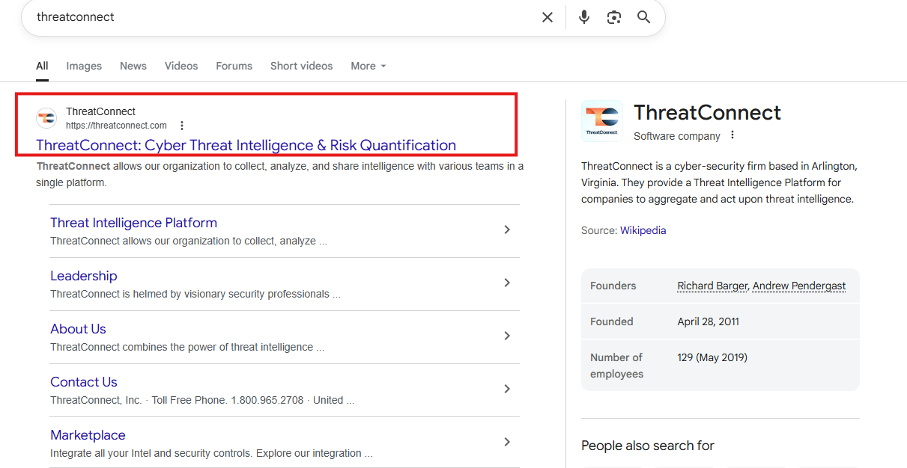

**ThreatConnect** is searched on Google and its official website is opened. It is described as a **Cyber Threat Intelligence and Risk Quantification** platform. Reading its homepage gives a good idea of how professional teams manage threat data.

### Step 8: Complete the ThreatConnect Registration Form

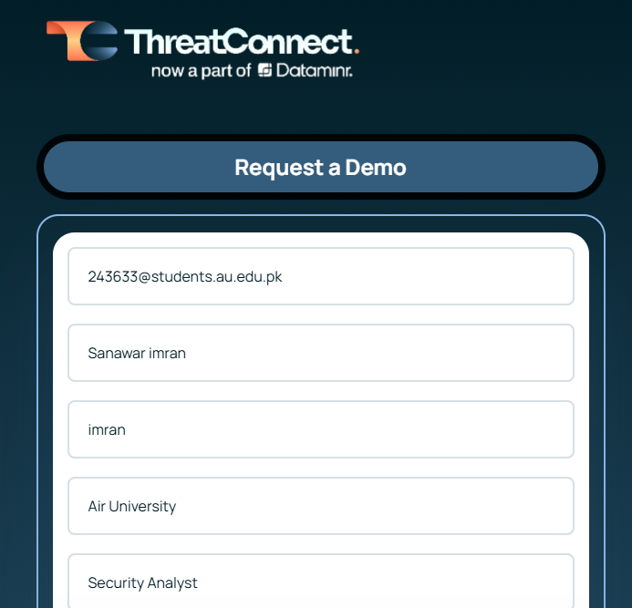

The **Request a Demo** form is filled in with the university email, full name, institution and role. Using an **institutional email** makes the request look more genuine. A confirmation email with login details usually arrives within 24 to 48 hours.

### Step 9: Build Indicators in the OpenIOC Editor

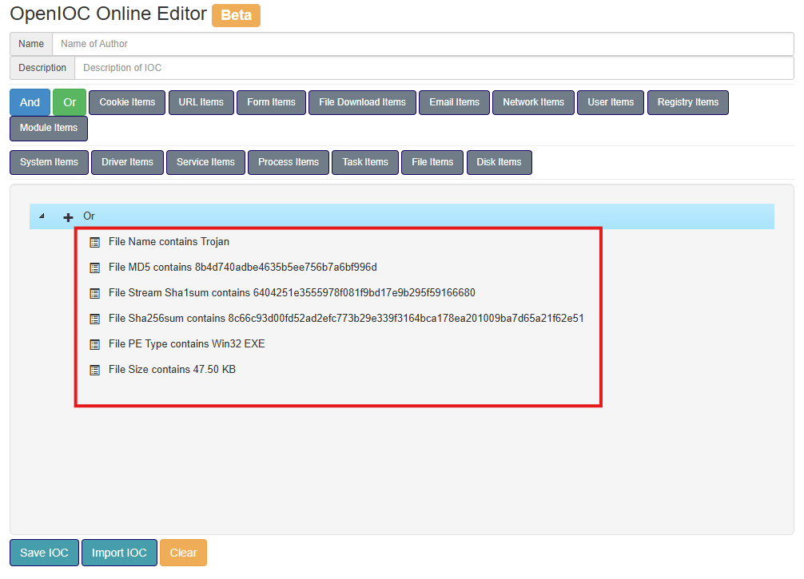

In the **OpenIOC Online Editor** a new IoC is created and named **ANARCHYRAT Trojan Indicator**. The file name, **MD5**, **SHA1**, **SHA256** and file size are added as conditions, copied exactly from VirusTotal. Combining several hashes makes the indicator very **specific** and reduces false positives.

### Step 10: Save the IoC File to Disk

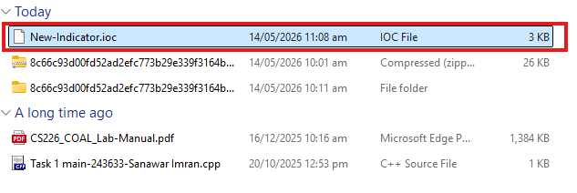

The indicator is exported with the **Save IOC** button as **New-Indicator.ioc**. The file is only about 3 KB because it stores **XML conditions** and no malware content. Checking the Downloads folder confirms that the file was saved correctly.

### Step 11: Visit the IOC Bucket Homepage

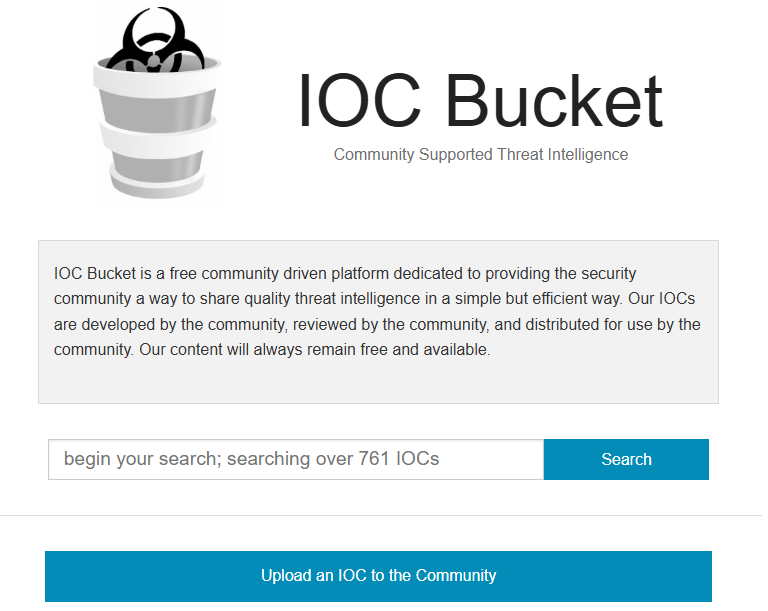

**IOC Bucket** is opened and its tagline, **Community Supported Threat Intelligence**, is visible on the homepage. The search bar lets users look up IoCs by keyword, hash or malware family. Searching for words like **Trojan** helps to see how other submissions are written.

### Step 12: Open the IoC Upload Form

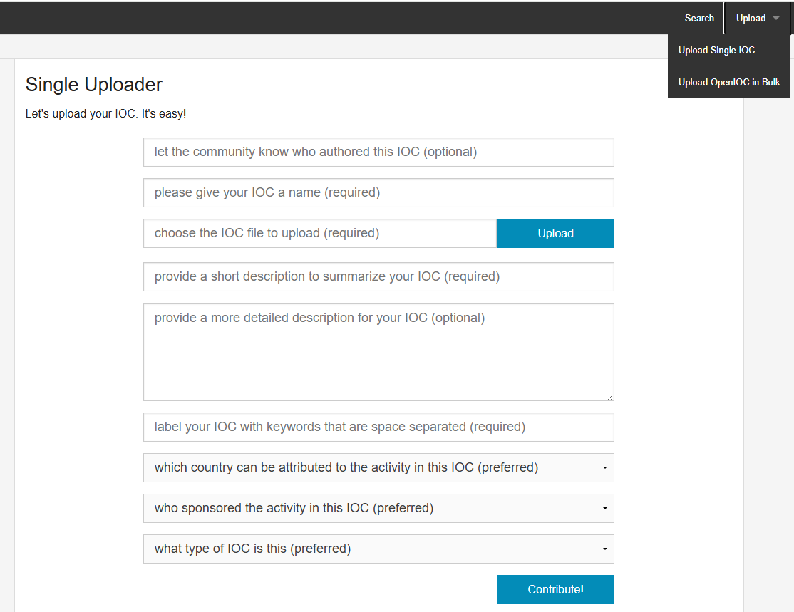

The **Upload an IOC to the Community** button leads to the **Single Uploader** form. The form asks for the IoC name, the **.ioc file**, short and long descriptions, tags and classification details. Clear names and descriptions make the IoC easier for others to find.

### Step 13: Submit the IoC to the Community

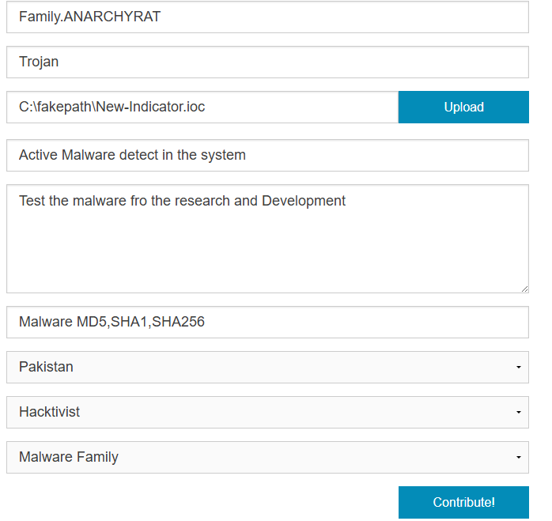

The remaining fields are completed, such as the malware family **ANARCHYRAT**, the type **Trojan** and the tags **MD5, SHA1, SHA256**. After a final review the **Contribute!** button is clicked to publish the IoC. The indicator is now available to security analysts around the world.

---

## What I Learned

In this lab I learned how to safely get a malware sample from **MalwareBazaar** and how to read a **VirusTotal** report, especially the **hashes** and file details. I understood why **hash values** are the most reliable IoCs, since changing even one byte creates a completely different hash. I also learned how to create an **.ioc file** in the **OpenIOC Editor**, how a platform like **ThreatConnect** is used in real security teams, and how to share findings on **IOC Bucket**. Most importantly, I learned that **careful handling** and **accurate data entry** matter a lot in threat intelligence work.

---

## Conclusion

This lab covered a full **end-to-end CTI workflow** using real industry tools. A malware sample was collected, analysed, converted into a **machine-readable IoC** and shared with the global community. These skills are the foundation of practical roles such as **Threat Intelligence Analyst**, **SOC Analyst**, **Incident Responder** and **Malware Researcher**.
